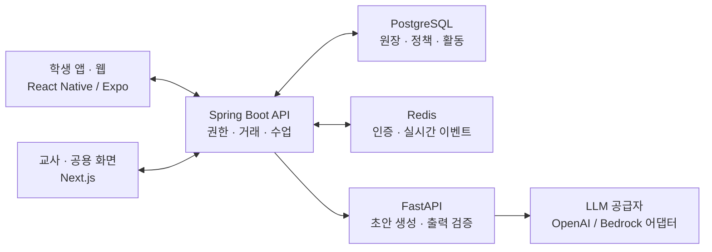

<div align="center">

# 🏡 EcoVillage · 이코빌리지

### 교실이 하나의 경제 마을이 되는 경험

**학급 화폐로 월급·소비·저축·투자·공동 의사결정을 배우는 초등학생 경제교육 플랫폼**


SSAFY 15기 공통 프로젝트 · S15P11B201

[서비스 소개](#서비스-소개) · [담당 역할과 기여](#담당-역할과-기여) · [주요 기능](#주요-기능) · [AI 운영 지원](#ai-운영-지원) · [아키텍처](#아키텍처) · [기술적 의사결정](#기술적-의사결정) · [검증과 품질 관리](#검증과-품질-관리) · [코드 둘러보기](#코드-둘러보기)

</div>

---

## 서비스 소개

경제 개념을 설명으로만 배우면 자신의 선택이 어떤 결과를 만드는지 경험하기 어렵습니다. 이코빌리지는 **교실 안에서 돈을 벌고, 쓰고, 모으고, 함께 예산을 결정하는 작은 경제**를 제공합니다.

초등학교 **4~6학년** 학생은 학급 전용 화폐와 캐릭터를 사용해 경제활동에 참여합니다. 교사는 학년과 운영 규모에 맞춰 모듈·급여·세금·상품·금융 정책을 설정하고 수업을 진행합니다. AI는 학급 운영 지표를 설명하고 퀴즈와 경제 이야기의 초안을 제공해 교사의 준비를 돕습니다.

### 하나의 서비스, 세 가지 화면

| 학생 | 교사 | 교실 공용 화면 |
| :--- | :--- | :--- |
| 태블릿 중심의 **Expo 앱·학생 웹**에서 지갑, 상점, 은행, 투자, 부동산, 퀴즈와 투표에 참여 | **Next.js 웹**에서 경제교실 개설, 학생·정책 관리, 승인·정산, AI 초안 검토와 수업 진행 | 퀴즈 문제·타이머·활동 결과 등 공개 가능한 정보 표시 |

### 학급 경제는 이렇게 이어집니다

| 1. 교실 개설 | 2. 소득과 소비 | 3. 저축과 선택 | 4. 함께 배우기 |
| :--- | :--- | :--- | :--- |
| 교사가 학년·화폐명·운영 규모와 활동 모듈을 설정합니다. | 학생이 역할별 급여를 받고 세금·상점 구매를 경험합니다. | 예·적금, 가상 투자, 자리 기반 부동산 활동으로 기회비용을 배웁니다. | 공동기금 사용처 투표와 경제 퀴즈로 개념을 돌아봅니다. |

모든 경제활동은 **교육용 학급 화폐**를 사용합니다. 실제 금융상품이나 현금 거래를 제공하지 않습니다.

## 담당 역할과 기여

**[@watermell0n](https://github.com/watermell0n) — 팀장(PM) · Backend 일부 · DB · AI 서비스 · QA**

팀장으로 일정과 업무 분배, 기능 우선순위 조정을 맡았습니다. 개발에서는 백엔드 일부와 DB·AI 서비스를 담당하고, 교사·학생 화면의 QA와 오류 수정에도 참여했습니다. **실제 초등학교 5학년 한 학급을 대상으로 시연을 진행해 마쳤습니다.**

| 핵심 기여 | 구현·검증 내용 | 관련 코드 |
| :--- | :--- | :--- |
| **AI 서비스와 책임 분리** | 경제 설정 추천·밸런싱, 교사용 챗봇, 경제 이벤트·퀴즈 초안 생성 설계·구현. Java/Spring과 Python/FastAPI를 분리하고 AI는 설명·초안, 규칙 엔진과 원장은 값의 계산·반영을 담당 | [AI 서비스](ai-service/src/ecovillage_ai/) · [Spring AI 연동](backend/src/main/java/com/b201/ecovillage/ai/) |
| **거래 원장 기반 금전 처리** | 급여·구매·퀴즈 보상을 금액 합계가 0인 복식 원장 거래로 통일. 재고·잔액을 한 트랜잭션으로 묶고 계정 정렬 잠금·멱등키·반대 부호 복구 거래로 동시성·중복·오류 정정 처리 | [원자 거래](backend/src/main/java/com/b201/ecovillage/ledger/application/AtomicLedgerTransactionService.java) · [복구 거래](backend/src/main/java/com/b201/ecovillage/ledger/application/LedgerRecoveryService.java) |
| **QA와 오류 추적** | 교사·학생 화면을 반복 점검. 퀴즈 세션 오류를 프런트·백엔드·DB 흐름으로 추적해 임시 세션 ID 조회와 오래된 상태 버전 충돌 수정. 타입 검사·Backend 빌드·DB 세션 상태 대조로 확인 | [학생 퀴즈](student-app/expo/app/quiz.tsx) · [교사 화면](teacher-web/app/) · [퀴즈 API·테스트](backend/src/test/java/com/b201/ecovillage/quiz/) |
| **PM·현장 시연** | 일정·담당·우선순위 관리, 실제 초등학교 5학년 한 학급 대상 시연 진행 | [협업·일정 문서](docs/TEAM_SCHEDULE_AND_WORKFLOW.md) |

AI 출력은 Pydantic 스키마와 허용 범위 검증을 통과해도 **검토가 필요한 상태**(`REVIEW_REQUIRED`)로 저장되며, 교사 승인 후에만 적용·공개됩니다. 현장 시연 경험과 자동 테스트는 각각 사용 흐름 확인과 구현 회귀 검증의 근거로 구분합니다.

## 주요 기능

| 영역 | 학생의 경험 | 교사의 운영 기능 |
| :--- | :--- | :--- |
| **경제교실** | 학급 코드 로그인, 개인 프로필·활동 확인 | 학생 명단, 학년·운영 규모, 모듈·정책 설정, 자율시간·지도 활동 제어 |
| **급여·세금·지갑** | 월급명세서, 잔액·거래 내역 확인 | 역할별 급여 지급, 세금과 경제 정책 관리 |
| **상점·캐릭터** | 교실 상품 구매, 디지털 아이템 구매·장착, 캐릭터 꾸미기 | 상품·재고·가격 관리, 구매 내역 확인 |
| **개인거래** | 상대를 지정해 거래 제안·응답 | 승인·거절과 거래 기록 확인 |
| **은행·대출** | 예금·적금 가입, 교육용 대출 신청·상환, 신용 정보 확인 | 금융상품·대출 정책 설정, 신청 승인·정산 |
| **가상 투자** | 교육용 종목 매수·매도, 공개된 가격 이력·손익 확인 | 단기·장기 시장 운영, AI 시나리오·이야기 검토, 가격 단계 진행 |
| **부동산·청약** | 교실 자리 기반 자산 탐색, 매매·임대 계약과 청약 참여 | 좌석판·자산·공급 조건 설정, 계약 승인, 청약 선정·정산 |
| **공동기금·투표** | 예산 사용처를 살펴보고 투표 | 안건·선택지 등록, 진행·종료와 집계 확인 |
| **퀴즈·수업** | 게임형 경제·넌센스 퀴즈, 평가형 퀴즈와 결과 확인 | 문제은행·AI 초안 검토, 활동 시작·진행·종료와 보상 설정 |

학년과 활성 모듈에 따라 사용할 수 있는 활동이 달라집니다. `1회·1주·1달·1학기`는 추천 운영 규모이며 교사가 실제 일정과 구성을 정합니다.

## AI 운영 지원

**AI가 설명과 초안을 만들고, 서버가 규칙을 검증하며, 교사가 검토·승인합니다.** 금액·계좌·투자 가격을 AI가 직접 변경하지 않도록 책임을 분리했습니다.

| 기능 | 활용 방식 |
| :--- | :--- |
| **설정 점검·경제 밸런싱** | 화폐량·소비·재고·자산 집중도 등 집계 지표와 허용 범위를 기반으로 문제 원인과 조정안을 설명 |
| **교사용 챗봇** | 학급 운영 질문에 조회 기간·근거 지표·대응안·부작용을 포함한 답변 제공 |
| **퀴즈 초안** | 학년·주제·학습목표에 맞는 경제·넌센스 객관식·OX 문항 생성, 교사 검토 후 문제은행 연결 |
| **경제 이벤트** | 물가·공급·세금·금리·보상·공동기금 등 수업용 이야기와 선택지 생성 |
| **투자 이야기·기업 초안** | 교육용 시장의 시나리오·기업 설명·현재 단계 뉴스 생성, 승인된 이야기와 공개 가격 이력만 학생에게 제공 |

FastAPI는 구조화된 요청과 출력 스키마를 사용하고, 개인정보·근거 변조·허용 범위·미래 정보·승인 경계를 검증합니다. **학생용 자유대화 챗봇은 제공하지 않습니다.**

## 아키텍처

### 서비스 구성



클라이언트는 HTTP API로 명령·조회 요청을 보내고 WebSocket으로 수업 상태와 경제 이벤트를 받습니다. Spring Boot가 도메인 규칙과 저장을 담당하고, AI 서비스는 내부 인증을 거친 생성 요청만 처리합니다.

### 배포 구성

| 계층 | 최종 배포 구성 |
| :--- | :--- |
| 서버 | SSAFY 제공 **Ubuntu EC2 · Docker Compose** |
| 진입점 | **Caddy** HTTPS 역방향 프록시 |
| 교사 웹 | Next.js 서버 |
| 학생 웹 | Expo 웹 빌드 · Nginx 정적 제공 |
| 내부 서비스 | Spring Boot · FastAPI · PostgreSQL 17 · Redis 7.4 |
| CI | Jenkins의 계약 검증·테스트·클라이언트 빌드·Backend 이미지 빌드 |

운영 배포 절차는 [포팅 매뉴얼](exec/README.md)에 있습니다. Jenkins는 검증과 빌드를 담당하며, 운영 배포는 매뉴얼의 릴리스 디렉터리 절차로 수행합니다. `infra/terraform/`의 AWS 구성은 설계·구축 자료이며 위 최종 배포 경로와 구분합니다.

## 기술적 의사결정

| 해결할 문제 | 구현 방식 | 설계 의도·코드 |
| :--- | :--- | :--- |
| 구매·투자·정산 중 일부만 반영되면 잔액이 틀어짐 | **복식 원장 + DB 트랜잭션**에 잔액·거래와 도메인 변경을 함께 반영 | 경제활동의 금액 흐름을 일관되게 기록 · [원자 거래 서비스](backend/src/main/java/com/b201/ecovillage/ledger/application/AtomicLedgerTransactionService.java) |
| 중복 클릭·재시도로 같은 거래가 두 번 처리됨 | **멱등성 키·요청 해시**, 계좌 잠금과 상태 버전 검사 | 기존 처리 결과 재사용, 다른 요청의 키 재사용 거절 · [원장 테스트](backend/src/test/java/com/b201/ecovillage/ledger/application/AtomicLedgerTransactionServiceTest.java) |
| 거래 이후 정책이 바뀌거나 정정이 필요함 | **정책 스냅샷·복구 거래** | 완료 기록을 덮어쓰지 않고 당시 조건과 정정 이력 보존 · [복구 서비스](backend/src/main/java/com/b201/ecovillage/ledger/application/LedgerRecoveryService.java) |
| 수업 중 연결이 끊기거나 이벤트 발송이 실패함 | **Transactional Outbox · 채널 시퀀스 · 재연결 복구** | 저장과 발송을 분리하고 마지막 수신 지점부터 복구 · [실시간 처리](backend/src/main/java/com/b201/ecovillage/realtime/) |
| AI 응답이 학급 정책이나 교육 범위를 벗어날 수 있음 | **Pydantic 스키마·결정적 규칙 검증·교사 승인** | 생성 결과를 그대로 적용하지 않고 검증된 초안으로 사용 · [AI 검증](ai-service/src/ecovillage_ai/features/) |
| 학생·교사·공용 화면의 권한과 공개 범위가 다름 | **서버 권한 검사·역할별 응답**, 일회용 실시간 연결 티켓 | 화면 노출과 데이터 접근 권한을 분리 · [인증·권한](backend/src/main/java/com/b201/ecovillage/identity/) |
| 여러 클라이언트와 AI 서비스가 같은 계약을 사용해야 함 | **OpenAPI·AsyncAPI·필드 매핑 검증** | 명세와 Spring 구현·DB 필드 연결을 정적 검사 · [계약](contracts/) · [검증 스크립트](scripts/) |

## 기술 스택

| 영역 | 사용 기술 |
| :--- | :--- |
| 학생 앱·웹 | React Native 0.86 · Expo 57 · Expo Router · TypeScript · TanStack Query · React Hook Form · Zod · React Native Skia |
| 교사 웹 | Next.js 15 App Router · React 19 · TypeScript |
| Backend | Java 21 · Spring Boot 4.1 · Spring Data JPA · WebSocket · Flyway |
| 데이터·실시간 | PostgreSQL 17 · Redis 7.4 |
| AI | Python 3.12 · FastAPI · Pydantic · OpenAI / AWS Bedrock 공급자 어댑터 |
| 배포·검증 | Docker Compose · Caddy · Nginx · Jenkins · JUnit · Testcontainers · pytest · Ruff |

포팅 매뉴얼의 최종 운영 공급자는 **OpenAI**입니다. Bedrock 어댑터도 포함하며, 로컬·자동 평가에는 API 키 없이 동작하는 결정적 `FAKE` 공급자를 사용할 수 있습니다.

## 검증과 품질 관리

| 영역 | 저장소에 포함된 검증 |
| :--- | :--- |
| **거래·경제 기능** | 원장 원자성·멱등성·복구, 금융상품·투자 흐름, 부동산 계약 승인·결제 등의 JUnit 테스트 |
| **DB 무결성** | Flyway 마이그레이션과 PostgreSQL Testcontainers 기반 스키마 검증 |
| **실시간·권한** | WebSocket 처리, 연결 티켓, 학생 접속 상태, 이벤트 발행과 Outbox 테스트 |
| **AI 계약·안전** | 공통 계약, 설정 점검, 밸런싱, 챗봇, 이벤트, 투자 뉴스, 퀴즈의 **350개 평가 카탈로그**와 pytest 회귀 테스트 |
| **클라이언트·계약** | TypeScript 검사, Next.js 빌드, Expo 웹 export, HTTP·WebSocket·AI 계약과 스키마 정합성 검사 |

AI 자동 평가는 구조·정책·안전 규칙을 확인합니다. 실제 모델의 문장 품질과 교육 적합성은 별도의 공급자 실행·사람 검토가 필요하며, 자동 평가 통과를 모델 정확도로 해석하지 않습니다.

[Backend 테스트](backend/src/test/) · [AI 테스트](ai-service/tests/) · [AI 평가 기준](docs/ai/MVP_RELEASE_EVALUATION.md) · [퀴즈 품질 평가](ai-service/evals/README.md) · [개발 중 통합 검증 기록](docs/ai/INTEGRATION_VERIFICATION.md)

## 코드 둘러보기

```text
EcoVillgae/
├── student-app/expo/  학생 앱·웹: 경제활동 화면과 API·실시간 연동
├── teacher-web/       교사 콘솔·공용 화면: 운영, 승인, AI와 수업 진행
├── backend/           핵심 API: 인증, 원장, 경제활동, 수업과 실시간 처리
├── ai-service/        AI 생성, 공급자 어댑터, 프롬프트·검증·평가
├── contracts/        HTTP·WebSocket·내부 AI 계약과 필드 매핑
├── deploy/           Caddy와 운영 설정 도구
├── infra/            Jenkins·Terraform·관측 구성 자료
├── exec/             최종 포팅 매뉴얼과 재현용 DB 스키마 덤프
└── docs/             제품, 데이터, API, UX, AI 설계와 검증 기록
```

| 살펴볼 내용 | 코드·문서 |
| :--- | :--- |
| 최종 실행·배포 환경 | [포팅 매뉴얼](exec/README.md) · [운영 Compose](compose.prod.yaml) |
| 학생 화면과 API 연결 | [학생 화면](student-app/expo/app/) · [기능별 코드](student-app/expo/src/features/) |
| 교사 운영·AI 화면 | [교사 웹](teacher-web/app/) · [AI 워크스페이스](teacher-web/app/ai/) |
| 지갑·원장과 경제 기능 | [Backend 도메인](backend/src/main/java/com/b201/ecovillage/) · [DB 마이그레이션](backend/src/main/resources/db/migration/) |
| AI 설계·구현 | [AI 코드](ai-service/src/ecovillage_ai/) · [프롬프트 실행 구조](docs/ai/PROMPT_RUNTIME.md) · [AI 내부 계약](contracts/ai-internal-openapi.yaml) |
| 데이터·API·실시간 설계 | [데이터 모델](docs/DATA_MODEL.md) · [HTTP 계약](contracts/openapi.yaml) · [WebSocket 계약](contracts/asyncapi.yaml) |
| 캐릭터·아이템 렌더링 | [캐릭터 설계](docs/CHARACTER_SYSTEM.md) · [에셋 작업 규격](docs/design/CHARACTER_ASSET_SPEC.md) |

## 로컬 실행

**Java 21 · Node.js 24 권장 · Python 3.12 · Docker**가 필요합니다. 외부 AI를 사용할 경우 공급자 설정과 API 키를 로컬 환경 파일에 별도로 준비합니다.

```bash
git clone https://github.com/watermell0n/EcoVillgae.git
cd EcoVillgae
cp .env.example .env
docker compose --profile app up -d --build --wait
```

개별 서비스 개발 실행, 환경 변수, 최초 학교·계정 생성, DB 재현과 운영 배포는 [포팅 매뉴얼](exec/README.md)을 참고하세요. 실제 비밀값을 저장소에 커밋하지 않습니다.

---

### 소개 기준

이 README는 **`master`의 최종 통합 코드**를 기준으로 작성했습니다. 작성 기준 코드 커밋은 [`43cd869`](https://github.com/watermell0n/EcoVillgae/commit/43cd869)이며, 이 시점의 `master`는 `develop`의 모든 변경을 포함합니다. `release`는 이전 시연 코드 보존 브랜치입니다.

`docs/`와 각 하위 README에는 개발 단계의 계획·검증 기록이 함께 남아 있습니다. 초기 제외 범위, 조회 전용 UI 설명과 클라우드 구축 계획은 최종 코드와 다를 수 있으므로 **현재 기능은 구현 코드, 최종 배포 구성은 `exec/README.md`**와 함께 확인하세요.
