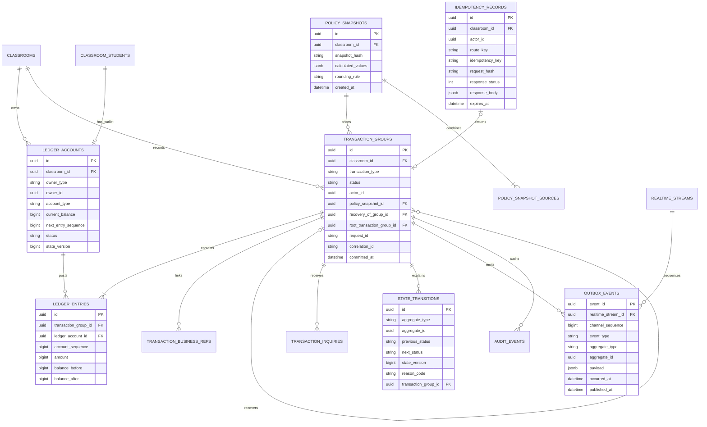
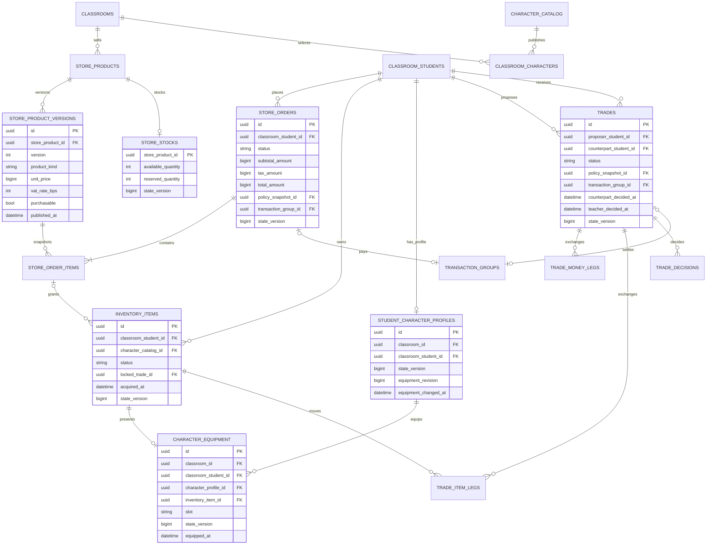
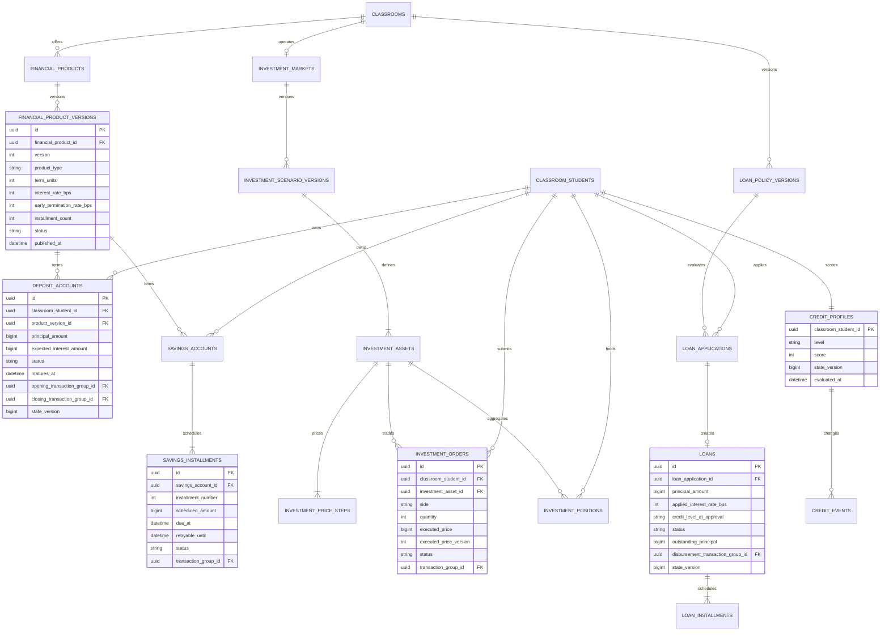
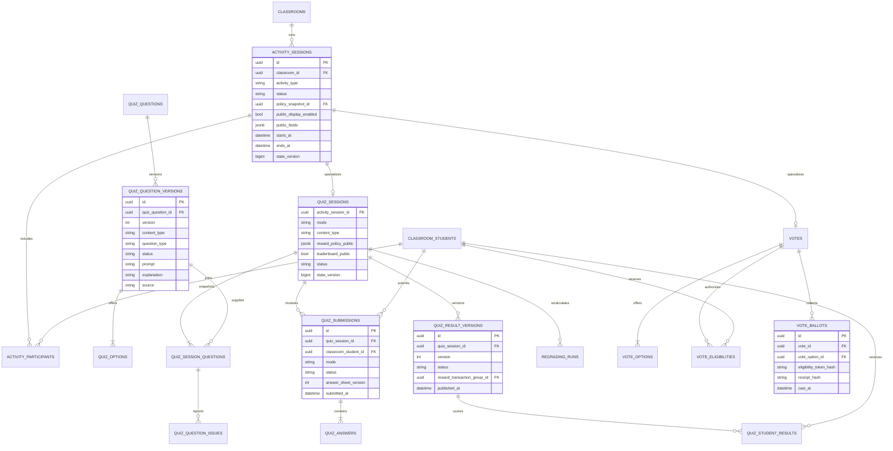
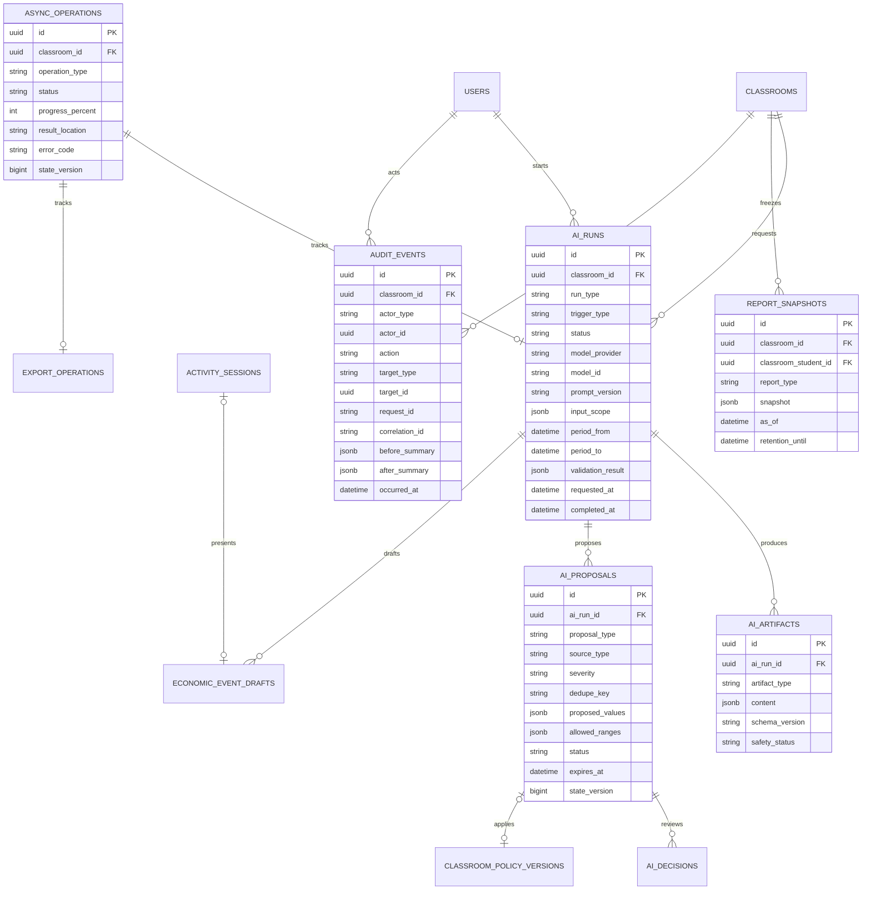

# 이코빌리지 논리 데이터 모델

- 버전: v0.5
- 기준일: 2026-07-30
- 개발 기준 브랜치: `develop`
- 상태: MVP 논리 ERD 기준선
- 대상 DB: PostgreSQL 17

## 1. 목적과 범위

이 문서는 확정된 요구사항, 상태 머신, HTTP API와 WebSocket 이벤트를 PostgreSQL의 논리 엔티티와 관계로 연결합니다. 실제 테이블 자료형, 인덱스와 DDL은 [물리 스키마](PHYSICAL_SCHEMA.md)와 Flyway 마이그레이션에서 확정했습니다.

MVP 범위는 초등학교 4~6학년이며 상점·캐릭터·개인거래·예금·적금·가상 투자·교육용 대출·퀴즈·투표·AI 운영 지원을 포함합니다. 중학생 코스, 자리·부동산, 보험, 주거·청약은 포함하지 않습니다.

입력 문서:

- [요구사항 기준선](REQUIREMENTS_BASELINE.md)
- [핵심 상태 머신](STATE_MACHINES.md)
- [역할·권한 매트릭스](PERMISSION_MATRIX.md)
- [HTTP API 명세](HTTP_API_SPEC.md)
- [WebSocket 명세](WEBSOCKET_SPEC.md)
- [OpenAPI 계약](../contracts/openapi.yaml)
- [AsyncAPI 계약](../contracts/asyncapi.yaml)

## 2. 핵심 설계 결정

| ID | 결정 |
| --- | --- |
| DM-001 | 모든 학급 운영 데이터는 `classroom_id`로 격리하고 다른 학급의 식별자를 참조할 수 없도록 복합 외래키를 사용합니다. |
| DM-002 | 학생은 실명 없이 학급별 출석번호·닉네임·비밀번호 자격증명으로 관리합니다. 로그인 실패 횟수에 따른 잠금 컬럼은 만들지 않습니다. |
| DM-003 | `1회·1주·1달·1학기`는 추천 규모 라벨이며, 실제 시작일·종료일·활동 회차와 분리해 저장합니다. |
| DM-004 | 금액은 최소 화폐 단위의 `bigint`, 세율·금리·비율은 basis point 정수로 저장합니다. 부동소수점 금액은 사용하지 않습니다. |
| DM-005 | 금액 변경은 복식 원장으로 기록하며 거래 그룹 안의 원장 항목 합계는 항상 0입니다. 지갑 잔액은 원장 계정의 현재 잔액 캐시이고 원장이 최종 근거입니다. |
| DM-006 | 완료 거래는 수정·삭제하지 않습니다. 운영 오류는 원거래를 참조하는 별도 복구 거래로 기록합니다. |
| DM-007 | 거래 당시 가격·세율·금리·반올림·상품 조건은 불변 정책 스냅샷으로 고정하며 이후 정책 변경을 소급하지 않습니다. |
| DM-008 | 상태 보유 엔티티는 상태와 낙관적 `state_version`을 분리해 관리합니다. 디지털 아이템은 `inventory_items`를 소유 원장으로 두고 가역적인 장착 표현 상태를 `student_character_profiles`·`character_equipment`로 분리합니다. |
| DM-009 | 도메인 변경, 원장과 outbox 이벤트는 같은 DB 트랜잭션으로 커밋합니다. Redis는 기준 데이터를 보유하지 않습니다. |
| DM-010 | 공개 화면은 공개 projection만 사용합니다. 학생 잔액·신용·대출·개인거래·TEST 결과를 공개용 테이블이나 이벤트 payload에 복제하지 않습니다. |
| DM-011 | 게시·가입·실행에 사용된 버전은 수정하지 않고 새 버전을 만듭니다. 퀴즈 문제, 금융상품, 정책, 투자 시나리오가 이 원칙을 따릅니다. |
| DM-012 | 운영 데이터는 물리 삭제보다 종료 상태와 보관기한을 사용합니다. 보관기간 종료 후 학생 식별 연결만 제거하고 비식별 집계를 남길 수 있습니다. |
| DM-013 | `classroom_code`는 서버가 생성한 전역 유일 8자 불변 코드이고, `currency_name`은 OWN이 개설 시 입력한 검증 완료 1~10자 불변 표시값입니다. |
| DM-014 | 학급 생성의 예상 학생 수는 `classrooms`에 저장합니다. 역할·급여 모듈을 선택한 경우에만 급여 역할과 안정 식별자 `salary_roles.role_code`를 만들며 `classroom_students.salary_role_id`는 nullable입니다. 자율시간과 모듈은 연결 테이블로 정규화하고 학교 AI 설정은 불변 버전 이력으로 관리합니다. |

## 3. 학급·인증·설정

```mermaid
erDiagram
    USERS ||--o{ SCHOOL_MEMBERSHIPS : receives
    SCHOOLS ||--o{ SCHOOL_MEMBERSHIPS : scopes
    SCHOOLS ||--o{ CLASSROOMS : operates
    SCHOOLS ||--o{ SCHOOL_AI_SETTING_VERSIONS : governs
    USERS ||--o{ SCHOOL_AI_SETTING_VERSIONS : changes
    COURSE_TEMPLATE_VERSIONS ||--o{ CLASSROOMS : recommends
    COURSE_TEMPLATES ||--o{ COURSE_TEMPLATE_VERSIONS : versions
    COURSE_TEMPLATE_VERSIONS ||--o{ COURSE_TEMPLATE_MODULES : contains
    CLASSROOMS ||--o{ CLASSROOM_TEACHERS : assigns
    USERS ||--o{ CLASSROOM_TEACHERS : teaches
    CLASSROOMS ||--o{ CLASSROOM_STUDENTS : enrolls
    CLASSROOM_STUDENTS ||--|| STUDENT_CREDENTIALS : authenticates
    CLASSROOM_STUDENTS ||--o{ STUDENT_SESSIONS : opens
    CLASSROOM_STUDENTS ||--o{ DEVICE_LINKS : uses
    CLASSROOMS ||--o{ CLASSROOM_MODULES : enables
    CLASSROOMS ||--o{ CLASSROOM_POLICY_VERSIONS : versions
    CLASSROOMS ||--o{ AUTONOMOUS_SCHEDULES : schedules
    AUTONOMOUS_SCHEDULES ||--o{ AUTONOMOUS_SCHEDULE_MODULES : enables
    CLASSROOM_MODULES ||--o{ AUTONOMOUS_SCHEDULE_MODULES : assigned_to
    CLASSROOMS ||--o{ SALARY_ROLES : defines
    SALARY_ROLES ||--o{ CLASSROOM_STUDENTS : assigns
    CLASSROOM_STUDENTS ||--o{ PAYSLIPS : receives

    CLASSROOMS {
        uuid id PK
        uuid school_id FK
        uuid course_template_version_id FK
        string classroom_code UK
        string currency_name
        int grade
        string scale_label
        int planned_student_count
        date actual_starts_on
        date actual_ends_on
        string status
        string app_mode_override
        bigint state_version
    }
    CLASSROOM_TEACHERS {
        uuid id PK
        uuid classroom_id FK
        uuid user_id FK
        string role
        datetime assigned_at
    }
    CLASSROOM_STUDENTS {
        uuid id PK
        uuid classroom_id FK
        uuid salary_role_id FK
        int roster_number
        string nickname
        string status
        bigint state_version
    }
    CLASSROOM_MODULES {
        uuid id PK
        uuid classroom_id FK
        string module_code
        string status
        bigint state_version
    }
    CLASSROOM_POLICY_VERSIONS {
        uuid id PK
        uuid classroom_id FK
        string policy_area
        int version
        jsonb values
        datetime effective_from
        string source
    }
    AUTONOMOUS_SCHEDULES {
        uuid id PK
        uuid classroom_id FK
        int day_of_week
        time local_start_time
        time local_end_time
        string status
    }
    AUTONOMOUS_SCHEDULE_MODULES {
        uuid id PK
        uuid classroom_id FK
        uuid autonomous_schedule_id FK
        string module_code FK
    }
    SALARY_ROLES {
        uuid id PK
        uuid classroom_id FK
        string role_code UK
        string name
        bigint gross_amount
        string status
    }
    SCHOOL_AI_SETTING_VERSIONS {
        uuid id PK
        uuid school_id FK
        int version
        bool enabled
        string reason
        datetime effective_from
        datetime superseded_at
        uuid created_by_user_id FK
    }
    PAYSLIPS {
        uuid id PK
        uuid classroom_student_id FK
        bigint gross_amount
        bigint deduction_amount
        bigint tax_amount
        bigint net_amount
        uuid transaction_group_id FK
    }
```

### 3.1 주요 규칙

- 학급별 소유 교사는 정확히 1명이며 공동 담당 교사는 0명 이상입니다.
- `classroom_students`의 `(classroom_id, roster_number)`와 `(classroom_id, nickname)`은 각각 유일합니다.
- `classrooms.classroom_code`는 학교 범위가 아닌 전체 서비스에서 유일하며 `ABCDEFGHJKMNPQRSTUVWXYZ23456789` 문자 집합의 8자 코드입니다.
- `classrooms.currency_name`은 NFKC 정규화 후 한글·영문·숫자 1~10자와 금칙어 검증을 통과한 필수값입니다. 학급 코드와 화폐 단위명은 생성 후 변경하지 않습니다.
- 학생 비밀번호 해시는 `student_credentials`에 분리하고 닉네임 변경과 비밀번호 재설정을 같은 기능으로 취급하지 않습니다.
- 학생 세션은 한 학생당 활성 세션 1개만 허용합니다. 새 학교 태블릿 연결 시 기존 활성 세션을 종료합니다.
- 교사 웹은 허용된 복수 브라우저 세션을 지원하므로 교사 사용자에는 학생용 단일 활성 태블릿 세션 제약을 두지 않습니다.
- 교사 회전형 갱신 세션은 Redis `auth:teacher-session:v1:{session_id}`와 해시된 갱신 토큰 인덱스에 14일 TTL로 보관합니다. PostgreSQL `users.external_subject`는 설정된 단일 OIDC issuer의 `sub`와 매핑합니다.
- `classrooms.scale_label`은 추천 깊이만 나타내며 실제 운영 날짜를 계산하거나 고정하지 않습니다.
- `classrooms.planned_student_count`는 개설 시 받은 양의 예상 인원이며 실제 활성 학생 수와 별도로 보존합니다.
- `salary_roles.role_code`는 학급 안에서 유일한 영문 대문자 기반 안정 코드입니다. 표시명 변경과 학생 배정 DTO는 이 코드를 기준으로 연결합니다.
- 전역 필수 모듈은 없습니다. 역할·급여 모듈이 비활성화되면 `salary_roles`와 `payslips`를 만들지 않고 학생의 `salary_role_id`는 `null`로 둡니다. 미선택 상태 자체는 무결성 오류가 아닙니다.
- 방 생성에서 선택한 모듈은 `classroom_modules`에 `DISABLED`로 먼저 등록할 수 있으며, 초기 정책이 필요한 모듈은 정책 저장과 활성 전이를 같은 트랜잭션으로 처리합니다.
- 지갑·원장은 선택형 기능 모듈이 아니라 금액을 사용하는 활성 모듈이 처음 필요로 할 때 준비하는 기술 인프라입니다. 금액 모듈이 전혀 없는 학급에 학생 지갑을 미리 만들 필요는 없습니다.
- 자율시간의 `module_codes` 배열은 `autonomous_schedule_modules`의 행들로 저장하며 복합 FK로 다른 학급의 일정·모듈을 연결할 수 없습니다.
- `classroom_policy_versions`는 새 거래 적용용 정책입니다. 실제 거래가 참조하는 결합 결과는 별도 `policy_snapshots`에 저장합니다.
- 학교 AI 활성화 여부는 `school_ai_setting_versions`의 현재 행으로 조회하고, 변경 시 이전 행을 종료한 뒤 새 버전을 추가합니다.

## 4. 거래 원장·정책·이벤트

### 4.1 원장 계정 유형

| 계정 유형 | 소유 주체 | 목적 |
| --- | --- | --- |
| `STUDENT_WALLET` | 학생 | 학생이 화면에서 확인하는 가용 잔액 |
| `CLASSROOM_FUND` | 학급 | 세금·공제와 공동기금 사용 |
| `STORE_REVENUE` | 학급 시스템 | 공식 상점 매출 대응 계정 |
| `MONEY_ISSUANCE` | 학급 시스템 | 급여·퀴즈 보상 등 화폐 발행 대응 계정 |
| `DEPOSIT_LIABILITY` | 학급 시스템 | 정기예금 원금·이자 지급 의무 |
| `SAVINGS_LIABILITY` | 학급 시스템 | 정기적금 납입금·이자 지급 의무 |
| `INVESTMENT_CLEARING` | 학급 시스템 | 가상 투자 매수·매도와 종료 정산 |
| `LOAN_RECEIVABLE` | 학급 시스템 | 교육용 대출 원금·상환 대응 계정 |

### 4.2 불변 원장 규칙

1. `COMMITTED` 거래 그룹에는 두 개 이상의 원장 항목이 있어야 하며 `sum(ledger_entries.amount) = 0`이어야 합니다.
2. 각 원장 항목은 `balance_before + amount = balance_after`를 만족합니다.
3. 동일 계정의 `account_sequence`는 1씩 증가하고 `(ledger_account_id, account_sequence)`가 유일합니다.
4. 학생 지갑은 커밋 후 음수가 될 수 없습니다. 시스템 대응 계정은 계정 유형별 허용 범위를 따릅니다.
5. 거래 그룹·원장 항목·정책 스냅샷은 `COMMITTED` 이후 `UPDATE`와 `DELETE`를 금지합니다.
6. 복구 거래는 `recovery_of_group_id`로 원거래를 참조하고 반대 효과를 새 원장 항목으로 기록합니다.
7. 하나의 복구 거래가 다시 정정되더라도 `root_transaction_group_id`는 최초 원거래를 가리킵니다.
8. 가격·세율·금리 계산은 `policy_snapshot_sources`가 참조하는 정책·상품·가격 버전을 서버가 조합해 수행합니다.
9. 도메인 변경, 원장 항목, 상태 이력과 outbox 이벤트는 하나의 PostgreSQL 트랜잭션으로 커밋합니다.
10. 이벤트 발행 실패는 도메인 거래를 되돌리지 않습니다. 미발행 outbox를 재시도합니다.

### 4.3 멱등성과 실시간 순서

- 멱등성 유일키는 `(classroom_id, actor_id, route_key, idempotency_key)`입니다.
- 같은 키와 다른 `request_hash`가 오면 `IDEMPOTENCY_KEY_REUSED`로 거절합니다.
- 거래·금융·승인 결과는 관련 업무 기록의 보관기간 동안 멱등성 응답을 보존합니다.
- `realtime_streams`는 실제 채널 키와 다음 sequence를 보유합니다.
- `outbox_events`의 `(realtime_stream_id, channel_sequence)`와 `event_id`는 유일합니다.
- replay 보존 범위 밖의 요청은 HTTP snapshot URL을 반환하고 클라이언트가 최신 상태를 다시 읽습니다.

## 5. 상점·캐릭터·개인거래

### 5.1 주요 규칙

- 상품 주문은 최소 한 개의 `store_order_items`를 가지며 주문 항목은 게시된 상품 버전을 참조합니다.
- 정상 완료 구매와 개인거래에는 학생 환불 상태를 두지 않습니다.
- 디지털 상품은 결제와 `inventory_items` 생성을 같은 트랜잭션으로 처리합니다.
- 실제 상품은 `PAID → READY_FOR_PICKUP → RECEIVED`를 사용하고 수령 전 재고는 이미 차감된 상태입니다.
- 캐릭터 원작 정보는 전역 `character_catalog`에 출처·권리 상태·검토일을 저장하고, 학급 판매 설정은 `classroom_characters`로 분리합니다.
- `inventory_items`는 디지털 아이템의 현재 소유자를 기록하는 단일 원장입니다. 상태는 `AVAILABLE·LOCKED_TRADE`만 사용하며 장착 여부나 `equipped_at`을 저장하지 않습니다.
- 학생은 최대 한 개의 `student_character_profiles`를 가지며 기본 체형은 `BASE`입니다. 체형은 `CHUBBY·BASE·SLIM·VERY_SLIM` 네 값만 허용합니다.
- `character_equipment`는 프로필의 장착 표현 상태입니다. 슬롯은 `BACKGROUND·EFFECT·BACK·BOTTOM·SHOES·TOP·NECK·FACE·HAND·HAT`이며 프로필별 슬롯당 한 행, 인벤토리 아이템당 최대 한 행입니다.
- 장착 행은 같은 학급·같은 학생이 소유하고 상태가 `AVAILABLE`인 아이템만 참조할 수 있습니다. 장착 중인 아이템은 먼저 해제하지 않으면 `LOCKED_TRADE`로 바꿀 수 없습니다.
- 프로필·장착 행·소유 원장은 각각 `state_version`으로 낙관적 동시성을 보호합니다. 장착 명령의 외부 버전 기준은 프로필 `state_version`입니다.
- 개인거래에는 제안자와 상대방이 반드시 다르고 두 학생 모두 같은 학급에 소속되어야 합니다.
- `trade_item_legs`에 포함된 아이템은 거래가 대기 중인 동안 `LOCKED_TRADE`이며 다른 거래·장착에 사용할 수 없습니다.
- 상대 학생 동의와 교사 승인 기록은 `trade_decisions`에 별도 보존합니다.
- 교사 승인 시 금액·개인거래세·아이템 소유권·잠금 해제와 원장을 하나의 트랜잭션으로 확정합니다.

## 6. 예금·적금·투자·대출·신용

### 6.1 주요 규칙

- 금융상품 가입은 반드시 게시된 `financial_product_versions`를 참조하고 가입 후 조건을 바꾸지 않습니다.
- 예금·적금의 가입·납입·만기·중도해지·교실 종료 정산은 각각 연결된 원장 거래가 커밋된 뒤 상태를 확정합니다.
- 적금 자동납입은 부분 출금하지 않습니다. 잔액 부족은 `MISSED`로 기록하고 `retryable_until` 안에서만 재납입합니다.
- 투자 가격은 실수 생성 그래프가 아니라 `investment_price_steps`의 정수 가격 계열을 기준으로 합니다.
- 투자 주문은 시장가·정수 수량만 사용하며 부분체결·공매도·레버리지를 허용하지 않습니다.
- `investment_positions`는 빠른 조회용 집계이며 주문·원장으로 재계산할 수 있어야 합니다.
- 대출 신청 당시 정책 버전과 승인 당시 신용 수준을 함께 보존합니다.
- 대출 승인만으로 원금을 지급하지 않고 대출·상환일정·원장 지급이 성공할 때 `ACTIVE`가 됩니다.
- 신용 상태 변경은 `credit_events`에 근거와 이전·이후 값을 기록하며 신규 대출에만 금리 조정을 적용합니다.
- 교실 종료 후 부족한 대출 잔액은 음수 지갑을 만들지 않고 `CLOSED_UNPAID`와 미상환 금액으로 보존합니다.

## 7. 지도 활동·퀴즈·투표

### 7.1 퀴즈 규칙

- AI 문제는 `REVIEW_REQUIRED`, 교사 직접 작성 문제는 `DRAFT`에서 시작합니다.
- 게시된 문제 수정은 기존 버전을 바꾸지 않고 새 `quiz_question_versions`를 만듭니다.
- 퀴즈 시작 시 문제 버전·선택지·정답·보상·참가자를 `quiz_session_questions`와 활동 참여자에 고정합니다.
- GAME 답안은 문항별 서버 접수 시각을 저장하고, TEST 답안지는 학생별 `answer_sheet_version`으로 낙관적 잠금을 적용합니다.
- TEST 결과에는 속도 보너스·순위·화폐 보상 거래가 존재할 수 없습니다.
- `1회` 코스도 교사가 GAME 보상과 금액 관련 모듈을 활성화한 경우 실제 발행액·예산·
  보상 비중 규칙을 통과한 보상 거래를 만들 수 있습니다. 코스 라벨만으로 보상을 금지하지 않습니다.
- 재채점은 과거 결과를 수정하지 않고 새 `quiz_result_versions`와 필요한 복구 거래를 생성합니다.

### 7.2 익명 투표 규칙

- `vote_eligibilities`는 참가 자격과 1회 투표 사용 여부를 관리합니다.
- 투표지는 학생 ID 대신 투표별 무작위 토큰의 해시를 저장합니다.
- `(vote_id, eligibility_token_hash)`는 유일하며 학생당 한 표만 허용합니다.
- 교사·공용 화면 조회는 `vote_ballots` 원문이 아니라 선택지별 집계 projection만 사용합니다.
- 결과 확정 이후에는 투표지를 수정하지 않고 재집계 사유와 새 결과 버전을 기록합니다.

## 8. AI·비동기 작업·감사·리포트

### 8.1 주요 규칙

- AI 서비스는 `ai_runs`, `ai_artifacts`와 제안만 만들 수 있고 원장·학생 계좌·정책 테이블을 직접 수정할 수 없습니다.
- AI 제안 적용은 교사 결정 후 핵심 API가 허용 범위와 최신 정책 버전을 다시 검증합니다.
- `ai_runs.trigger_type`은 `SETUP_PRECHECK·ON_DEMAND·AUTO_MONITOR·TEACHER_REQUEST·MONITOR_RECOMMENDATION`을 구분합니다. 자동 실행은 요청 교사 없이 시스템 행위자로 기록합니다.
- 설정 추천과 운영 밸런싱은 같은 제안 저장 구조를 사용하되 `proposal_type`, 적용 대상과 데이터 충분성 규칙을 구분합니다. 설정 추천 수치는 Spring 규칙 엔진 산출물이며 AI 원문에서 파싱하지 않습니다.
- 자동 모니터링 제안의 `dedupe_key`는 학급·지표·방향·심각도·분석 구간으로 결정적으로 만들고, 같은 키는 한 번만 저장합니다. `ACKNOWLEDGED` 결정은 정책 적용이 아니며 다음 분석 구간의 재발을 막지 않습니다.
- `economic_event_drafts`는 `source_type`과 원본 제안 참조를 저장합니다. `INVESTMENT_NEWS`는 반드시 하나의 `investment_price_steps`에 연결하고 승인 후에도 해당 단계가 공개될 때까지 학생 조회에서 제외합니다.
- 투자 뉴스의 제목·본문을 수정해도 연결된 시나리오·자산·가격 단계와 가격 자체는 변경하지 않습니다. 미래 단계의 뉴스와 가격은 교사용 검토 범위와 학생 공개 projection을 분리합니다.
- 챗봇 질문·답변 원문은 30일, 모델·프롬프트·비용·성공·실패 메타데이터는 1년 보관합니다.
- 학생 5명 미만 또는 관련 거래 10건 미만인 밸런싱 실행은 `INSUFFICIENT_DATA`로 종료하고 개인 단위 결과를 생성하지 않습니다.
- `report_snapshots`는 개인용·교사용·최종 리포트를 구분하며 공개 화면에서 직접 조회하지 않습니다.
- 감사 이벤트에는 비밀번호·토큰·퀴즈 정답 원문을 저장하지 않습니다.

## 9. API·상태 머신과 집계 루트

| API·이벤트 영역 | 집계 루트 | 주요 하위 엔티티 | 상태 머신 |
| --- | --- | --- | --- |
| `API-CLS`, `EVT-CLS` | `classrooms` | 교사·학생·일정·일정-모듈·급여 역할·정책 | SM-CLS-001·SM-APP-001·SM-MOD-001 |
| `API-TXN`, `EVT-TXN` | `transaction_groups` | 원장 계정·원장 항목·복구 연결 | SM-TXN-001 |
| `API-SHP`, `EVT-SHP` | `store_orders` | 주문 항목·재고·아이템 | SM-SHP-001·SM-ITM-001 |
| `GET /classrooms/{C}/students/me/character-profile` | `student_character_profiles` | 슬롯별 `character_equipment`와 보유 `inventory_items` 참조 | 없음(낙관적 버전) |
| `API-TRD`, `EVT-TRD` | `trades` | 금액 leg·아이템 leg·결정 | SM-TRD-001·SM-ITM-001·SM-TXN-001 |
| `API-FIN` 예금·적금 | `deposit_accounts`, `savings_accounts` | 상품 버전·납입 일정 | SM-DEP-001·SM-SAV-001·SM-SAV-002 |
| `API-FIN`, `EVT-IVT` 투자 | `investment_markets` | 시나리오·자산·가격·주문·포지션 | SM-IVT-001·SM-IVT-002 |
| `API-FIN` 대출 | `loan_applications`, `loans` | 정책·상환 일정·신용 이력 | SM-LON-001·SM-CRD-001 |
| `API-QZ`, `EVT-QZ` | `quiz_sessions` | 문제 스냅샷·제출·결과 버전·재채점 | SM-QST-001·SM-QZS-001·SM-QAD-001 |
| `API-VOT`, `EVT-VOT` | `votes` | 선택지·자격 토큰·익명 투표지 | SM-ACT-001 |
| `API-AI`, `EVT-OPS` | `ai_runs`, `async_operations` | 산출물·제안·결정 | SM-AIR-001 |
| `API-ADM-004` | `school_ai_setting_versions` | 학교 AI 설정 버전 | 없음(불변 버전) |

## 10. 요구사항 추적

| 요구사항 | 데이터 엔티티 |
| --- | --- |
| AUTH-001~008 | `classrooms`, `classroom_students`, `student_credentials`, `student_sessions`, `device_links`, `users`, `school_memberships`, Redis 교사 세션 |
| CLS-001~010·CRS-001~006 | `classrooms`, `classroom_teachers`, `classroom_modules`, `autonomous_schedules`, `autonomous_schedule_modules`, `salary_roles`, `course_template_versions`, `activity_sessions` |
| ECO-001~010 | `ledger_accounts`, `transaction_groups`, `ledger_entries`, `policy_snapshots`, `payslips`, `store_*`, `inventory_items`, `student_character_profiles`, `character_equipment`, `character_catalog` |
| TRD-001~005 | `trades`, `trade_money_legs`, `trade_item_legs`, `trade_decisions`, `idempotency_records` |
| FIN-001~012 | `financial_product_versions`, 예금·적금·투자·대출·신용 엔티티, `policy_snapshots`, 원장 엔티티 |
| QZ-001~009 | 퀴즈 문제 버전·실행·제출·결과·신고·재채점 엔티티 |
| AI-001~008 | `school_ai_setting_versions`, `classroom_policy_versions`, `ai_runs`, `ai_artifacts`, `ai_proposals`, `ai_decisions`, `economic_event_drafts`, `audit_events` |
| DAT-001~006 | `report_snapshots`, `export_operations`, `audit_events`, `idempotency_records`, 보관기한 컬럼 |
| SYS-003 | `realtime_streams`, `outbox_events`, `async_operations` |

## 11. 물리 스키마 검증 결과

1. 87개 논리 엔티티를 [물리 스키마](PHYSICAL_SCHEMA.md)의 87개 테이블에 1:1 매핑했습니다.
2. 전역 학급 코드, 학급 범위 복합 FK, 소유 교사·학생 번호·닉네임·세션·지갑·투표권 유일성을 정의했습니다.
3. 거래 그룹 합계 0, 전후 잔액, 계정 sequence와 완료 후 불변성을 지연 제약 트리거로 설계했습니다.
4. 상태 전이는 서비스가 판정하고 DB는 상태 집합·결과 무결성·불변성을 강제하도록 책임을 구분했습니다.
5. 상품·정책·금융·퀴즈·투자 버전의 불변 참조와 공개 projection 경계를 정의했습니다.
6. 보관기한·식별 연결 제거와 원장·감사 보존 기준을 확정했습니다.

## 12. 구현 상태와 후속 작업

Flyway `V1_1`~`V1_14`과 DBT-001~022에 87개 테이블, 캐릭터 소유·장착 분리, 전역 학급 코드, 화폐 단위명 불변성, MVP 저장 필드, 공개 GAME 순위 경계, 추천 코스 제품 데이터와 활동 공개 필드 allowlist를 반영했습니다.

1. Docker 사용 가능 Jenkins에서 물리 테이블 수 검사와 DBT-001~022, Testcontainers 23개를 모두 실행합니다.
2. [API·스키마 필드 매핑](../contracts/api-field-mapping.json)을 구현 DTO·영속 계층과 동기화합니다.
3. 서비스·E2E 인수 테스트를 RTM에 연결합니다.
