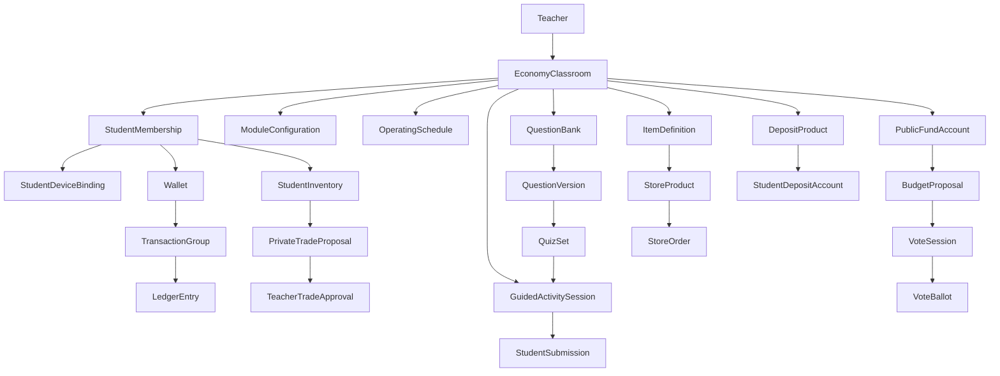

# 경제교실 지속형 MVP 제품·기능 명세

- 문서 버전: 1.0
- 기준일: 2026-07-28
- 상태: 제품 기준선 확정
- 대상: 기획, 디자인, 프론트엔드, 백엔드, QA

## 1. 문서의 목적과 범위

이 문서는 초등학교 4학년부터 중학교 3학년까지의 학생이 학교에서 학급 화폐를 이용해 소득, 소비, 저축, 세금, 거래와 공공의사결정을 경험하는 지속형 경제교육 플랫폼의 MVP 기준을 정의한다.

현재 저장소의 1·2일 체험형 데모 구현과 문서는 현재 상태를 설명하는 자료로 유지한다. 이 문서는 그 구현을 즉시 대체했다는 뜻이 아니라, 이후 제품을 확장할 때 따라야 할 목표 제품 명세다.

### 제품 한 문장

> 교사가 경제교실의 운영기간, 규칙과 모듈을 설정하면 학생이 학교의 자율시간과 교사 지도 활동에서 지속적으로 경제활동을 경험하는 모듈형 경제교육 플랫폼

### MVP 성공 기준

다음 과정이 한 경제교실 안에서 처음부터 끝까지 동작하면 MVP가 성립한다.

1. 교사가 경제교실과 학생 계정을 생성한다.
2. 학생이 학교 지급 개인 태블릿을 계정과 연결하고 출석번호·비밀번호로 로그인한다.
3. 교사가 자율 이용 시간을 열거나 게임 퀴즈·테스트·투표를 시작한다.
4. 학생이 보상과 월급을 받고 세금을 낸다.
5. 학생이 공식 상점, 캐릭터, 개인거래소와 정기예금을 이용한다.
6. 세금이 학급 공공기금에 적립되고 학생이 사용처에 익명 투표한다.
7. 학생과 교사가 거래·학습·자산 리포트를 확인한다.
8. 중복 지급, 이중 구매, 잔액 초과 사용과 개인정보 공개가 발생하지 않는다.

## 2. 제품 원칙

1. 서비스는 정규 교과의 고정 진도보다 재량시간의 간헐적·지속적 사용을 우선한다.
2. 코스는 추천안이고 실제 이용은 교사가 선택한 모듈과 선수개념에 따라 구성한다.
3. 학생의 선택 결과는 다음 활동과 자산에 누적된다.
4. 교사가 매 활동을 진행하지 않아도 사전에 허용한 기능은 정해진 시간에 자동 운영된다.
5. 교사 지도 활동이 시작되면 학생 앱은 같은 활동의 학생용 화면으로 동기화된다.
6. 교사 화면, 학생 화면과 공용 화면은 같은 상태를 공유하지만 서로 다른 정보를 보여준다.
7. 모든 금액 변경은 거래 원장을 통해서만 발생한다.
8. 결과의 크기보다 선택의 이유, 기록 이해와 계획 수정을 학습성과로 본다.
9. 속도, 운과 초기 자산이 장기 자산 격차를 지나치게 확대하지 않도록 보상에 상한을 둔다.
10. 학생 개인의 잔액, 세금, 성적, 신용과 실수는 다른 학생에게 공개하지 않는다.

## 3. 사용자와 이용 환경

### 3.1 사용자

| 사용자 | 이용 환경 | 주요 역할 |
| --- | --- | --- |
| 담당 교사 | 데스크톱 또는 노트북 웹 | 경제교실 생성, 정책 설정, 자율활동·지도 활동 운영, 기록 확인 |
| 학생 | 학교 지급 1인 1태블릿 앱 | 학습, 거래, 소비, 저축, 투표와 개인 리포트 확인 |
| 수업용 공용 화면 | 프로젝터·대형 화면용 웹 | 문제, 타이머, 익명 집계와 공개 결과 표시 |

MVP에서는 경제교실당 담당 교사 한 명만 둔다. 공동 담당 교사와 학교 관리자는 후속 범위다.

### 3.2 학교 전용 이용

- 학생의 금액 변경 활동은 교사가 연 자율 이용 시간 또는 지도 활동 중에만 가능하다.
- 학교 전용 여부는 MVP에서 GPS로 판단하지 않는다.
- 학생 앱은 교사가 설정한 운영시간과 모듈 허용 상태로 금액 변경 기능을 통제한다.
- 이용 종료 상태에서도 지갑, 이전 거래, 학습 결과와 리포트는 조회할 수 있다.
- 학교 밖 푸시 알림과 잠금화면 알림은 MVP에서 사용하지 않는다.

### 3.3 학생 인증

최초 연결:

1. 교사가 예상 인원만큼 출석번호 기반 학생 계정 슬롯을 생성한다.
2. 학생이 교사가 공유한 학급 입장 주소 또는 QR로 경제교실을 선택한다.
3. 학생이 본인의 출석번호를 입력한다.
4. 최초 입장 학생은 공개 활동에 사용할 닉네임과 비밀번호를 설정한다.
5. 계정과 학교 지급 태블릿을 연결한다.

이후 로그인:

> 학급 입장 주소 또는 QR → 출석번호 입력 → 비밀번호 입력 → 홈

- 기존 이코빌리지의 학생 입장·로그인·비밀번호 재설정 흐름을 재사용한다.
- 학생 실명, 이메일과 전화번호는 수집하지 않는다.
- 학생 계정은 경제교실 안의 출석번호와 닉네임으로 식별한다.
- 닉네임은 경제교실 안에서 중복될 수 없고 금지어 검사를 통과해야 한다.
- 교사는 부적절한 닉네임을 수정할 수 있다.
- 교사는 비밀번호 초기화, 태블릿 연결 해제와 계정 일시정지를 할 수 있다.
- 다른 태블릿에서 로그인하려면 교사의 기기 연결 초기화가 필요하다.
- 학생 비밀번호 입력 실패 횟수에는 제한을 두지 않고 실패 횟수로 계정을 잠그지 않는다.
- 교사가 비밀번호를 초기화하면 기존 로그인 세션을 종료하고, 학생은 다음 입장 때 기존 닉네임을 그대로 유지한 채 새 비밀번호만 설정한다.

### 3.4 교사 인증

- MVP 교사는 서비스에서 발급한 로그인 ID와 비밀번호를 사용한다.
- 로그인 성공 후 서버 세션으로 교사용 웹을 이용한다.
- 교사 로그인과 계정 복구는 기존 이코빌리지 교사 인증 흐름을 재사용한다.
- 학교 SSO와 공동 담당 교사는 후속 범위다.

## 4. 경제교실의 상태 모델

서로 다른 의미의 상태를 한 필드로 합치지 않는다.

### 4.1 생명주기

| 상태 | 의미 |
| --- | --- |
| `DRAFT` | 생성 중이며 학생이 입장할 수 없음 |
| `ACTIVE` | 운영기간 안에서 이용 가능한 경제교실 |
| `ENDED` | 신규 활동과 거래가 차단되고 조회만 가능 |
| `ARCHIVED` | 교사 기본 목록에서 숨긴 종료 경제교실 |

종료한 경제교실은 삭제하지 않는다. 운영 전 초안만 삭제할 수 있다.

운영 종료일이 지나면 경제교실은 즉시 삭제되거나 자동 정산되지 않고 `ACTIVE` 상태의 `CLOSED` 모드로 잠긴다. 교사는 종료 점검 화면에서 진행 중 테스트, 개인거래 제안, 실제 상품 주문, 투표 예약예산과 예금계좌를 정리한 뒤 `ENDED`를 확정한다.

### 4.2 현재 이용 모드

`ACTIVE` 경제교실은 다음 중 하나의 모드를 가진다.

| 모드 | 의미 |
| --- | --- |
| `CLOSED` | 조회만 가능 |
| `AUTONOMOUS` | 정해진 모듈을 학생이 자율 이용 |
| `GUIDED` | 교사가 시작한 한 개의 지도 활동 진행 |

한 경제교실에서 두 개의 지도 활동을 동시에 실행할 수 없다.

### 4.3 긴급 잠금

긴급 잠금은 현재 이용 모드와 별개의 값이다.

- 잠금 시 신규 거래, 제출과 상태 변경을 즉시 차단한다.
- 마지막 정상 이용 모드와 진행 상태를 보존한다.
- 교사가 재개하면 보존한 상태로 돌아간다.
- 원자적으로 처리 중이던 거래는 완료하거나 전체 롤백한 후 잠근다.

### 4.4 지도 활동 우선순위

- 지도 활동은 자율 이용과 반복 일정보다 우선한다.
- 지도 활동이 끝나면 시작 전 자율 이용의 남은 시간이 있을 때만 자율 이용으로 복귀한다.
- 자율 이용 시간이 이미 끝났다면 `CLOSED`로 돌아간다.

## 5. 모듈과 MVP 범위

### 5.1 항상 포함되는 기반

- 교사·학생 계정
- 경제교실
- 태블릿 연결과 비밀번호 인증
- 지갑과 거래 원장
- 자율 이용·지도 활동 제어
- 알림
- 기본 리포트
- 감사 기록

### 5.2 선택 가능한 MVP 모듈

- 월급명세서·소득세
- 게임 퀴즈
- 테스트 퀴즈
- AI 문제 생성
- 캐릭터·디지털 아이템
- 공식 디지털 상점
- 실제 상품 상점
- 개인 아이템 거래소
- 정기예금
- 부가세
- 학급 공공기금·예산·투표

### 5.3 모듈 의존성

| 선택 모듈 | 시스템 의존성 |
| --- | --- |
| 월급명세서·세금 | 지갑, 거래 원장 |
| AI 문제 생성 | 게임 퀴즈 또는 테스트 퀴즈 |
| 공식 디지털 상점 | 아이템·인벤토리 |
| 캐릭터 꾸미기 | 캐릭터 아이템·인벤토리 |
| 실제 상품 상점 | 공식 상점, 주문·수령 |
| 개인거래소 | 디지털 아이템·인벤토리 |
| 정기예금 | 지갑, 경제 운영일 |
| 공공기금·투표 | 세금 계정, 지도 활동 |

기술 의존성이 빠진 경우 시스템이 자동으로 추가하고 교사에게 이유를 보여준다.

학습 선수개념은 모듈 추천과 안내에 사용하지만, MVP에서 시스템이 교사의 선택을 강제로 차단하지는 않는다.

### 5.4 MVP 이후 범위

- 적금
- 주식투자
- 보험
- 대출·신용
- 시장가격·물가
- 학생 운영 상점·재고·매출·이익
- 부동산·자리 이용권
- 주거·청약
- 복지·사회안전망 고급 정책
- 학생 간 직접 송금·채팅·경매·맞교환

자리 이용권은 상점 상품이 아니라 부동산 모듈에서 `기간형 공간 이용권`으로 다룬다.

## 6. 경제교실 생성

경제교실 생성은 다음 6단계 마법사로 구성한다.

> 기본정보 → 학생 → 모듈 → 경제정책 → 자율시간 → 검토·개설

모든 단계는 자동 임시 저장한다.

### 6.1 기본정보

| 필드 | 규칙 |
| --- | --- |
| 경제교실 이름 | 필수, 기본값 `○학년 ○반 경제교실` |
| 학년 | 초4~초6, 중1~중3 |
| 예상 학생 수 | 1~50명 |
| 운영 시작일·종료일 | 종료일이 시작일보다 빠를 수 없음 |
| 화폐 이름·아이콘 | 기본 이름 `클래스머니`, 금액은 정수 |
| 운영 템플릿 | 1회, 1주, 4주, 8주, 자유 운영 |

템플릿은 기간과 추천 모듈의 초기값만 제공하며 교사가 수정할 수 있다.

### 6.2 학생

- 예상 인원만큼 출석번호 기반 계정 슬롯을 생성한다.
- 학생 실명 입력란은 만들지 않는다.
- 출석번호 직접 입력, 출석번호·닉네임 CSV 등록 또는 닉네임 등록 미루기를 지원한다.
- 경제교실 내 출석번호와 닉네임 중복은 허용하지 않는다.
- 최종 개설 전에는 학생 계정을 활성화하지 않는다.

### 6.3 모듈

- 학년과 템플릿에 따라 추천 표시를 제공한다.
- 선택하지 않은 모듈은 학생 앱에서 숨긴다.
- 운영 중 모듈을 추가할 수 있다.
- 모듈 중지는 기존 데이터와 기록을 보존하고 신규 사용만 차단한다.
- 자율 이용시간 종료나 일시정지는 개인거래소 모듈 중지가 아니며, 거래 동작만 막고 진행 중 거래 제안과 아이템 잠금을 유지한다.
- 개인거래소 모듈 중지를 확정하면 작성 중·상대 동의 대기·교사 승인 대기 거래를 모두 취소하고 아이템 잠금을 해제한다. 이미 교사가 승인한 원자 거래는 완료하거나 전체 롤백한다.
- 실제 상품 상점 중지 시 신규 구매만 막고 수령 대기 주문은 계속 처리한다.
- 예금 중지 시 신규 가입만 막고 활성 계좌는 만기·중도해지까지 유지한다.
- 진행 중 지도 활동의 모듈은 활동을 종료하기 전까지 중지할 수 없다.

### 6.4 경제정책

| 항목 | 기본값 |
| --- | ---: |
| 최초 지원금 | 0 |
| 기본 월급 | 1,000 |
| 월급 방식 | 동일 월급 |
| 잔액 음수 | 허용하지 않음 |
| 소득세 | 10% |
| 공식 상점 기본 부가세 | 10% |
| 상품별 부가세 변경 | 허용 |
| 개인거래 부가세 | 공식 상점 기본 부가세와 동일 |
| 퀴즈 참여 보상 | 50 |
| 퀴즈 정답 보상 | 40 |
| 퀴즈 속도 보상 | 최대 10 |
| 테스트 화폐 보상 | 사용하지 않음 |
| 하루 개인거래 작성 | 5회 |
| 하루 개인거래 동의 | 5회 |
| 개인거래 최저가 | 공식 판매가의 50% |
| 개인거래 최고가 | 공식 판매가의 150% |

최초 지원금은 학생 계정 최초 활성화 시 학생당 한 번만 지급한다.

월급은 `동일 월급`과 `역할별 월급` 중 선택한다. 역할별 월급은 역할명, 설명, 담당 학생, 기본급과 적용기간을 가진다. 역할 미배정 학생도 공통 기본급을 받는다. 역할급의 최고액이 공통 기본급의 1.5배를 넘으면 경고하지만 저장을 강제로 막지는 않는다.

정책 변경은 미래 거래에만 적용한다. 과거 거래, 월급명세서와 영수증은 당시 정책 스냅샷을 유지한다.

### 6.5 자율시간

- 기본값은 교사의 수동 개방이다.
- 요일별 반복 일정과 일회성 일정을 추가할 수 있다.
- 일정별 시작·종료, 이용 모듈, 거래 제한과 종료 전 알림을 설정한다.
- 일정 중복은 저장하지 못한다.
- 종료 5분 전과 1분 전에 학생에게 알린다.

### 6.6 검토·개설

교사에게 학생 수, 기간, 모듈, 정책, 자율시간, 자동 추가된 의존성과 경고를 한 화면에 보여준다.

개설은 다음을 하나의 작업으로 처리한다.

1. 경제교실을 `ACTIVE`로 전환한다.
2. 출석번호 기반 학생 계정 슬롯을 활성화한다.
3. 학급 코드와 QR을 생성한다.
4. 모듈과 반복 일정을 활성화한다.
5. 교사 대시보드로 이동한다.

하나라도 실패하면 전체 개설을 롤백하고 `DRAFT`를 유지한다.

## 7. 화면 정보구조

### 7.1 교사용 웹

- 로그인
- 경제교실 목록
- 경제교실 생성
- 대시보드
- 운영센터
- 학생 관리
- 경제 관리
  - 월급·보상
  - 세금·공공기금
  - 전체 거래
- 퀴즈
  - 문제은행
  - AI 문제 생성·검토
  - 게임 퀴즈
  - 테스트
  - 결과
- 상점·아이템
  - 아이템
  - 공식 상점
  - 실제 상품 주문
  - 개인거래소
- 금융
  - 예금상품
  - 예금 현황
  - 경제 운영일
- 공공예산·투표
- 리포트
- 경제교실 설정

### 7.2 학생 태블릿 앱

왼쪽 고정 메뉴:

- 홈
- 지갑
- 학습
- 상점
- 금융
- 내 정보

세부 화면:

- 최초 연결·닉네임·비밀번호
- 홈·알림
- 지갑·거래내역·월급명세서·세금
- 경제 학습·게임 퀴즈·테스트
- 공식 디지털·실제 상품 상점
- 캐릭터·인벤토리
- 개인거래소
- 정기예금
- 공공예산 투표
- 개인 리포트

### 7.3 수업용 공용 화면

- 대기
- 활동 입장 현황
- 게임 퀴즈
- 테스트 타이머·제출 현황
- 공공예산 투표
- 활동 결과

## 8. 교사용 화면 상세

### 8.1 공통 상단

- 경제교실 선택
- 생명주기 상태
- 현재 이용 모드
- 남은 이용시간
- 공용 화면 연결 상태
- 공용 화면 열기
- 긴급 잠금

### 8.2 대시보드

표시 정보:

- 현재 운영 상태와 접속 학생 수
- 전체 사용 가능 화폐
- 학급 공공기금
- 오늘 거래 수·상점 매출·거래소 거래액
- 전체 예금 원금과 다음 만기
- 오늘 일정
- 실제 상품 수령 대기
- 이상 거래·비밀번호 초기화 요청·AI 검토·미응시 테스트
- 최근 활동

빠른 실행:

- 자율활동 임시 개방
- 게임 퀴즈
- 동시 테스트
- 공공예산 투표
- 월급 지급

빠른 실행은 최종 작업을 즉시 수행하지 않고 대상과 예상 결과를 먼저 보여준다.

### 8.3 운영센터

자율활동 시작 설정:

- 10분, 20분, 30분, 일정 종료까지 또는 직접 입력
- 허용 모듈
- 전체 또는 일부 학생
- 임시 거래 제한

진행 중 기능:

- 남은 시간
- 접속 학생
- 이용 모듈
- 이용시간 연장
- 모듈 추가·차단
- 종료
- 긴급 잠금

종료 시:

- 신규 구매, 개인거래 작성·동의, 예금 가입과 제출을 차단한다.
- 서버가 접수한 원자 거래는 완료하거나 롤백한다.
- 진행 중 개인거래 제안과 아이템 잠금은 유지하되 새로운 동의와 교사 승인은 막는다.
- 시작 가능한 시간이 충분해 이미 진행 중인 개별 테스트는 정상 종료시각까지 유지한다.
- 교사가 예정시간보다 일찍 자율 이용을 종료한 경우에만 개별 테스트를 1분 유예 후 자동 제출한다.
- 작성 중 답안과 개인거래 제안 초안을 저장한다.

지도 활동:

1. 활동과 콘텐츠를 선택한다.
2. 대상 학생과 공용 화면 미리보기를 확인한다.
3. `학생 호출`로 학생 앱을 대기실로 이동시킨다.
4. 접속 인원을 확인한다.
5. 교사가 활동을 시작한다.
6. 응답 마감, 결과 공개와 종료를 제어한다.

학생 접속 현황에는 접속 여부, 현재 활동 입장, 제출 여부, 마지막 연결시각과 오류만 보여준다. 교사는 학생 태블릿의 실제 화면 내용을 원격 감시하지 않는다.

### 8.4 학생 관리

목록:

- 출석번호
- 닉네임
- 계정 활성 상태
- 태블릿 연결 상태
- 마지막 접속
- 현재 이용 제한

기능:

- 학생 추가·수정
- CSV 등록 결과와 행별 오류 확인
- 비밀번호 초기화
- 태블릿 연결 해제
- 계정 일시정지·재개
- 개인 지갑·거래·학습 리포트 이동

운영 기록이 있는 학생은 삭제하지 않고 `비활성` 처리한다.

### 8.5 월급·보상

월급 지급:

1. 지급 회차와 기간을 입력한다.
2. 동일 월급 또는 적용 중인 역할급을 불러온다.
3. 활동 보상을 선택적으로 추가한다.
4. 총소득, 세금, 실수령액과 전체 발행액을 미리 본다.
5. 교사가 확정한다.

같은 지급 회차를 중복 실행할 수 없다. 지급 후 원본을 수정하지 않고 복구 거래를 만든다.

임의 지급·회수에는 대상, 금액과 필수 사유가 필요하다.

### 8.6 거래 관리

필터:

- 학생
- 기간
- 거래 유형
- 관련 모듈
- 완료·실패·복구 상태
- 거래번호

상세:

- 거래 그룹과 원장 항목
- 전후 잔액
- 실행자
- 관련 상품·퀴즈·예금
- 정책 스냅샷
- 학생 문의
- 연결된 복구 거래

교사는 완료 거래를 편집·삭제할 수 없고, 사유를 입력한 보상 거래로만 복구한다.

### 8.7 문제은행·AI 생성

AI 생성 입력:

- 게임 또는 테스트
- 경제 또는 넌센스
- 학년
- 모듈·개념
- 난이도
- 문제 수·유형
- 예상 풀이시간
- 계산 문제 여부
- 내부 학습자료와 교사 추가 지시

MVP 문제 유형은 객관식 단일 선택과 O/X다. 복수 선택, 단답형, 순서 배열과 교사 수동 채점은 후속 범위다.

생성 결과:

- 문제, 선택지, 정답, 해설
- 개념·학년·난이도·예상시간
- 게임·테스트 사용 가능 여부

상태:

> 생성 중 → 검토 필요 → 교사 승인 → 사용 가능 → 보관

교사는 문제·선택지·해설 단위 재생성, 직접 수정, 승인과 보관을 할 수 있다. 사용 이력이 있는 문제를 수정하면 새 버전을 만든다.

자동 검증:

- 단일 선택 정답 한 개
- 선택지 중복 없음
- 문제 안의 정답 노출 없음
- 정답·해설 일치
- 계산 검증
- 학년 적합 표현
- 금지 표현
- 기존 문제와 과도한 중복 없음

AI 결과는 교사 승인 없이 학생에게 공개하지 않는다. AI에는 학생 실명과 개인 성적을 전달하지 않는다.

### 8.8 게임 퀴즈 운영

상태:

> 초안 → 대기실 → 문제 진행 → 응답 마감 → 정답 공개 → 라운드 보상 → 종료

교사 기능:

- 퀴즈 세트 선택
- 대상 학생
- 문제별 제한시간
- 게임 점수와 화폐 보상 정책
- 학생 호출
- 문제 공개
- 응답 마감
- 정답·익명 분포 공개
- 다음 문제
- 최종 1·2·3위 공개 여부
- 최종 종료

게임 점수와 화폐 보상은 분리한다. 속도는 게임 점수에 크게 반영할 수 있지만 화폐 속도 보상은 기본 최대 10으로 제한한다.

MVP의 게임 퀴즈 화폐는 월급과 구분된 즉시 게임 보상이며 소득세를 적용하지 않는다. 소득세는 월급 회차에 포함된 기본급·역할급·활동 보상에만 적용한다.

게임 퀴즈 최종 결과에는 1·2·3위 학생의 닉네임과 캐릭터를 학생 화면과 공용 화면에 표시할 수 있다. 이는 해당 게임 세션의 점수 순위에만 적용하며 학생 잔액·자산·누적 경제 순위와 테스트 성적은 공개하지 않는다.

### 8.9 테스트 운영

진행 방식:

- 동시 테스트: 교사가 호출하고 모든 학생이 함께 응시
- 개별 테스트: 자율 이용 시간 안에서 지정 기간에 응시

설정:

- 대상 학생
- 응시 기간
- 제한시간
- 시도 횟수
- 문제·선택지 섞기
- 이전 문제 이동
- 자동 제출
- 정답·결과 공개 시점
- 합격 기준

기본값:

- 1회 응시
- 속도 점수 없음
- 학생별 문제 순서 섞기
- 전체 종료 후 정답 공개
- 화폐 보상 없음
- 다른 학생 순위 비공개

개별 테스트는 자율 이용의 남은 시간이 테스트 제한시간보다 짧으면 시작할 수 없다. 교사가 이미 진행 중인 자율 이용을 예정시간보다 일찍 종료하면 학생에게 1분 유예 후 답안을 자동 제출한다.

교사 실시간 화면에는 시작·응시·제출·연결 상태만 보이고 학생의 답안 내용은 종료 전 노출하지 않는다.

### 8.10 아이템·공식 상점

아이템:

- 이름·설명·이미지
- 캐릭터 장착 부위
- 중복 보유·최대 수량
- 소모 여부
- 거래 가능 여부
- 거래 기준가
- 학년 제한

상품:

- 연결 아이템 또는 실제 상품 정보
- 판매가격
- 부가세 사용·세율
- 전체 재고
- 학생당 구매 한도
- 판매기간
- 재판매 허용과 대기기간

상품 상태:

> 판매 예정 → 판매 중 → 품절 → 판매 종료

기본 캐릭터 아이템과 공공기금으로 전체 지급한 아이템은 거래 불가가 기본이다.

거래 가능한 아이템에는 거래 기준가가 필요하다. 현재 공식 판매가격이 있으면 그 가격을 사용하고, 퀴즈·미션 전용 아이템처럼 공식 판매가격이 없으면 교사가 아이템에 기준가를 지정한다.

캐릭터 원천 정책:

- 저작재산권 보호기간이 끝난 것으로 확인된 유명 원작 캐릭터를 후보로 사용할 수 있다.
- 원작의 보호기간 만료와 별개로 후대의 영화·애니메이션·번역·삽화 등 2차적 저작물과 상표권을 따로 확인한다.
- 실제 서비스의 캐릭터 이미지와 아이템은 권리 확인이 끝난 원전만 참고해 자체 제작하거나 이용조건이 명확한 에셋을 사용한다.
- 캐릭터마다 원전, 저작자, 최초 공표일, 보호기간 검토 근거, 사용한 에셋의 출처·라이선스와 검토자를 기록한다.
- 권리 상태가 불명확하면 서비스에 포함하지 않고 자체 오리지널 캐릭터로 대체한다.

### 8.11 실제 상품 주문

주문 상태:

> 수령 대기 → 수령 완료

예외 상태:

> 수령 대기 → 제공 불가 → 복구 완료

- 실제 상품은 학급 화폐로만 구매한다.
- 실제 상품은 디지털 인벤토리에 넣지 않고 주문·수령 기록으로 관리한다.
- 개인거래소 재판매를 허용하지 않는다.
- 구매가 완료된 상품은 디지털·실제 상품 모두 학생 취소와 환불을 허용하지 않는다.
- 교사도 완료 거래를 임의 취소하거나 환불하지 않는다.
- 중복 결제, 재고 오류 또는 실제 상품 제공 불가처럼 원거래를 이행할 수 없는 오류에만 사유를 입력한 복구 거래로 상품가격과 부가세를 원래 계정에 되돌린다.
- 음식 상품에는 교사가 주의정보를 작성할 수 있다.

### 8.12 개인거래소 관리

MVP 개인거래소는 불특정 학생이 매물을 즉시 구매하는 방식이 아니라, 거래 상대를 지정하는 고정가격 합의 거래만 지원한다.

- 작성 중, 상대 동의 대기, 교사 승인 대기, 완료, 거절, 취소, 실패, 만료 목록
- 상품별 최저·최고 가격
- 학생별 하루 거래 작성·동의 횟수
- 개인거래 부가세율
- 거래별 제안자·상대방, 아이템, 가격, 부가세, 최종 결제금액과 판매자 수령액
- 교사 승인·거절과 사유
- 개인거래소 모듈 일시정지·중지
- 이상 거래 표시와 복구

교사는 상대 학생의 동의가 끝난 거래만 승인할 수 있다. 승인 시점에 구매자 잔액, 아이템 잠금, 가격 제한과 일일 횟수를 다시 검증하고 금액·세금·소유권을 원자적으로 이전한다.

경매, 자유 채팅, 맞교환, 외상, 불특정 구매, 구매 예약과 직접 송금은 지원하지 않는다.

### 8.13 예금 관리

상품 설정:

- 이름·설명
- 최소·최대 가입금액
- 가입 가능 기간
- 만기까지 경제 운영일
- 고정이자 또는 기간 이자율
- 중도해지 허용과 중도해지 이자
- 학생당 계좌 수
- 전체 가입 한도
- 이자소득세
- 자율 가입 허용
- 신용등급 연계 안내

예금상품 상태:

> 준비 → 가입 가능 → 가입 마감 → 종료

교사는 전체 원금, 예상 이자, 다음 만기와 경제 운영일 진행 미리보기를 확인한다. 경제 운영일 진행은 예상 만기 지급과 전체 화폐 증가액을 보여준 뒤 확정한다.

예금 가입 자격과 이율은 학급 신용등급으로 차별하지 않는다. 만기와 중도해지 기록은 금융활동 리포트에 남기되, MVP에서는 신용점수를 계산하지 않는다. 후속 대출·신용 모듈을 열면 활성화 이후의 상환 기록을 중심으로 별도의 학급 신용등급을 계산한다.

### 8.14 공공예산·투표

사용처 유형:

- 시스템 자동 적용: 전체 아이템 지급, 상점 할인, 특별 퀴즈, 예금 이자 지원 등
- 교사 직접 실행: 학급 행사, 공용 준비물, 기타 커스텀 사용처

기본 템플릿을 제공하되 이름, 설명, 이미지, 예산, 대상, 효과와 기간을 수정할 수 있다. 투표 시작 후에는 수정하지 않고 복제해 새 안건으로 만든다.

투표 설정:

- 제목·설명
- 선택지와 비용·효과
- 최대 예산
- 제한시간
- 최소 참여 인원
- 결과 공개
- 동점 처리

기본 규칙:

- 학생당 한 표
- 마감 전 변경 가능
- 개인 선택 비공개
- 교사도 참여 여부만 확인
- 최다 득표안 선정
- 동점은 결선투표
- 최소 참여 미달은 무효

투표 중 필요한 최대 예산을 잠가 중복 집행을 막는다. 결과 선정 후에도 교사가 `집행`을 확정해야 기금 차감과 효과가 발생한다.

### 8.15 리포트

교사:

- 학생별 소득·소비·세금·예금
- 퀴즈 참여·정답률·테스트 성취도
- 상점 판매·실제 주문·개인거래
- 학급 전체 화폐 발행·회수·이동
- 공공기금 수입·지출
- 예금 원금·예상 이자
- 미참여·이상 거래·문의

리포트는 최종 잔액 순위보다 선택과 기록을 중심으로 보여준다. 학생 간 공개 순위는 만들지 않는다.

### 8.16 경제교실 종료

운영 종료일 도달 또는 교사의 수동 종료 요청 시 종료 점검 화면을 연다.

점검 항목:

- 진행 중 지도 활동과 테스트
- 작성 중·상대 동의 대기·교사 승인 대기 개인거래
- 수령 대기 실제 상품 주문
- 진행 중 투표와 예약예산
- 활성 예금계좌
- 미처리 거래 문의와 복구

종료 처리:

1. 자율 이용을 닫고 신규 거래를 차단한다.
2. 진행 중 테스트를 제출하고 지도 활동을 종료한다.
3. 미완료 개인거래를 취소하고 아이템 잠금을 해제한다. 이미 승인한 원자 거래는 완료하거나 전체 롤백한다.
4. 진행 중 투표를 취소해 예약예산을 해제하거나 교사가 먼저 집행한다.
5. 수령 대기 실제 주문을 수령 완료하거나 제공 불가 사유와 복구 거래를 기록해 정리한다.
6. 예금상품별로 정상 만기 지급 또는 상품의 중도해지 조건에 따른 운영 종료 정산을 선택하고 예상 금액을 확인한다.
7. 미처리 원자 거래가 없는지 확인한다.
8. 최종 리포트 스냅샷을 만든 뒤 경제교실을 `ENDED`로 변경한다.

수령 대기 주문과 활성 예금계좌가 남아 있으면 최종 종료할 수 없다. 종료 후에는 기록 조회와 내보내기만 허용한다.

## 9. 학생 앱 화면 상세

### 9.1 공통 상단과 메뉴

공통 상단:

- 경제교실 이름
- 현재 이용 모드와 남은 시간
- 사용 가능 금액
- 알림
- 연결 상태
- 캐릭터

왼쪽 메뉴:

> 홈 / 지갑 / 학습 / 상점 / 금융 / 내 정보

모듈 표시:

| 상태 | 표시 |
| --- | --- |
| 경제교실 미선택 | 숨김 |
| 선택했으나 현재 닫힘 | 다음 이용시간과 함께 비활성 |
| 현재 허용 | 활성 |
| 개인 제한 | 교사 문의 안내와 함께 비활성 |
| 모듈 종료 | 기록 조회만 가능 |
| 지도 활동 | 일반 메뉴 잠금, 활동 화면으로 전환 |

### 9.2 홈

- 캐릭터와 꾸미기
- 사용 가능 금액·예금·총금융자산
- 자율 이용 남은 시간
- 현재 이용 가능한 활동
- 오늘의 테스트·미션
- 최근 거래 3건
- 예금 만기·상품 수령·개인거래 완료 알림

아이템 예상 시세는 총금융자산에 포함하지 않는다.

### 9.3 지도 활동 자동 전환

1. 교사 활동 시작 알림을 표시한다.
2. 진행 중인 원자 거래를 완료 또는 롤백한다.
3. 작성 중 입력을 임시 저장한다.
4. 3초 후 활동 대기실로 이동한다.
5. 일반 메뉴를 잠근다.
6. 교사 종료 후 결과 확인을 거쳐 이전 모드로 복귀한다.

### 9.4 지갑

탭:

> 내 지갑 / 거래내역 / 월급명세서 / 세금·공공기금

내 지갑:

- 사용 가능 금액
- 예금자산
- 총금융자산
- 기간별 받은 돈·소비·세금·저축
- 최근 거래

거래 목록:

- 날짜별 그룹
- 받은 돈, 소비, 세금, 상점, 개인거래, 예금, 복구 필터
- 상품·퀴즈·월급 회차 검색
- 거래번호, 시각, 전후 잔액, 관련 대상과 상태 상세

학생은 거래를 수정·삭제할 수 없다. `교사에게 문의하기`로 미실행, 미수령, 금액 오류와 기타 사유를 제출할 수 있다.

월급명세서:

- 지급 회차·기간
- 역할
- 기본급·활동 보상
- 총소득
- 소득세·공제
- 실수령액

세금:

- 본인의 소득세·부가세·이자소득세
- 전체 공공기금과 출처별 합계
- 최근 집행과 예정 투표

다른 학생 개인 납부액은 볼 수 없다.

### 9.5 공식 상점

탭:

> 디지털 상품 / 실제 상품 / 구매내역

상품 목록:

- 이미지·이름
- 최종 결제금액
- 남은 재고
- 학생 구매 가능 수량
- 판매 종료까지 남은 시간
- 개인거래 가능 여부

상품 상세:

- 아이템 미리보기 또는 실제 상품 설명
- 기본가격·부가세·최종 결제금액
- 현재 잔액과 구매 후 잔액
- 재고·학생 한도
- 거래 가능 여부
- 주의정보

구매:

1. 수량을 선택한다.
2. 최종 금액과 구매 후 잔액을 확인한다.
3. 비밀번호 재입력 없이 확인 버튼으로 구매한다.
4. 처리 중 버튼을 잠근다.
5. 성공 시 디지털 아이템 또는 실제 주문을 생성한다.

잔액·재고·한도 중 하나라도 부족하면 전체 작업을 실패시키고 금액을 변경하지 않는다.

구매 확인과 결제가 완료되면 디지털·실제 상품 모두 학생 취소와 환불을 제공하지 않는다. 구매 확인 화면에는 이 정책을 명확히 표시한다. 중복 결제, 재고 오류 또는 실제 상품 제공 불가 같은 시스템·운영 오류는 교사가 원거래를 수정하지 않고 사유가 있는 복구 거래로만 정정한다.

### 9.6 캐릭터·인벤토리

- 기본 캐릭터와 무료 아이템 제공
- 헤어, 얼굴, 상의, 하의, 모자·액세서리, 배경, 칭호 슬롯
- 구매 전 미리보기
- 보유·장착·거래 가능·거래 제안 중 필터
- 거래 제안 작성 시 자동 장착 해제
- 거래 제안 중 아이템의 장착·사용·다른 거래 제안 차단

아이템은 학습 점수와 금융 결과를 높이는 능력치를 가지지 않는다. 확률형 뽑기와 유료 우위 기능은 사용하지 않는다.

유명 캐릭터를 사용할 때는 저작권 보호기간이 끝난 원전과 자체 제작 에셋만 사용하고, 후대의 특정 애니메이션·영화·게임 디자인을 모방하지 않는다. 캐릭터 이름·로고의 상표권을 포함한 권리 검토가 끝나지 않은 에셋은 배포하지 않는다.

### 9.7 개인거래소

탭:

> 거래 작성 / 받은 제안 / 교사 승인 대기 / 거래 내역

학생 선택 정보:

- 거래 상대의 닉네임·캐릭터
- 거래 가능한 보유 아이템
- 거래 가격과 허용 가격 범위
- 부가세와 구매자의 최종 결제금액
- 거래 완료 시 판매자가 받을 금액

실명은 수집하거나 표시하지 않는다. 상대 지정과 거래 내역에는 출석번호 대신 닉네임·캐릭터를 사용한다.

거래 작성:

1. 제안자 A가 거래 상대 B를 선택한다.
2. A가 거래 가능한 보유 아이템과 판매가격을 입력한다.
3. 허용 가격·횟수와 당사자 상태를 검증한다.
4. A가 가격, 부가세와 B의 최종 결제금액을 확인한다.
5. 아이템을 잠그고 B에게 거래 제안을 보낸다.

상대 동의:

1. B는 A의 닉네임·캐릭터, 아이템, 판매가격, 부가세, 최종 결제금액과 동의 기한을 확인한다.
2. B가 거절하거나 기한이 지나면 거래를 종료하고 아이템 잠금을 해제한다.
3. B가 동의하면 거래를 `교사 승인 대기`로 전환하고 개인거래소 거래 내역과 교사 승인 목록에 표시한다.

B가 동의하기 전 제안 내용은 A·B와 교사만 볼 수 있다. B의 동의 이후에는 경제교실 학생이 개인거래소 거래 내역에서 A·B의 닉네임·캐릭터, 아이템, 판매가격, 부가세와 승인 상태를 볼 수 있다. 출석번호, 잔액과 교사 승인 사유는 다른 학생에게 공개하지 않는다.

교사 승인과 완료:

1. 교사는 A·B, 아이템, 가격, 부가세, 최종 결제금액, 양쪽의 당일 거래 횟수와 이상 징후를 확인한다.
2. 교사가 거절하면 사유를 기록하고 아이템 잠금을 해제한다.
3. 교사가 승인하면 B의 잔액에서 판매가격과 부가세를 차감하고, A에게 판매가격을 지급하며, 부가세를 학급 공공기금에 적립하고, 아이템 소유권을 B에게 이전한다.
4. 위 금액과 소유권 이전은 하나의 원자 거래로 처리한다. 승인 시점 검증이 실패하면 아무 값도 변경하지 않고 거래를 실패 처리한 뒤 아이템 잠금을 해제한다.
5. 완료 거래는 A·B와 교사가 확인할 수 있고, 학생용 거래 내역에는 양쪽 닉네임·캐릭터, 아이템, 가격, 세금, 시각과 상태를 표시한다.

완료 후 학생 임의 취소와 환불은 불가하며 오류는 교사가 원거래를 참조하는 복구 거래로 정정한다.

### 9.8 정기예금

목록:

- 상품명
- 최소·최대 금액
- 만기까지 경제 운영일
- 고정이자 또는 기간 이자율
- 중도해지 조건

가입 확인:

- 현재 현금
- 가입금액
- 가입 후 현금
- 예상 이자·이자소득세
- 예상 만기 수령액
- 만기 경제 운영일
- 신용등급 반영 여부 안내

가입은 현금에서 예금으로의 자산 이동이므로 소비로 계산하지 않는다.

만기:

- 경제 운영일 도달 시 학생 조작 없이 원금과 이자를 자동 지급한다.
- 만기 처리는 계좌당 한 번만 실행한다.
- 학생은 다음 접속 시 만기 알림과 상세 계산을 확인한다.

중도해지:

- 허용 상품만 가능하다.
- 기본값은 원금 전액 반환, 약정 이자 미지급이다.
- 포기하는 예상 이자를 확인한 뒤 해지한다.

예금 만기와 중도해지는 금융활동 리포트에 표시하지만 MVP의 가입 가능 여부·이율과 신용등급에는 영향을 주지 않는다.

### 9.9 게임 퀴즈

학생 화면:

- 대기실
- 문제와 선택지
- 제한시간
- 제출 완료 상태
- 정답·해설
- 게임 점수와 화폐 보상
- 최종 결과
- 최종 1·2·3위의 닉네임·캐릭터

제출 후 답을 변경할 수 없다. 네트워크 재시도는 같은 응답으로 처리해 중복 보상을 막는다.

### 9.10 테스트

학생 화면:

- 전체 문제 수와 현재 번호
- 남은 시간
- 답안
- 미응답 문제
- 이전·다음
- 최종 제출

답안은 태블릿에 임시 저장하고 서버와 동기화한다. 시간이 끝나면 자동 제출한다. 학생은 공개 정책에 따라 총점, 오답과 해설을 본다. 다른 학생 점수와 순위는 볼 수 없다.

### 9.11 공공예산 투표

- 현재 공공기금
- 선택지별 비용·효과
- 집행 후 예상 잔액
- 한 표 선택
- 마감 전 변경
- 제출 여부
- 마감 후 공개 결과

개인 선택은 학생, 교사와 공용 화면 모두에서 공개하지 않고 집계 결과만 보여준다.

### 9.12 개인 리포트

- 받은 돈
- 소비
- 판매 수입
- 세금
- 예금과 이자
- 현재 총금융자산
- 퀴즈 참여·정답률
- 테스트 개념별 성취
- 이전 기간과의 변화

자산 순위 대신 학생 자신의 계획과 실제 결과 비교를 제공한다.

### 9.13 알림

유형:

- 운영
- 지갑
- 상점·거래
- 금융
- 학습

즉시 배너:

- 구매·판매·예금 성공 또는 실패
- 자율활동 종료 5분·1분 전
- 연결 끊김

전체 화면:

- 지도 활동 호출
- 긴급 잠금
- 테스트 종료
- 경제교실 종료

알림은 관련 화면으로 이동하는 링크를 가진다.

## 10. 수업용 공용 화면

공용 화면은 교사 웹에서 새 창으로 연다. 짧은 수명의 읽기 전용 표시 토큰을 사용하며, 창을 닫았다 다시 열어도 현재 활동 상태를 복원한다.

### 10.1 대기

- 경제교실 이름
- 현재 상태
- 활동 제목
- 접속·입장 인원
- 시작 안내

### 10.2 게임 퀴즈

- 문제·선택지
- 타이머
- 제출 인원
- 정답
- 익명 응답 분포
- 라운드 점수
- 최종 결과
- 최종 1·2·3위의 닉네임·캐릭터

게임 중 개인 화폐 잔액은 표시하지 않는다. 순위 공개는 게임 퀴즈 세션에만 한정하고 테스트와 자산 리포트에는 적용하지 않는다.

### 10.3 테스트

- 테스트 이름
- 주의사항
- 남은 시간
- 응시·제출 인원

시험 문제, 개인 답안과 점수는 표시하지 않는다.

### 10.4 공공예산 투표

- 공공기금
- 선택지별 비용·효과
- 남은 시간
- 참여 인원
- 마감 후 집계
- 선정안과 집행 후 잔액

### 10.5 공용 화면 금지 정보

- 학생 출석번호와 개인 식별번호
- 학생별 잔액·세금·거래
- 학생별 테스트 점수와 오답
- 교사 메모
- 학생별 투표 선택
- 개인 이용 제한 사유

## 11. 화폐·거래 원장

### 11.1 금액 원칙

- 모든 금액은 음수가 아닌 정수 단위다.
- 학생의 사용 가능 잔액은 음수가 될 수 없다.
- 대출은 미래 모듈에서 별도 부채 계정으로 처리한다.
- 금액 저장은 64비트 정수 범위를 사용한다.

### 11.2 자산

| 항목 | 의미 |
| --- | --- |
| 사용 가능 금액 | 즉시 소비·거래 가능한 현금 |
| 예금자산 | 정기예금에 잠긴 원금과 확정 이자 |
| 총금융자산 | 현금 + 예금자산, 향후 주식·부채 반영 |

캐릭터와 아이템의 시장 추정가는 총금융자산에 포함하지 않는다.

### 11.3 원장 불변 규칙

1. 잔액은 원장 항목 없이 변경할 수 없다.
2. 완료된 거래는 수정·삭제하지 않는다.
3. 취소·복구는 원본을 참조하는 반대 거래로 기록한다.
4. 한 사용자 행동에서 파생된 여러 항목은 한 거래 그룹으로 묶는다.
5. 같은 외부 요청과 지급 회차는 한 번만 처리한다.
6. 잔액·재고·아이템·공공기금이 함께 바뀌는 작업은 전부 성공하거나 전부 실패한다.
7. 정책값은 거래 시점의 값을 스냅샷으로 저장한다.

### 11.4 주요 거래 유형

수입:

- 최초 지원금
- 월급
- 활동·퀴즈 보상
- 개인거래 판매금
- 예금 원금 반환
- 예금 이자
- 복구
- 교사 조정 지급

지출·이동:

- 소득세·부가세·이자소득세
- 공식 상점 구매
- 개인거래 구매·부가세
- 예금 가입
- 교사 조정 회수

### 11.5 학생 표시 그룹

- 월급: 총소득 지급과 세금 차감을 묶어 실수령액을 표시한다.
- 상점: 상품가격과 부가세를 묶어 최종 결제금액을 표시한다.
- 개인거래: 판매가격, 부가세, 구매자 최종 결제금액과 판매자 수령액을 함께 표시한다.
- 예금 가입: 현금 감소와 예금 증가를 자산 이동으로 표시한다.
- 예금 만기: 원금 반환, 이자와 이자소득세를 묶어 표시한다.

### 11.6 학급 전체 화폐량

화폐량은 학생 지갑만 합산하지 않고 다음을 구분한다.

- 학생 사용 가능 화폐
- 학생 예금자산
- 학급 공공기금
- 위 항목을 합한 학급 전체 화폐

활동별 효과:

- 월급·퀴즈 보상·기본 예금 이자: 전체 화폐 증가
- 소득세·부가세: 학생 화폐에서 공공기금으로 이동
- 공식 상점 상품가격: 전체 화폐 감소
- 개인거래: 판매가격은 학생 사이를 이동하고 부가세는 구매자 지갑에서 공공기금으로 이동
- 예금 가입·원금 반환: 현금과 예금 사이 이동
- 공공기금 현금성 지원: 공공기금에서 학생에게 이동
- 공공기금 비현금 효과: 공공기금 차감과 서비스 효과 기록

공공기금으로 예금 이자를 지원하거나 학생에게 현금을 지급할 때는 같은 금액을 기금에서 이전하고 별도로 신규 발행하지 않는다.

## 12. 월급과 세금

### 12.1 월급

> 기본급 + 역할급 또는 활동 보상 = 총소득  
> 총소득 - 소득세·공제 = 실수령액

- 지급은 교사가 회차별 미리보기를 확인한 후 실행한다.
- 완전 자동 지급은 하지 않고 예정일 알림만 제공한다.
- 역할과 월급 정책 변경은 다음 회차부터 적용한다.

### 12.2 소득세

- 총소득에 적용한다.
- 월급 거래 그룹에서 별도 원장 항목으로 차감한다.
- 학급 공공기금의 `소득세` 출처로 적립한다.

### 12.3 부가세

- 경제교실 기본 세율을 두고 상품별 적용 여부와 세율을 덮어쓸 수 있다.
- 학생 화면에는 최종 결제금액을 가장 크게 표시한다.
- 영수증에는 상품가격, 부가세와 총액을 분리한다.
- 정상 구매에는 취소·환불을 제공하지 않는다. 중복 결제, 재고 오류 또는 실제 상품 제공 불가를 복구할 때만 상품가격과 부가세를 원래 계정으로 되돌리는 반대 거래를 만든다.
- 개인거래에도 부가세를 적용한다. 구매자는 합의한 판매가격과 부가세를 부담하고, 판매자는 판매가격을 받으며, 부가세는 학급 공공기금에 적립한다.
- 개인거래 부가세는 거래 제안 생성 시점의 세율을 정책 스냅샷으로 고정한다. 상대 학생과 교사는 같은 세율·금액을 확인하며, 승인 전 정책이 바뀌어도 기존 제안의 결제금액은 바뀌지 않는다.
- 개인거래 부가세는 실제 세법을 재현하는 세금이 아니라 학급 경제교육을 위한 모의 정책임을 학생 화면에 표시한다.

공식 상점의 상품가격은 학급 경제에서 회수되는 화폐고, 부가세만 공공기금으로 이동한다. 향후 학생 운영 상점 모듈에서는 판매자 매출 계정을 별도로 설계한다.

### 12.4 예금·대출과 학급 신용등급

학급 신용등급은 실제 금융기관의 개인신용점수가 아닌 후속 대출·신용 교육 모듈의 시뮬레이션 값이다. MVP 정기예금은 신용등급 없이 이용하며, 대출·신용 모듈이 선택되지 않은 경제교실에는 신용점수와 등급을 표시하지 않는다.

예금 연계:

- 예금 가입, 만기와 중도해지 내역은 금융활동 리포트에 기록한다.
- 예금 가입금액과 만기 달성은 대출 한도 검토 시 자산·계획 이행 참고정보가 될 수 있지만 신용점수를 직접 올리지 않는다.
- 중도해지는 계약 위반이나 연체가 아니므로 신용점수를 낮추지 않는다.
- 예금 가입 가능 여부와 이율은 신용등급으로 차별하지 않는다.

후속 대출·신용 모듈 기본안:

| 등급 | 점수 | 신규 대출 기본 정책 |
| --- | ---: | --- |
| A | 85~100 | 기준 한도 100%, 기준금리 -2%p |
| B | 70~84 | 기준 한도 80%, 기준금리 |
| C | 55~69 | 기준 한도 50%, 기준금리 +2%p |
| D | 0~54 | 신규 대출 중지, 상환·학습 미션 제공 |

- 최초 점수는 70점, B등급이다.
- 교사가 대출상품별 기준 한도와 기준금리를 먼저 정하고 등급별 비율·가감금리를 적용한다. 적용금리는 0%보다 낮아질 수 없다.
- 약정일 상환은 회차당 `+2`, 대출 전액 정상 상환은 추가 `+3`, 연체는 회차당 `-8`, 상환불능 확정은 `-20`을 기본으로 한다.
- 점수는 0~100 범위이며 같은 경제 운영일에 반복 상환해 점수를 과도하게 올릴 수 없도록 상승 상한을 둔다.
- 대출 신청 화면은 현재 등급, 적용금리, 가능 한도, 총상환액, 회차별 상환액과 연체 시 변화를 계약 전에 보여준다.
- 완료된 상환과 등급 변경은 수정·삭제하지 않고 오류가 있을 때 원사건을 참조하는 복구 기록을 만든다.
- 학생은 본인 등급과 변동 사유만 보고, 다른 학생과 공용 화면에는 공개하지 않는다. 교사는 지도와 복구 목적으로 전체를 조회한다.

## 13. 학급 공공기금

수입:

- 소득세
- 공식 상점 부가세
- 개인거래 부가세
- 이자소득세
- 교사 추가 지급

공동기금이라는 표현은 학생 자발 기부금과 혼동될 수 있어 제품 명칭을 `학급 공공기금`으로 통일한다.

사용:

- 시스템 자동 효과
- 교사 직접 실행 커스텀 사용처

투표 중 예산을 예약하고, 집행 시 실제 차감한다. 무효·취소 투표의 예약액은 해제한다. 특정 학생의 개인 지원 여부를 실명 투표로 결정하지 않는다.

## 14. 실시간 동기화와 연결 복구

### 14.1 통신 책임

- 일반 조회와 명령: HTTP API
- 지도 활동, 타이머, 운영 모드와 공용 화면 상태 푸시: WebSocket
- WebSocket 연결 실패 시 제한적 주기 조회로 현재 상태를 복구한다.

서버 시간이 타이머와 마감의 기준이다. 태블릿 시간은 판정에 사용하지 않는다.

### 14.2 재접속

- 재접속 시 경제교실, 이용 모드, 지도 활동, 제출과 최신 자산 상태를 다시 불러온다.
- 지도 활동 중이면 현재 단계로 자동 입장한다.
- 제출·구매·지급은 요청 식별자로 중복 처리를 막는다.
- 테스트 답안은 로컬 임시 저장 후 서버와 병합한다.
- 금액 변경은 오프라인에서 허용하지 않는다.

### 14.3 지도 활동 전환

교사가 학생 호출 시 서버는 활동 세션 식별자와 상태를 모든 대상 학생에게 전달한다. 학생 앱은 교사 화면을 미러링하지 않고 같은 활동의 학생 전용 경로로 이동한다.

## 15. 권한과 개인정보

| 기능 | 담당 교사 | 학생 | 공용 화면 |
| --- | ---: | ---: | ---: |
| 경제교실 생성·종료 | 가능 | 불가 | 불가 |
| 모듈·정책 설정 | 가능 | 불가 | 불가 |
| 개인 잔액·거래 | 전체 조회 | 본인만 | 불가 |
| 화폐 지급·회수·복구 | 가능 | 불가 | 불가 |
| 상점 구매 | 관리·복구 | 본인 | 결과 집계만 |
| 개인거래 제안·동의 | 승인·거절·중지·복구 | 본인 거래·학급 거래 내역 | 불가 |
| 예금 가입·해지 | 상품 관리 | 본인 | 집계만 |
| 게임 퀴즈 | 생성·진행 | 답변·게임 상위 3명 확인 | 문제·익명 분포·게임 상위 3명 |
| 테스트 | 배정·결과 | 본인 응시 | 시간·제출 인원 |
| 공공예산 투표 | 생성·마감·집행 | 익명 한 표 | 집계 결과 |
| 개인 리포트 | 전체 | 본인 | 불가 |

- 서비스는 학생 실명을 수집하지 않고 교사는 출석번호와 닉네임으로 학생을 관리한다.
- 학생 상호 간에는 닉네임·캐릭터만 필요한 범위에서 사용한다.
- 개인거래 당사자 선택과 상대 동의 화면에는 당사자의 닉네임·캐릭터를 표시한다. 상대 동의가 끝난 거래는 학급 개인거래소 내역에도 같은 범위로 공개한다.
- 감사·승인·복구를 위해 교사 화면에는 거래 당사자의 출석번호와 닉네임을 표시한다.
- 게임 퀴즈 1·2·3위는 닉네임·캐릭터만 공개하며, 테스트 결과와 자산 순위는 공개하지 않는다.
- 학생 성적과 경제 데이터를 AI 문제 생성 요청에 포함하지 않는다.

## 16. 공통 오류·예외 정책

### 16.1 금액 변경

- 잔액 부족: 거래 전체 실패
- 재고 부족: 거래 전체 실패
- 구매 한도 초과: 거래 전체 실패
- 중복 요청: 최초 결과 반환
- 상대 동의 또는 교사 승인 시 제안자가 아이템을 더 이상 소유하지 않음: 거래 실패, 금액 변화 없음
- 교사 승인 시 구매자의 판매가격·부가세 합계 잔액 부족: 거래 실패, 아이템 잠금 해제
- 마감 후 요청: 상태 충돌로 거절

### 16.2 운영

- 지도 활동 중 다른 지도 활동 시작 차단
- 공용 화면 연결 실패가 학생 활동을 중단시키지 않음
- 일부 학생 미접속 상태에서도 교사가 시작 가능
- 운영 종료 후 신규 거래·활동 차단, 기록 조회 허용
- 반복 일정과 지도 활동 충돌 시 지도 활동 우선

### 16.3 콘텐츠

- AI 검증 실패 문제는 `검토 필요` 유지
- 승인 전 문제는 퀴즈 세트에 추가할 수 없음
- 사용한 문제 수정 시 새 버전
- 투표 시작 후 선택지 수정 불가
- 판매 시작 후 과거 구매 영수증의 가격·세율 변경 없음

### 16.4 교사 오류

- 완료 거래 삭제 금지
- 복구 전 영향 학생·금액·아이템·기금 미리보기
- 복구 사유 필수
- 복구도 중복 실행 방지

## 17. 감사 기록

다음 교사 작업은 실행자, 시각, 대상, 이전값, 새 값과 사유를 기록한다.

- 경제교실 개설·종료
- 모듈·자율시간·경제정책 변경
- 월급·보상·세금 실행
- 거래 복구
- 상품·재고·세율 변경
- 개인거래소 일시정지·중지
- 경제 운영일 진행
- 예금상품 변경
- 투표 시작·마감·집행
- 학생 계정 정지·기기 해제
- 학생 비밀번호 초기화

## 18. 비기능 요구사항

- 태블릿 가로 화면을 우선 지원한다.
- 주요 터치 영역은 최소 48px을 목표로 한다.
- 색상만으로 상태를 구분하지 않는다.
- 학생 주요 문장은 초4가 이해할 수 있는 길이와 용어를 사용한다.
- 금액 변경 버튼에는 처리 중 상태와 중복 클릭 방지가 필요하다.
- 서버 시간대는 경제교실 설정을 기준으로 하고 기본값은 `Asia/Seoul`이다.
- 거래, 타이머와 제출 상태는 서버가 최종 판단한다.
- 공용 화면은 읽기 전용이며 교사 세션의 민감한 인증정보를 공유하지 않는다.
- 개인정보 보관기간과 삭제 절차는 학교 계약·정책 검토 후 확정하되, 제품은 경제교실 종료 후 내보내기와 삭제를 지원해야 한다.

## 19. MVP 완료 인수 시나리오

### 시나리오 A: 경제교실 개설

1. 교사가 학년, 인원, 기간, 모듈과 정책을 설정한다.
2. 25개 학생 계정과 인증정보가 생성된다.
3. 학생이 학급 입장 주소에서 출석번호로 계정을 찾고 닉네임·비밀번호를 최초 설정한 뒤 로그인한다.
4. 다른 학생 계정이나 다른 경제교실 정보에 접근할 수 없다.

### 시나리오 B: 자율활동

1. 교사가 점심시간 20분 동안 상점·거래소·예금을 연다.
2. 학생이 상품 구매·개인거래 제안·상대 동의·예금 가입을 한다.
3. 종료 5분·1분 전 알림이 표시된다.
4. 종료 후 신규 거래가 차단되고 완료 거래는 보존된다.

### 시나리오 C: 게임 퀴즈

1. 교사가 승인 문제 세트를 선택하고 학생을 호출한다.
2. 학생 앱이 대기실로 이동한다.
3. 문제, 제출, 마감, 정답과 보상이 같은 세션에 기록된다.
4. 재접속과 중복 제출에도 보상이 한 번만 지급된다.
5. 최종 결과에는 게임 퀴즈 1·2·3위의 닉네임·캐릭터만 표시된다.

### 시나리오 D: 테스트

1. 교사가 테스트를 배정한다.
2. 학생 답안이 자동 저장되고 시간 종료 시 제출된다.
3. 교사는 종료 전 답안 내용을 볼 수 없다.
4. 공개 후 학생은 본인 결과만 본다.

### 시나리오 E: 상점과 거래소

1. 공식 상품 구매 시 상품가격과 부가세가 원자적으로 처리된다.
2. 실제 상품은 수령 대기 후 교사가 완료 처리한다.
3. A가 B를 지정해 아이템·가격을 제안하고 B가 동의하면 교사 승인 대기로 전환된다.
4. 교사 승인 시 판매가격·개인거래 부가세와 아이템 소유권 이전이 동시에 처리된다.
5. 같은 아이템을 두 거래에 사용할 수 없고 승인 시 잔액이 부족하면 아무 금액도 이동하지 않는다.
6. 정상 완료 상품 구매와 개인거래에는 학생 취소·환불 기능이 없다.

### 시나리오 F: 정기예금

1. 학생이 예상 이자와 만기를 보고 가입한다.
2. 가입은 소비가 아닌 자산 이동으로 기록된다.
3. 경제 운영일 도달 시 원금과 이자가 한 번만 지급된다.
4. 교사는 지급 전 예상 전체 이자를 확인한다.

### 시나리오 G: 공공기금·투표

1. 소득세와 부가세가 출처별로 적립된다.
2. 교사가 사용처를 만들고 학생을 투표로 호출한다.
3. 개인 선택은 공개되지 않고 한 표만 인정된다.
4. 집행 확정 후에만 기금 차감과 효과가 발생한다.

## 20. 개념 데이터 모델

다음 모델은 API 경로나 테이블명을 확정하는 상세 ERD가 아니라, 서로 다른 수명주기와 책임을 합치지 않기 위한 도메인 경계다.

### 20.1 핵심 엔티티 책임

| 엔티티 | 책임 |
| --- | --- |
| `EconomyClassroom` | 학년, 기간, 화폐, 생명주기와 현재 이용 모드 |
| `StudentMembership` | 한 경제교실 안의 학생 번호·표시정보·상태 |
| `StudentDeviceBinding` | 학생과 학교 태블릿 연결 |
| `ModuleConfiguration` | 선택 모듈, 정책과 활성·중지 상태 |
| `OperatingSchedule` | 반복·일회성 자율 이용 시간과 허용 모듈 |
| `GuidedActivitySession` | 한 번의 게임, 테스트 또는 투표 진행 상태 |
| `Wallet` | 학생 사용 가능 잔액의 조회 모델 |
| `TransactionGroup` | 한 사용자 행동에서 발생한 원장 항목 묶음 |
| `LedgerEntry` | 수정하지 않는 개별 금액 이동 |
| `QuestionVersion` | 수정 이력과 정답을 가진 승인 문제 버전 |
| `QuizSet` | 게임·테스트에 사용할 문제 버전의 순서 집합 |
| `StudentSubmission` | 학생 응답, 제출시각과 채점 결과 |
| `ItemDefinition` | 소유 가능한 디지털 아이템의 성격 |
| `StoreProduct` | 판매가격·세금·재고·기간이 붙은 상품 |
| `StudentInventory` | 학생의 아이템 소유권·수량·장착·잠금 |
| `PrivateTradeProposal` | 제안자·상대방·아이템·고정가격·세금·동의 상태 |
| `TeacherTradeApproval` | 상대 동의가 끝난 개인거래의 교사 승인·거절·사유 |
| `StoreOrder` | 디지털 지급 또는 실제 상품 수령 주문 |
| `DepositProduct` | 가입조건·기간·이자 정책 |
| `StudentDepositAccount` | 학생별 원금·만기·상태 |
| `PublicFundAccount` | 출처별 세금과 사용 가능한 기금 |
| `BudgetProposal` | 비용·효과·실행방식을 가진 예산 선택지 |
| `VoteSession` | 투표 기간, 예산 예약, 집계와 결정 |
| `VoteBallot` | 학생당 한 개의 비공개 선택 |

### 20.2 반드시 분리할 모델

- `ItemDefinition`과 `StoreProduct`: 소유 대상과 판매조건
- `StoreProduct`와 `PrivateTradeProposal`: 공식 판매와 상대 지정 개인거래
- `Wallet`과 `LedgerEntry`: 빠른 잔액 조회와 원본 거래
- `QuizSet`과 `GuidedActivitySession`: 재사용 콘텐츠와 한 번의 실행
- `QuestionVersion`과 `StudentSubmission`: 문제 수정 이력과 당시 학생 답안
- `DepositProduct`와 `StudentDepositAccount`: 공통 상품정책과 개인 계약
- `BudgetProposal`과 `VoteSession`: 재사용 사용처와 한 번의 투표
- `OperatingSchedule`과 `GuidedActivitySession`: 허용 시간과 실시간 수업

## 21. API 명세 전 기준

API 명세는 이 문서의 다음 개념을 직접 반영해야 한다.

- 경제교실 생명주기, 현재 이용 모드와 긴급 잠금의 분리
- 완료 거래 불변성과 복구 거래
- 모듈 설정과 현재 이용 가능 상태의 분리
- 상품, 아이템, 인벤토리, 개인거래 제안과 교사 승인의 분리
- 게임 점수와 화폐 보상의 분리
- 테스트 응시와 게임 퀴즈 세션의 분리
- 공공기금 예산 예약과 실제 집행의 분리
- 실제 날짜와 경제 운영일의 분리
- 교사·학생·공용 화면별 권한
- 실시간 상태 푸시와 금액 변경 명령의 분리

구체적인 엔드포인트를 작성하기 전에 도메인 엔티티, 상태 전이, 원장 항목과 요청 중복 방지 키를 API 설계 문서에서 확정한다.

## 22. 추천 교육과정 템플릿

추천 교육과정은 경제교실 생성 시 초기 모듈·일정·콘텐츠를 채우는 템플릿이다. 교사가 수정할 수 있으며 플랫폼의 기능 상태를 대신하지 않는다.

### 22.1 공통 학습 사이클

> 지갑·거래기록 → 활동·총소득 → 월급명세서·세금 → 실수령액 → 예산계획 → 소비 → 계획·실제 비교 → 저축·기간형 선택 → 리포트

1회 체험에서는 기간형 상품을 생략하고 `남은 돈 배분과 선택 이유`로 마무리한다.

### 22.2 1주 템플릿

| 시점 | 활동 |
| --- | --- |
| 첫 활동 | 지갑, 월급명세서, 세금, 예산, 상점, 예금 선택 |
| 중간 자율시간 | 게임 퀴즈·미션 보상, 추가 소비, 거래 기록 확인 |
| 마지막 활동 | 예금 결과, 공공기금 투표, 개인 리포트 |

같은 기능을 사용하되 학년별로 문장, 계산, 선택지와 리포트 난이도를 다르게 한다.

### 22.3 4주 학년별 템플릿

| 학년 | 1주 | 2주 | 3주 | 4주 |
| --- | --- | --- | --- | --- |
| 초4 | 지갑·소득·소비 | 예산계획 | 저축목표·예금 | 공공기금·리포트 |
| 초5 | 월급명세서·세금 | 예금·기초 투자 | 가격 변화 | 공공기금·리포트 |
| 초6 | 세금 | 시장가격·물가 | 공공예산·복지 | 정책 투표·리포트 |
| 중1 | 예산·비상금 | 예금·위험 | 보험·대출 | 신용·리포트 |
| 중2 | 소비자·상점 | 생산·재고 | 가격결정 | 매출·원가·이익 |
| 중3 | 저축·투자 | 위험과 분산 | 대출·주거 | 청약·자산 리포트 |

투자, 보험, 대출, 신용, 생산·재고, 주거와 청약은 지속형 MVP 이후 모듈이다. 해당 모듈이 없을 때는 학습 콘텐츠나 교사 진행 활동으로만 제공하고 금액 거래 기능은 노출하지 않는다.

### 22.4 8주 템플릿

공통 구조:

| 주차 | 공통 활동 |
| --- | --- |
| 1주 | 지갑, 첫 월급명세서, 세금, 예산, 상점 |
| 2주 | 월급, 세금, 예금 만기와 계획·실제 비교 |
| 3~6주 | 학년별 중점 트랙 |
| 7주 | 학급 공공기금·공공의사결정 |
| 8주 | 최종 월급명세서·자산·학습 리포트 |

학년별 중점:

| 학년 | 3~6주 중점 트랙 |
| --- | --- |
| 초4 | 소비계획 → 저축목표 → 반복 예산 → 목표 달성 |
| 초5 | 세금 → 예금·기초 투자 → 가격 변화 → 공공기금 |
| 초6 | 시장가격 → 물가 → 공공예산 → 복지 |
| 중1 | 비상금 → 위험 → 보험 → 대출·신용 |
| 중2 | 상품구매 → 재고 → 가격결정 → 매출·이익 |
| 중3 | 투자 → 분산·위험관리 → 대출·주거 → 청약·자산관리 |

### 22.5 선수개념

| 모듈 | 필요한 선수개념 |
| --- | --- |
| 상점·소비 | 지갑 |
| 캐릭터 상점 | 지갑, 상점 |
| 개인거래소 | 지갑, 거래 기록, 아이템 소유 |
| 예산관리 | 지갑, 소비 |
| 월급명세서 | 지갑, 소득 |
| 세금 | 소득, 월급명세서 |
| 공공예산 | 세금, 학급 공공기금 |
| 예금·이자 | 지갑, 예산관리 |
| 투자 | 저축 경험, 원금 손실 가능성의 기초 이해 |
| 위험과 수익 | 투자 선택 또는 모의 결과 |
| 위험관리 | 위험과 수익 |
| 보험 | 위험 개념, 예산관리 |
| 대출·신용 | 지갑, 예산관리, 상환 개념 |
| 디지털 결제 | 지갑, 거래 기록 |
| 금융사기 예방 | 디지털 결제, 신용 |
| 시장·가격 | 상점, 소비 |
| 생산·재고 | 상점, 시장가격 |
| 원가·매출·이익 | 생산·재고 |
| 물가·인플레이션 | 시장가격 |
| 주거·부동산 | 예산관리, 대출 |
| 청약 | 저축, 주거 |
| 자리 이용권 | 지갑, 예산관리 |
| 복지·사회안전망 | 세금, 공공예산 |

투자를 시작하기 전에 완성된 위험관리 모듈 전체를 요구하지 않는다. 먼저 손실 가능성을 안내하고 투자 결과를 경험한 뒤 위험과 수익, 분산과 위험관리로 확장한다.
