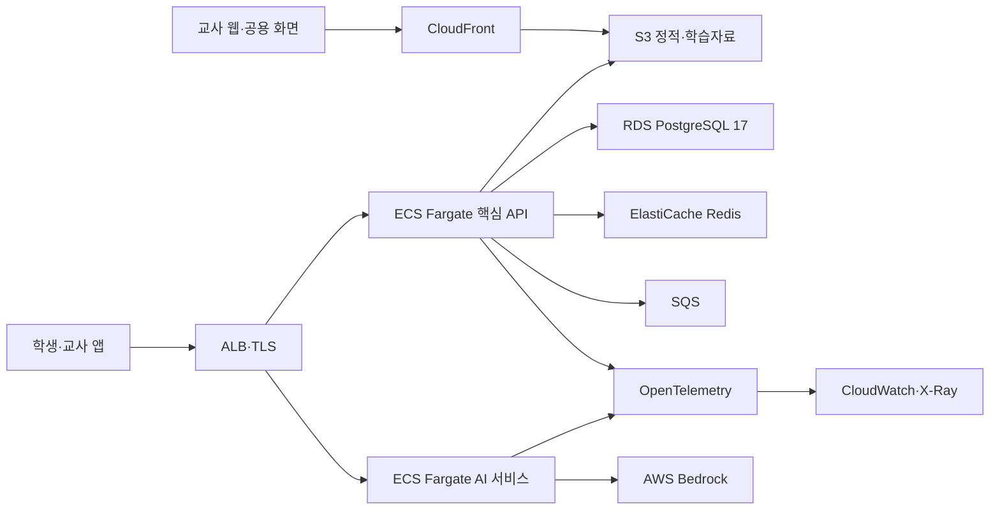

# 이코빌리지 인프라 기준선

- 기준일: 2026-07-29
- 상태: 개발 인프라·CI·Terraform 계약 확정, AWS 자원 미생성
- 기본 리전: `ap-northeast-2`

## 1. 지금 준비한 범위

| 영역 | 준비 내용 | 현재 검증 |
| --- | --- | --- |
| 로컬 실행 | PostgreSQL 17, Redis 7.4, OpenTelemetry Collector Compose 구성 | Docker 환경에서 기동 필요 |
| 공통 설정 | 비밀값이 없는 `.env.example`, Git ignore, Docker ignore | 정적 검사 |
| CI | Jenkins Declarative Pipeline, 계약·DB·Terraform·서비스 조건부 검사 | Jenkins 에이전트 연결 필요 |
| 백엔드 | Gradle 테스트·패키징·JUnit 결과·JAR 보관 | 로컬 Gradle 검증 |
| Terraform | CLI·AWS provider 범위, 서울 리전, 환경·태그·예산 입력 계약 | init·validate는 Terraform 환경에서 실행 |
| 관측성 | OTLP 수집 파이프라인과 Sentry·CloudWatch 연결 경계 | 실제 exporter 미연결 |

## 2. 지금 실제 AWS 자원을 만들지 않는 이유

다음 값이 확정되지 않은 상태에서 VPC·ECS·RDS 등을 만들면 비용과 구조를 다시
바꿀 가능성이 큽니다.

- 사용할 AWS 계정과 권한 경계
- 개발·스테이지·운영 환경 수
- 월 예산과 NAT Gateway 허용 여부
- 도메인, TLS 인증서와 외부 공개 방식
- RDS·ElastiCache 크기, 백업·보존기간
- Jenkins 에이전트 위치와 Docker 권한
- Terraform 원격 상태 S3 버킷과 접근 주체
- Sentry 조직·프로젝트와 알람 수신 채널

현재 Terraform은 인증 계정·리전·가용영역을 확인하는 안전한 읽기 전용 기준선만
포함합니다. `terraform apply`로 과금 자원을 생성하지 않습니다.

## 3. 목표 AWS 구성



교사 웹의 서버 렌더링이 필요한 경우 정적 S3 배포 대신 별도 ECS 서비스를
사용합니다. 이 선택은 실제 Next.js 화면 구현 후 확정합니다.

## 4. 구축 순서

### 개발 시작 전에 완료

- 공통 폴더와 환경변수
- PostgreSQL·Redis 로컬 구성
- Jenkinsfile과 서비스별 조건부 검사
- Terraform provider·환경·태그 계약
- 비밀정보 저장 금지와 MR 규칙

### 서비스 실행 골격이 나온 뒤

- 백엔드·AI·교사 웹 Dockerfile
- 로컬 Compose 서비스 연결
- ECR 저장소와 이미지 태그 규칙
- Jenkins 멀티브랜치·Docker 에이전트

### 첫 AWS 개발 배포 전에

- 원격 Terraform 상태와 잠금
- VPC·서브넷·보안그룹·ALB
- ECS Fargate·RDS·ElastiCache
- S3·CloudFront·SQS
- Secrets Manager 또는 Parameter Store
- CloudWatch·OpenTelemetry·Sentry
- 예산 경보와 백업·보존 정책

### 운영 전

- 부하·복구·장애 대응 테스트
- RDS 복구 훈련과 보안 점검
- 앱 EAS Build·Submit·Update 승인 단계
- 배포 승인·롤백·감사 기록

## 5. Jenkins 기준

Jenkins 에이전트에는 Java 21, Node.js, Terraform, Docker와 Python을 설치합니다.
기본 파이프라인은 다음을 수행합니다.

1. 계약·논리·물리·DB·인프라 정적 검사
2. `terraform fmt`, `init -backend=false`, `validate`
3. 백엔드 테스트·패키징과 JUnit 결과 수집
4. 프로젝트가 초기화된 학생 앱·교사 웹·AI 서비스만 조건부 검사
5. 기본값이 `true`인 `REQUIRE_DB_TESTS`로 PostgreSQL Testcontainers skip을 실패 처리

배포 단계는 아직 넣지 않습니다. AWS 계정·환경과 승인 방식이 확정된 후 별도
단계로 추가합니다.

## 6. Terraform 사용

```bash
cd infra/terraform
terraform fmt -recursive
terraform init -backend=false
terraform validate
terraform plan -var-file=dev.tfvars
```

실제 원격 상태를 사용하기 전 `backend.hcl.example`을 `backend.dev.hcl`로
복사해 비밀정보가 없는 환경별 파일을 만들고 상태 버킷 접근권한을 검토합니다.

```bash
terraform init -reconfigure -backend-config=backend.dev.hcl
```

환경별 backend·tfvars 파일은 Git에 올리지 않습니다. 상태 버킷은 버전 관리를
활성화하고 `use_lockfile = true`로 상태 잠금을 사용합니다. `terraform apply`는
팀 승인 전 실행하지 않습니다.
