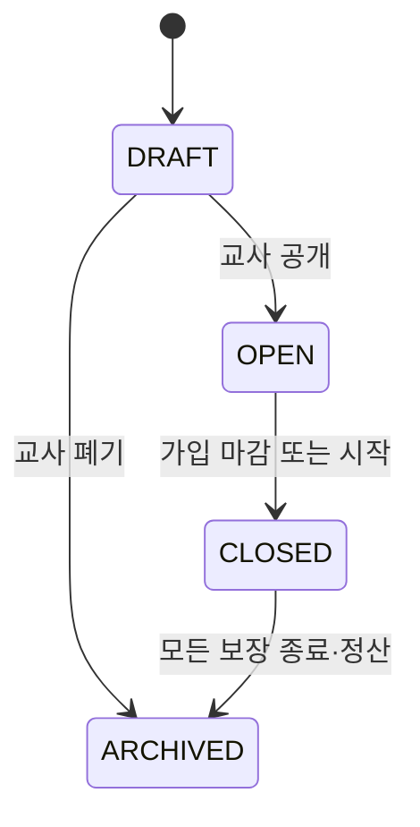
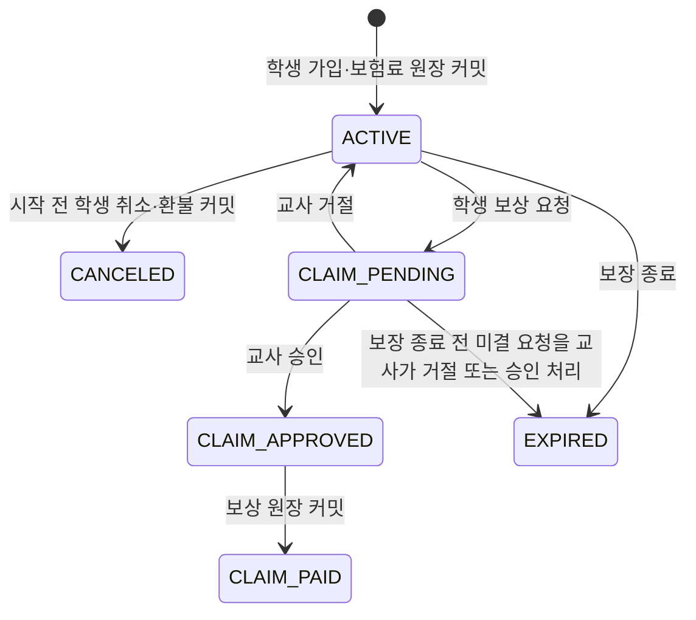

# 교육용 보험 MVP 정책·사용 흐름

- 상태: 결정안 (`S15P11B201-312`)
- 기준일: 2026-08-03
- 대상: 초등 5~6학년의 교실 경제 활동

이 문서의 보험은 실제 금융상품이나 확률형 보상이 아니다. 학생이 정해진 교실 활동에서 준비물·역할 수행에 필요한 가상 비용을 잃었을 때, 위험 분담과 원장 기록을 학습하는 **교실 활동 보장**이다. 실제 금전, 개인 신용, 건강·가정 정보, 도박성 요소는 다루지 않는다.

## 1. MVP 범위

### 포함

- 교사가 학급별 보장 상품을 만들고 공개·마감한다.
- 학생이 공개된 상품 하나에 가입하거나, 보장 시작 전 가입을 취소한다.
- 정해진 보장 사유가 발생하면 학생이 보상을 요청하고 교사가 승인 또는 거절한다.
- 보험료와 보상금은 각각 별도의 원장 거래로 한 번만 확정한다.
- 모든 판단은 공개된 규칙과 교사 확인으로 이루어진다.

### 제외

- 실제 보험 판매, 현금 환급, 개인 신용 평가, 이자·연체·벌금
- 주사위·룰렛·무작위 추첨과 확률에 따른 보상
- 건강, 가족사, 장애, 재산 등 민감정보를 근거로 한 가입·보상 판단
- 자동 심사, AI의 보상 승인·거절, 부분 보상, 재보험
- 학생 간 보험금 양도·거래와 교실 밖으로 이어지는 계약

## 2. 상품과 금액 규칙

학급당 동시에 공개할 수 있는 상품은 최대 3개이며, 학생은 같은 보장 기간에 하나만 가입할 수 있다. 교사는 다음의 안전한 사유 중에서만 하나 이상을 선택한다.

| 보장 사유 코드 | 수업에서의 의미 |
| --- | --- |
| `SUPPLY_LOSS` | 수업용 가상 준비물·도구를 잃어 재구매가 필요한 경우 |
| `ACTIVITY_CANCELLATION` | 교사 확인으로 맡은 활동을 수행하지 못해 가상 비용이 발생한 경우 |
| `TEAM_RESTORE` | 팀 전체가 같은 사고로 손실을 입어 역할 수행을 복구해야 하는 경우 |

금액은 정수 화폐 단위이며 음수·소수·학생별 차등 가격은 허용하지 않는다.

```text
보험료 = 상품에 고정한 premium_amount
보상금 = 상품에 고정한 benefit_amount
상품 준비금 = 이전 준비금 + 가입 보험료 합계 - 지급한 보상금 합계
```

- `premium_amount`: 10~200, `benefit_amount`: 10~1,000, `benefit_amount <= premium_amount * 10`
- 보장 기간: 1~4주 또는 교사가 정한 단일 활동 종료 시점까지
- 가입은 시작 전까지만 가능하며, 취소는 보장 시작 전 전액 환불한다.
- 준비금이 부족하면 승인 자체가 실패한다. 일부 지급이나 학생 지갑의 음수는 허용하지 않는다.
- 준비금 부족은 교사가 학급 정책으로 보충한 뒤 같은 요청을 다시 판단한다. 시스템이 화폐를 자동 발행하지 않는다.

## 3. 상태와 사용 흐름

### 3.1 상품



### 3.2 가입과 보상 요청



`CLAIM_APPROVED`는 외부에 보이는 안정 상태가 아니다. 동일 트랜잭션에서 준비금·학생 지갑·원장 항목이 모두 커밋될 때만 `CLAIM_PAID`가 된다. 실패하면 요청은 `CLAIM_PENDING`으로 돌아가며 실패 사유를 교사에게만 남긴다.

### 3.3 교사 화면

1. 보험 설정에서 보장 사유, 보험료, 보상금, 기간, 가입 정원을 입력해 `DRAFT`를 만든다.
2. 공개 전 학생별 차등·확률형 표현·금액 범위를 서버가 검사한다.
3. 공개 후 가입 현황과 준비금만 집계로 확인한다. 다른 학생의 보상 사유 상세는 보이지 않는다.
4. 보상 요청함에서 사유 코드와 학생이 입력한 짧은 설명을 확인하고 승인·거절한다.
5. 승인 결과와 원장 거래 ID를 확인하고, 종료 후 상품을 보관한다.

### 3.4 학생 화면

1. 금융/마을의 “교실 활동 보장” 카드에서 공개 상품의 사유·보험료·보상금·기간을 본다.
2. 가입을 누르면 현재 잔액을 다시 검사한 뒤 보험료 거래와 함께 `ACTIVE`가 된다.
3. 시작 전에는 취소할 수 있고, 시작 후에는 내 보장 상태와 요청 이력만 본다.
4. 보장 사유가 발생하면 하나의 요청을 제출한다. 교사 결정 전에는 수정·중복 요청할 수 없다.
5. 지급 또는 거절은 개인 채널로만 알리고, 학급·공용 화면에는 개인 금액을 보내지 않는다.

## 4. 원장·권한·예외

모든 금액 변경은 `AtomicLedgerTransactionService.execute()`와 동일한 원자 경계에서 처리한다.

| 시점 | transaction_type | 차변/대변 효과 | actor |
| --- | --- | --- | --- |
| 학생 가입 | `INSURANCE_PREMIUM` | 학생 지갑 `-보험료`, 보험 준비금 `+보험료` | `STUDENT` |
| 시작 전 해지 | `INSURANCE_CANCELLATION_REFUND` | 보험 준비금 `-보험료`, 학생 지갑 `+보험료` | `STUDENT` |
| 보상 지급 | `INSURANCE_CLAIM_PAYOUT` | 보험 준비금 `-보상금`, 학생 지갑 `+보상금` | `TEACHER` |
| 교사 준비금 보충 | `INSURANCE_POOL_FUNDING` | 정책상 지정된 공동기금/발행 계정에서 보험 준비금으로 이동 | `TEACHER` |

- 각 거래는 `INSURANCE_PRODUCT`, `INSURANCE_SUBSCRIPTION`, 필요 시 `INSURANCE_CLAIM` business ref를 가진다.
- 가입·해지·지급에는 요청 ID 기반 멱등성을 적용한다. 완료 거래는 수정·삭제하지 않고 정정 거래로만 보완한다.
- 학생은 본인 가입·요청만, `OWN` 교사는 담당 학급 상품·요청만, `COT` 교사는 읽기만 가능하다.
- `CLASSROOM_NOT_ACTIVE`, `MODULE_INACTIVE`, `PRODUCT_NOT_OPEN`, `COVERAGE_NOT_ACTIVE`, `ALREADY_SUBSCRIBED`, `CLAIM_ALREADY_PENDING`, `POOL_INSUFFICIENT`, `IDEMPOTENCY_CONFLICT`를 명시 오류로 반환한다.

## 5. 구현 계약

### API와 실시간 이벤트

| API/이벤트 | 주체 | 역할 |
| --- | --- | --- |
| `PUT /classrooms/{C}/insurance-products/{P}` | OWN | 상품 초안 저장·공개·마감 |
| `GET /classrooms/{C}/insurance-products` | STU, OWN, COT | 역할에 맞춘 상품/집계 조회 |
| `POST /classrooms/{C}/insurance-subscription-commands` | STU | 가입·시작 전 취소 |
| `POST /classrooms/{C}/insurance-claims` | STU | 보상 요청 |
| `POST /classrooms/{C}/insurance-claims/{R}/teacher-decisions` | OWN | 승인·거절 |
| `insurance.subscription.status_changed` | SELF | 가입·해지·만료 결과 |
| `insurance.claim.status_changed` | SELF, TEACHER | 요청·결정·지급 결과 |
| `insurance.pool.changed` | TEACHER | 개인 정보 없는 준비금 변화 |

### DB 초안

- `insurance_products`: 학급, 이름, 보장 사유 목록, 보험료, 보상금, 기간, 정원, 상태, 버전
- `insurance_subscriptions`: 상품, 학생, 가입 당시 금액 스냅샷, 상태, 가입/해지 시각, 거래 ID
- `insurance_claims`: 가입, 사유 코드, 학생 설명, 교사 결정 사유, 상태, 결정자/시각, 지급 거래 ID
- `ledger_accounts.system_owner_key = INSURANCE_POOL:{product_id}`: 상품별 준비금 계정
- 상품·가입·청구 상태 이력은 기존 `state_transitions`에 기록한다.

## 6. 후속 작업 분해와 검증

1. BE 스키마·엔티티·정책 검증과 상품 상태 머신
2. BE 가입/취소/청구/승인 명령 및 원장 원자 트랜잭션
3. 학생 앱 가입·내 보장·보상 요청 화면과 개인 실시간 동기화
4. 교사 웹 상품 설정·요청함·준비금 화면
5. OpenAPI/AsyncAPI, 권한·상태·원장·동시성 통합 테스트

필수 테스트는 금액 경계, 중복 가입·요청, 시작 후 취소 거부, 준비금 부족 시 무이동, 승인 재시도 멱등성, 교사 외 승인 거부, 개인 보상 정보의 공개 채널 누출 방지를 포함한다.
