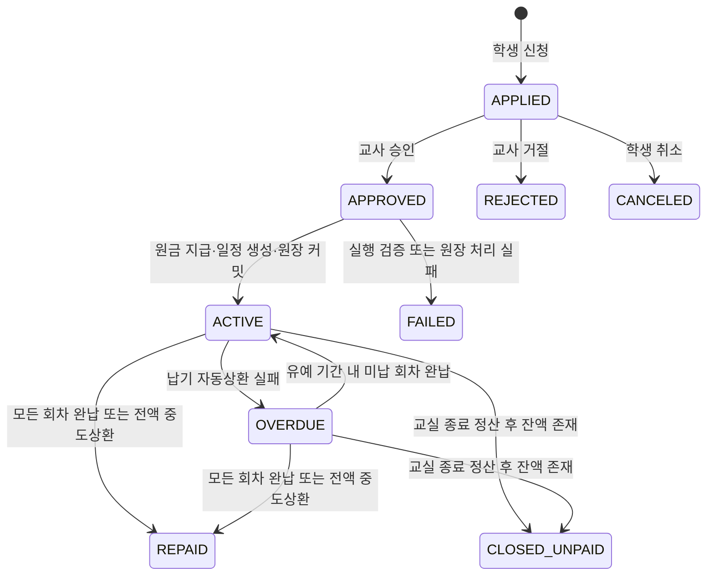

# 교육용 대출 MVP 정책·상환 흐름

- 상태: 결정됨 (S15P11B201-313)
- 기준일: 2026-08-03
- 범위: 교실 경제의 교육용 가상 대출. 실제 금융상품, 수수료, 복리, 채권 추심은 범위에서 제외한다.

이 문서는 `API_PRE_DESIGN_DECISIONS.md`, `DATA_MODEL.md`, `STATE_MACHINES.md`에 흩어진 대출 원칙을 MVP 구현에 필요한 단일 규칙으로 정리한다. 기존 기준 문서와 충돌하면 본 문서의 대출 MVP 결정이 우선한다.

## 1. MVP 결정

### 1.1 신청 가능 조건과 정책

학생은 다음 조건을 모두 만족할 때만 대출을 신청할 수 있다.

- 학급이 `ACTIVE`이고 대출 모듈이 `ACTIVE`이며, 학생에게 금융 명령이 허용된 유효 접근 모드여야 한다.
- 학생의 신용 등급이 `RESTRICTED`가 아니어야 한다.
- 같은 학생에게 `APPLIED`, `APPROVED`, `ACTIVE`, `OVERDUE` 중 하나인 대출 신청 또는 대출이 없어야 한다. MVP의 동시 대출 한도는 1건이다.
- 요청 금액은 현재 유효한 `loan_policy_versions.maximum_principal` 이하여야 한다.
- 요청 회차는 정책의 회차와 같아야 한다. MVP에서는 `term_units == installment_count`로 고정하며 둘 다 2~12회만 허용한다.

교사가 `API-FIN-010`으로 관리하는 정책은 아래 값을 가진다.

| 값 | MVP 규칙 |
| --- | --- |
| 최대 원금 | 학급별 교사가 정한다. 모듈 활성화 시 권장 기본값은 1회 기본 급여의 2배이며, 급여가 없는 학급은 교사가 명시적으로 입력한다. |
| 계약 금리 | `interest_rate_bps`는 연이율이 아니라 **대출 전체 기간에 한 번 적용하는 단리율**이다. 0~2,000bps(0~20%)만 허용한다. |
| 기간·회차 | 2~12 운영 단위, 매 운영 단위마다 1회 납부한다. |
| 유예 | 기본 3일이며 0~7일 범위에서 교사가 설정한다. |
| 신용 보정 | `GOOD -100bps`, `NORMAL 0bps`, `CAUTION +200bps`, `RESTRICTED`는 신규 신청 차단이다. 제한 등급 화면의 예상 금리는 참고용으로 `+400bps`를 표시한다. |

교사 승인 전에는 대출 원금, 원장 거래, 대출 레코드, 상환 일정이 만들어지지 않는다. 승인과 실행은 같은 요청에서 처리하되, 실제 지급·일정·원장 분개가 모두 성공한 경우에만 `ACTIVE`가 된다.

### 1.2 정책의 적용 범위

- 신청을 제출한 순간의 정책 버전, 기본 금리, 기간·회차·유예 값을 `loan_applications` 및 대출 정책 스냅샷에 고정한다.
- 승인 시에는 최신 신용 등급, 동시 대출 수, 모듈/학급 상태만 다시 확인한다. 이미 제출된 신청의 정책 조건은 바꾸지 않는다.
- 정책 변경은 이후의 신규 신청에만 적용한다. `ACTIVE`·`OVERDUE` 대출의 금리, 일정, 유예, 신용 보정에는 소급 적용하지 않는다.

## 2. 상태와 허용 전이

### 2.1 신청과 대출



| 상태 | 의미와 허용 동작 |
| --- | --- |
| `APPLIED` | 학생 신청 대기. 학생 취소와 교사 승인·거절만 가능하다. |
| `APPROVED` | 교사가 승인했지만 실행 커밋 전의 내부 상태다. API 응답으로 장시간 노출하지 않는다. |
| `ACTIVE` | 원장 지급과 상환 일정이 만들어진 정상 대출이다. 자동상환·유예 상환·전액 중도상환이 가능하다. |
| `OVERDUE` | 납기 자동상환에 실패한 대출이다. 유예 기간에 해당 회차를 전액 납부하면 `ACTIVE`로 돌아간다. |
| `REPAID` | 원금과 계약 이자를 모두 납부한 종료 상태다. |
| `REJECTED`, `CANCELED`, `FAILED` | 대출이 실행되지 않은 종료 상태다. 새 신청만 가능하다. `FAILED`에는 운영용 실패 코드와 사유를 남긴다. |
| `CLOSED_UNPAID` | 교실 종료 정산 후에도 남은 원금·이자가 있는 종료 상태다. 음수 지갑이나 추가 자동 청구를 만들지 않는다. |

`APPROVED -> ACTIVE`는 원금 지급, `loans`·`loan_installments` 생성, 원장 거래, 감사 이벤트를 하나의 트랜잭션으로 커밋한다. 어느 하나라도 실패하면 자산은 이동하지 않고 `FAILED` 사유만 남긴다. 실패한 신청은 수정하지 않고 새 신청으로 다시 시작한다.

### 2.2 회차 상태

회차 상태는 `SCHEDULED`, `PAID`, `MISSED`만 사용한다. 부분 출금·부분 납부는 허용하지 않는다.

- 납기 시각에 `SCHEDULED` 회차의 전액을 자동상환한다.
- 지갑 잔액이 부족하면 원장 거래를 만들지 않고 회차를 `MISSED`, 대출을 `OVERDUE`로 바꾼다.
- `grace_until` 이전에는 학생이 `RETRY_DUE_PAYMENT`로 해당 회차 전액을 다시 낼 수 있다.
- 유예 기간 안에 모든 `MISSED` 회차가 `PAID`가 되면 대출은 `ACTIVE`로 복귀한다. 유예가 끝나면 학생의 재시도는 `GRACE_WINDOW_EXPIRED`로 거절되고, 대출은 `OVERDUE`로 유지한다.

## 3. 금액 계산과 상환 예시

### 3.1 계산 규칙

대출 실행 시 아래 값을 고정한다. 이후 정책 변경이나 금리 변경으로 재계산하지 않는다.

```text
적용 금리(bps) = 정책 금리 + 승인 시 신용 보정
총 이자 = floor(원금 × 적용 금리 / 10,000)
총 상환액 = 원금 + 총 이자
```

원금과 이자는 각각 회차 수로 균등 배분한다. 앞의 회차에는 `floor(금액 / 회차)`를 배정하고, 나머지는 마지막 회차에 더한다. 모든 계산은 정수 통화 단위이며 반올림은 하지 않는다.

전액 중도상환은 남은 예정 원금과 남은 예정 이자를 한 번에 낸다. 중도상환 수수료와 별도 할인은 MVP에서 제공하지 않는다. 즉, 계약 시 확정된 단리 이자는 유지하되 추가 벌금은 없다.

### 3.2 예시

원금 1,000, 계약 금리 500bps(5%), `NORMAL`, 4회 상환이라면 다음과 같다.

```text
총 이자 = floor(1,000 × 500 / 10,000) = 50
총 상환액 = 1,050
원금 회차 = 250, 250, 250, 250
이자 회차 = 12, 12, 12, 14
납부액 = 262, 262, 262, 264
```

두 번째 납기일에 지갑 잔액이 200이면 200만 출금하지 않는다. 회차는 `MISSED`, 대출은 `OVERDUE`가 된다. 유예 종료 전 지갑에 262가 생긴 뒤 재시도하면 262를 한 번에 납부하고, 다른 미납이 없으면 다시 `ACTIVE`가 된다.

## 4. 원장·신용·종료 정산

### 4.1 원장 분개

모든 금액 이동은 `AtomicLedgerTransactionService`로 처리한다. 대출 도메인 상태 변경은 `LedgerDomainMutation`으로 같은 트랜잭션에 포함한다.

| 상황 | `transaction_type` | 분개 |
| --- | --- | --- |
| 실행 | `LOAN_DISBURSEMENT` | `LOAN_RECEIVABLE -원금`, `STUDENT_WALLET +원금` |
| 정기·유예 상환 | `LOAN_REPAYMENT` | `STUDENT_WALLET -(원금+이자)`, `LOAN_RECEIVABLE +원금`, `MONEY_ISSUANCE +이자` |
| 전액 중도상환 | `LOAN_PREPAYMENT` | 정기 상환과 같은 계정으로 남은 원금·이자를 한 번에 처리 |
| 교실 종료 정산 | `LOAN_CLOSE_SETTLEMENT` | 가능한 지갑 잔액만 위 상환 분개로 처리하고, 남은 금액은 `CLOSED_UNPAID`로 보존 |

실행 거래의 actor는 승인 교사(`TEACHER`), 학생의 수동 상환은 `STUDENT`, 자동상환·교실 종료 정산은 `SYSTEM`으로 기록한다. 각 거래는 `LOAN`과 `LOAN_INSTALLMENT` business reference를 가져야 하며, 요청 ID·라우트·행위자 기준 멱등성을 보장한다.

학생 지갑과 공동기금 계정은 음수를 허용하지 않는 기존 원장 규칙을 그대로 적용한다. 원장 부족 오류가 나면 도메인 변경도 커밋하지 않는다.

### 4.2 신용과 종료

- 신용 변경은 모든 경우 `credit_events`에 이전/이후 점수·등급, 사유, 관련 대출/회차를 기록한다.
- `RESTRICTED`는 신규 신청만 막는다. 이미 `ACTIVE` 또는 `OVERDUE`인 대출의 상환은 계속 허용한다.
- 신용 규칙의 구체적인 점수 임계값은 `loan_policy_versions.credit_adjustments`에 저장한다. MVP에서는 정시 상환의 개선과 연체의 하향만 처리하며, 장기 신용 산정은 후속 범위다.
- 교실 `CLOSING` 시 신규 신청·승인은 막는다. 시스템은 각 대출자의 가능한 지갑 잔액을 우선 상환하고, 부족한 잔액은 `CLOSED_UNPAID`와 미상환 원금·이자로 남긴다.

## 5. 구현 계약과 후속 작업

### 5.1 API와 화면

기존 HTTP 계약을 아래 내용으로 구현한다.

| API | 역할 | MVP 응답 핵심 |
| --- | --- | --- |
| `PUT /classrooms/{C}/loan-policy` | 교사 정책 저장 | 정책 버전, 한도, 금리, 회차, 유예, 신용 보정 |
| `POST /classrooms/{C}/loan-application-commands` | 학생 신청·취소 | 신청 ID, 상태, 정책·신용 스냅샷 |
| `POST /classrooms/{C}/loan-applications/{R}/teacher-decisions` | 교사 승인·거절 | 신청 상태, 대출 ID, 실행 거래 ID, 실패 사유 |
| `POST /classrooms/{C}/loans/{R}/repayment-commands` | 유예 재시도·전액 중도상환 | 대출 상태, 납부 회차, 거래 ID, 남은 원금·이자 |
| `GET /classrooms/{C}/students/me/loans-and-credit` | 학생 본인 조회 | 신청 가능 여부, 신용, 대출, 회차, 다음 납기일, 미상환액 |

학생 화면 `SCR-STU-019`는 신청 가능 여부·교사 승인 대기·상환 일정·다음 납기일·연체/유예·전액 중도상환 금액을 보여준다. 교사 화면 `SCR-WEB-016`은 정책 편집과 승인 대기열, 승인/거절 사유, 학생별 대출·연체 현황을 제공한다. 개인 잔액·신용·대출 상세는 본인과 담당 교사만 볼 수 있다.

### 5.2 백엔드 작업 분해

1. `loan_policy_versions`, `loan_applications`, `loans`, `loan_installments`, `credit_profiles`, `credit_events`의 엔티티·리포지토리·상태 제약을 구현한다.
2. 정책 저장과 신청/취소, 교사 승인/거절 명령을 구현한다. 승인 직전 신용·동시 대출·모듈·학급 상태를 재검증한다.
3. 대출 실행과 수동 상환을 원장 원자 트랜잭션으로 구현한다. `LOAN_RECEIVABLE` 시스템 계정과 학생 지갑을 생성/조회한다.
4. 납기 자동상환·유예 종료·교실 종료 정산 스케줄러를 구현한다. 스케줄러는 같은 회차를 여러 번 실행해도 중복 거래가 생기지 않아야 한다.
5. 상환·대출·신용 변경을 학급/학생 실시간 채널에 공개 범위에 맞춰 발행한다. 개인 금액은 공개 채널 payload에 포함하지 않는다.
6. 학생·교사 UI와 OpenAPI/AsyncAPI 계약, 권한·상태 전이 테스트를 연결한다.

### 5.3 필수 검증 시나리오

- `RESTRICTED`, 모듈 비활성, 동시 대출 존재, 한도 초과 신청이 모두 거절된다.
- 승인 전에는 학생 지갑·원장·대출·상환 일정이 변하지 않는다.
- 승인 성공 시 원금 지급, 대출 생성, 2~12회 일정, 원장 거래가 모두 생성되며 재시도에도 한 번만 실행된다.
- 승인 직전에 신용이나 동시 대출 상태가 바뀌면 실행 없이 거절된다.
- 납기 잔액 부족 시 부분 출금 없이 `MISSED`/`OVERDUE`가 되고, 유예 안의 전액 납부만 성공한다.
- 전액 중도상환과 마지막 정기 상환이 `REPAID`로 종료하며, 이중 상환이 불가능하다.
- 정책 변경 후 기존 대출은 기존 스냅샷을 유지하고 새 신청만 새 정책을 사용한다.
- 교실 종료 정산에서 지갑 음수를 만들지 않고 `CLOSED_UNPAID` 금액을 보존한다.
