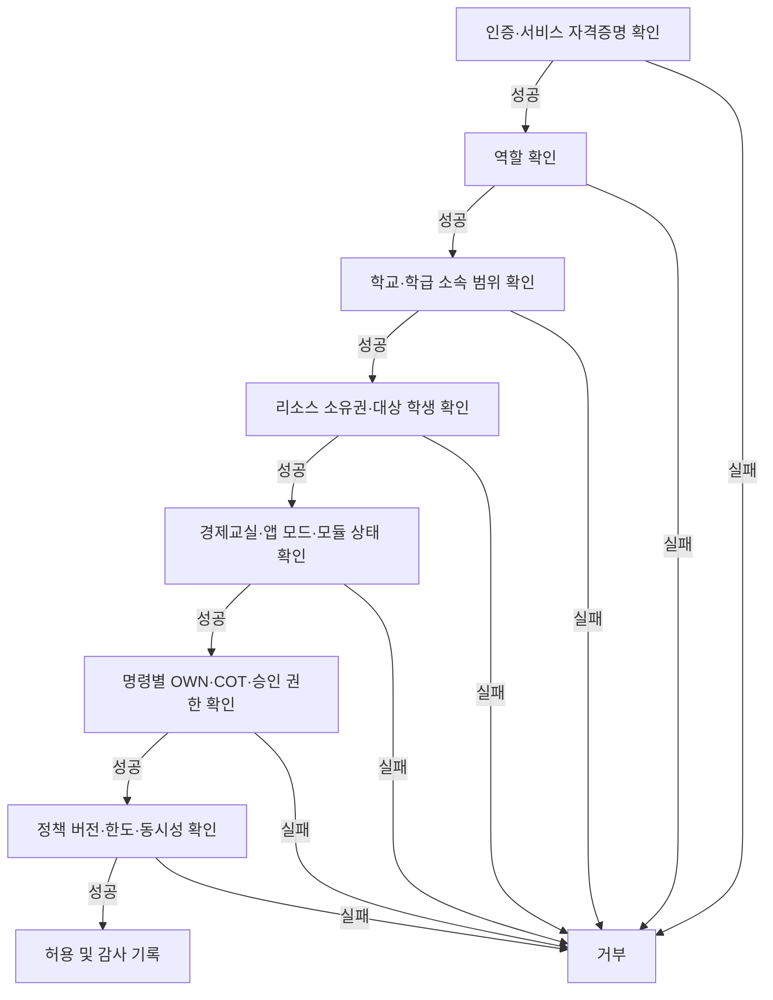

# 이코빌리지 역할·권한 매트릭스

- 버전: v0.2
- 기준일: 2026-07-29
- 상태: 요구사항·상태 머신·화면 행동 기반 권한 설계
- 범위: 학생 앱, 교사용 앱, 관리 웹, 공용 화면, 핵심 API, AI와 운영 인프라

## 1. 권한 원칙

1. 화면이 아니라 핵심 API에서 권한을 최종 판단합니다.
2. 교사용 앱과 관리 웹은 같은 역할·권한 규칙을 사용합니다.
3. 명시적으로 허용되지 않은 명령은 기본 거부합니다.
4. 역할, 학교·학급 소속, 리소스 소유권, 현재 상태와 모듈 상태를 모두 통과해야 합니다.
5. 학생은 본인 데이터와 본인에게 허용된 명령만 사용합니다.
6. 교사는 소유하거나 공동 담당으로 배정된 학급에만 접근합니다.
7. AI와 공용 화면에는 사람 역할을 부여하지 않고 목적이 제한된 서비스 권한만 제공합니다.
8. 시스템 자동처리는 사용자 권한을 우회하지 않고 정책과 상태 머신이 허용한 내부 명령만 실행합니다.
9. 금액·아이템·평가·개인정보 변경과 민감한 조회는 실행자와 사유를 감사 기록에 남깁니다.
10. MVP에서는 공동 담당 교사의 권한을 개별 체크박스로 커스텀하지 않고 고정 역할로 운영합니다.

권한 규칙 ID는 `PM-{영역}-{번호}` 형식을 사용합니다.

## 2. 역할과 범위

| 코드 | 역할 | 접근 범위 | 핵심 책임 |
| --- | --- | --- | --- |
| STU | 학생 | 본인 계정과 현재 소속 학급 | 자율 경제활동, 개인거래 제안·동의, 금융 신청, 퀴즈 참여 |
| OWN | 학급 소유 교사 | 본인이 소유한 학급 | 학급 구조·정책·모듈·담당 교사·종료의 최종 책임 |
| COT | 공동 담당 교사 | 담당으로 배정된 학급 | 수업 진행, 거래·대출 승인, 상품 수령, 복구와 일상 운영 |
| SAD | 학교 관리자 | 소속 학교 | 교사 계정·학교 설정·기기·학급 메타데이터·학교 감사 |
| POP | 플랫폼 운영자 | 플랫폼 운영 환경 | 배포·인프라·AI 공급자·전역 콘텐츠 권리 검토·시스템 장애 대응 |
| SYS | 시스템 행위자 | 정책으로 허용된 내부 작업 | 일정, 만기, 상환, 정산, 알림, 보존·삭제 작업 |
| AIS | AI 서비스 | 핵심 API가 전달한 최소 구조화 입력 | 설명·초안·선택지 생성 |
| DSP | 공용 화면 세션 | 연결된 지도 활동의 공개 데이터 | 문제·타이머·익명 집계·허용된 결과 표시 |

- 경제교실에는 OWN이 정확히 1명 존재하고 COT는 0명 이상일 수 있습니다.
- 일반 교사가 경제교실을 생성하면 해당 학급의 OWN이 됩니다.
- 역할은 학급별로 판정하므로 같은 교사 계정이 A학급의 OWN이면서 B학급의 COT일 수 있습니다.
- SAD와 POP는 교사의 수업 운영 권한을 자동으로 상속하지 않습니다.
- SYS·AIS·DSP는 로그인 사용자가 아니라 목적이 제한된 기술 주체입니다.

## 3. 소유 교사와 공동 담당 교사

### 3.1 둘 다 가능한 일

- 담당 학급 조회와 수업 리포트 확인
- 자율시간 수동 열기·닫기
- 퀴즈·투표·AI 이벤트 등 지도 활동 시작·종료
- 퀴즈 작성·검토·승인과 결과 확정
- 개인거래·대출 신청 승인·거절
- 실제 상품 준비·수령 확인
- 사유를 입력한 복구 거래 요청
- 교사용 AI 챗봇과 AI 초안 사용
- 학급 PDF·CSV 내보내기

### 3.2 소유 교사만 가능한 일

- 공동 담당 교사 초대·해제와 소유권 이전
- 학년, 추천 규모, 운영기간, 학생 명단과 역할급여 변경
- 코스 선택과 모듈 추가·중지
- 반복 자율시간 일정 변경
- 가격, 재고, 세금, 금리, 물가, 투자한도와 대출 정책 변경
- 세금·공동기금 사용처 변경
- AI 밸런싱 제안의 경제정책 적용
- 학급 AI 기능 전체 끄기
- 경제교실 CLOSING 시작

구조·정책 변경은 학급 전체 자산과 수업 흐름에 영향을 주므로 소유 교사에게만 허용합니다. 공동 담당 교사는 수업이 중단되지 않도록 일상 운영 권한을 갖되 다른 교사의 권한이나 학급 기준선을 바꿀 수 없습니다.

### 3.3 소유권 이전

- OWN은 현재 COT 중 한 명에게만 소유권 이전을 요청할 수 있습니다.
- 대상 COT가 수락하면 한 트랜잭션에서 기존 OWN을 COT로, 대상 COT를 OWN으로 변경합니다.
- SAD는 소유 교사가 학교를 떠났거나 접근할 수 없는 경우 사유를 입력해 기존 COT에게 긴급 이전할 수 있습니다.
- COT가 없다면 SAD가 학교 소속 교사를 먼저 COT로 배정한 뒤 이전합니다.
- 소유권 공백과 복수 OWN 상태는 허용하지 않습니다.

## 4. 매트릭스 표기

| 표기 | 의미 |
| --- | --- |
| ✓ | 역할·범위·상태 조건을 만족하면 허용 |
| 본인 | 본인의 리소스만 허용 |
| 담당 | 소유·공동 담당 학급만 허용 |
| 승인 | 승인·거절 명령만 허용 |
| 집계 | 개인 식별정보가 없는 집계만 허용 |
| 자동 | 사용자 호출 없이 정책에 따른 내부 작업만 허용 |
| 입력 | 핵심 API가 전달한 최소 데이터 입력만 허용 |
| 공개 | 공개 스키마로 변환된 데이터만 허용 |
| 복구 | 비상 소유권 이전 등 명시된 복구 명령만 허용 |
| — | 금지 |

## 5. 인증·역할·학급 권한

| 규칙 ID | 명령·데이터 | STU | OWN | COT | SAD | POP | SYS | AIS | DSP |
| --- | --- | --- | --- | --- | --- | --- | --- | --- | --- |
| PM-AUTH-001 | 학생 로그인·본인 세션 | 본인 | — | — | — | — | 검증 | — | — |
| PM-AUTH-002 | 학생 비밀번호 재설정 | 요청 | 담당 | 담당 | 복구 | — | 토큰 | — | — |
| PM-RBAC-001 | 역할·소속 조회 | 본인 | 담당 | 담당 | 학교 | 운영 메타 | 검증 | — | — |
| PM-RBAC-002 | 다른 학교·미담당 학급 접근 | — | — | — | — | — | — | — | — |
| PM-CLS-001 | 경제교실 생성 | — | ✓ | — | — | — | — | — | — |
| PM-CLS-002 | COT 초대·해제 | — | 담당 | — | 복구 | — | — | — | — |
| PM-CLS-003 | OWN 소유권 이전 | — | 담당 | 수락 | 복구 | — | 원자처리 | — | — |
| PM-CLS-004 | 학생 명단·번호·닉네임 정정 | — | 담당 | 조회 | 학교 메타 | — | — | — | — |
| PM-CLS-005 | 학년·규모·기간·역할급여·코스 변경 | — | 담당 | 조회 | 학교 메타 | — | — | — | — |
| PM-CLS-006 | 경제교실 CLOSING 시작 | — | 담당 | 조회 | 조회 | — | 정산 | — | — |

세부 규칙:

- 학생 로그인 실패 횟수로 계정 상태를 잠그지 않습니다.
- 비밀번호 재설정은 기존 이코빌리지 본인 확인 흐름을 사용하고 OWN·COT가 담당 학급 요청을 처리할 수 있습니다.
- 로그인 복구 과정에서 닉네임을 재설정하지 않습니다.
- 닉네임 오탈자 정정은 OWN이 학생 명단 관리에서 수행하고 감사 기록을 남깁니다.
- COT는 다른 COT를 초대하거나 해제할 수 없습니다.

## 6. 학급 운영·정책·모듈

| 규칙 ID | 명령·데이터 | STU | OWN | COT | SAD | POP | SYS | AIS | DSP |
| --- | --- | --- | --- | --- | --- | --- | --- | --- | --- |
| PM-CLS-007 | 반복 자율시간 일정 변경 | — | 담당 | 조회 | — | — | 계산 | — | — |
| PM-CLS-008 | 학생 앱 수동 열기·닫기 | — | 담당 | 담당 | — | — | 반영 | — | — |
| PM-MOD-001 | 모듈 추가·중지 | — | 담당 | 조회 | — | — | 정리 | — | — |
| PM-POL-001 | 급여·가격·재고·세율·금리·물가·한도 정책 변경 | — | 담당 | 조회 | — | — | 적용 | — | — |
| PM-POL-002 | 세금·공동기금 사용처 변경 | — | 담당 | 조회 | — | — | — | — | — |
| PM-ACT-001 | 지도 활동 준비·시작·종료 | 참여 | 담당 | 담당 | — | — | 타이머 | — | 공개 |
| PM-ACT-002 | 투표·퀴즈 결과 확정 | 본인결과 | 담당 | 담당 | — | — | 계산 | — | 공개 |
| PM-DSP-001 | 공용 화면 연결·해제 | — | 담당 | 담당 | — | — | 공개변환 | — | 공개 |

- COT는 반복 일정을 바꾸지 않고 필요할 때 수동으로 열고 닫을 수 있습니다.
- 모듈 추가·중지와 경제정책 변경은 OWN만 요청하고 SYS가 상태·활성 데이터를 검증해 적용합니다.
- GUIDED 활동 중에는 해당 활동 명령 외 학생 경제 명령을 차단합니다.
- DSP에는 개인 잔액·세금·금융·평가 원본과 실명이 포함되지 않습니다.

## 7. 지갑·상점·개인거래

| 규칙 ID | 명령·데이터 | STU | OWN | COT | SAD | POP | SYS | AIS | DSP |
| --- | --- | --- | --- | --- | --- | --- | --- | --- | --- |
| PM-TXN-001 | 지갑·원장·정책 스냅샷 조회 | 본인 | 담당 | 담당 | 집계 | 운영 메타 | 기록 | — | — |
| PM-TXN-002 | 급여·활동 보상 실행 | — | 담당 | 담당 | — | — | 자동 | — | — |
| PM-TXN-003 | 완료 거래 복구 요청 | — | 담당 | 담당 | — | — | 실행 | — | — |
| PM-SHP-001 | 상점 카탈로그·가격·부가세·재고 관리 | 조회 | 담당 | 조회 | — | — | — | — | — |
| PM-SHP-002 | 상품 구매 | 본인 | — | — | — | — | 검증 | — | — |
| PM-SHP-003 | 실제 상품 준비·수령 확인 | 본인상태 | 담당 | 담당 | — | — | 기록 | — | — |
| PM-CNT-001 | 캐릭터 원작 권리 검토·전역 게시 | — | 선택 | 조회 | — | ✓ | 기록 | — | — |
| PM-ITM-001 | 본인 캐릭터·아이템 장착·해제 | 본인 | 담당조회 | 담당조회 | — | — | 검증 | — | — |
| PM-TRD-001 | 개인거래 작성·취소 | 본인 | 조회 | 조회 | — | — | 검증 | — | — |
| PM-TRD-002 | 상대 거래 동의·거절 | 본인 | 조회 | 조회 | — | — | 검증 | — | — |
| PM-TRD-003 | 개인거래 승인·거절 | — | 승인 | 승인 | — | — | 정산 | — | — |

- OWN·COT는 완료 거래를 편집·삭제할 수 없고 사유가 있는 복구 거래만 요청할 수 있습니다.
- 복구 거래를 COT가 요청하면 OWN에게 알림을 보냅니다.
- 학생은 정상 완료 구매와 개인거래를 취소·환불할 수 없습니다.
- POP가 권리 검토와 출처 기록을 완료한 캐릭터 원작만 OWN이 학급 상품으로 선택할 수 있습니다.
- 학생은 본인이 소유한 `AVAILABLE` 아이템만 장착할 수 있고 `LOCKED_TRADE` 아이템은 장착·해제할 수 없습니다.
- SAD와 POP는 학생 개인 잔액과 원장 내용을 기본 권한으로 조회하지 않습니다.

## 8. 금융

| 규칙 ID | 명령·데이터 | STU | OWN | COT | SAD | POP | SYS | AIS | DSP |
| --- | --- | --- | --- | --- | --- | --- | --- | --- | --- |
| PM-FIN-001 | 예금·적금·투자·대출 상품 정책 생성·변경 | 조회 | 담당 | 조회 | — | — | 검증 | — | — |
| PM-FIN-002 | 예금·적금 가입·해지·납입 | 본인 | 담당조회 | 담당조회 | — | — | 자동납입 | — | — |
| PM-FIN-003 | 투자 매수·매도 | 본인 | 담당조회 | 담당조회 | — | — | 체결 | — | — |
| PM-FIN-004 | 투자 시장 시작·일시정지·종료 | 조회 | 담당 | 담당 | — | — | 정산 | — | — |
| PM-FIN-005 | 대출 신청·취소 | 본인 | 담당조회 | 담당조회 | — | — | 검증 | — | — |
| PM-FIN-006 | 대출 승인·거절 | — | 승인 | 승인 | — | — | 실행 | — | — |
| PM-FIN-007 | 대출 상환·중도상환 | 본인 | 담당조회 | 담당조회 | — | — | 자동상환 | — | — |
| PM-FIN-008 | 신용 상태 조회 | 본인 | 담당 | 담당 | — | — | 계산 | — | — |
| PM-FIN-009 | 교실 종료 금융 정산 | 조회 | 시작 | 보조 | — | — | 자동 | — | — |

- 상품 조건과 경제정책은 OWN만 변경합니다.
- COT는 투자 시장의 수업 진행을 위해 OPEN·PAUSED·CLOSED 명령을 실행할 수 있지만 가격 시나리오·한도·금리를 변경할 수 없습니다.
- 대출 승인자는 실행 직전 최신 신용·잔액·동시 대출 수와 정책을 다시 확인해야 합니다.
- 신용 상태와 대출 상세는 본인과 담당 OWN·COT만 조회합니다.
- 종료 강제 정산은 OWN의 CLOSING 시작을 근거로 SYS가 수행합니다.

## 9. 퀴즈·AI

| 규칙 ID | 명령·데이터 | STU | OWN | COT | SAD | POP | SYS | AIS | DSP |
| --- | --- | --- | --- | --- | --- | --- | --- | --- | --- |
| PM-QZ-001 | 문제 작성·수정·승인·문제은행 | — | 담당 | 담당 | — | — | 버전처리 | 초안 | — |
| PM-QZ-002 | 퀴즈 시작·종료·재채점·결과 확정 | 참여 | 담당 | 담당 | — | — | 계산 | — | 공개 |
| PM-QZ-003 | 오류 문항 신고 | 본인 | 담당 | 담당 | — | — | 기록 | — | — |
| PM-QZ-004 | 개인 평가 결과 조회 | 본인 | 담당 | 담당 | — | — | — | — | — |
| PM-AI-001 | 교사용 AI 챗봇·분석 요청 | — | 담당 | 담당 | — | — | 입력구성 | 입력 | — |
| PM-AI-002 | AI 퀴즈·이벤트 초안 요청·승인·거절 | — | 담당 | 담당 | — | — | 검증·적용 | 초안 | 공개후 |
| PM-AI-003 | AI 밸런싱 제안 조회 | — | 담당 | 담당 | 집계 | — | 지표 | 설명 | — |
| PM-AI-004 | AI 밸런싱 경제정책 적용 | — | 담당 | — | — | — | 적용 | — | — |
| PM-AI-005 | 학급·학교 AI 기능 끄기 | — | 학급 | — | 학교 | — | 차단 | — | — |
| PM-AI-006 | 모델 공급자·전역 한도 변경 | — | — | — | — | ✓ | 적용 | — | — |

- 학생은 AI 생성 화면·프롬프트·교사 챗봇에 접근하지 않습니다.
- AIS는 핵심 API가 전달한 가명화·집계·최소 입력만 받고 데이터베이스를 직접 조회하지 않습니다.
- AIS는 정책, 학생 계좌, 거래, 투자 가격과 문제 게시 상태를 직접 변경하지 않습니다.
- AI 퀴즈·이벤트는 OWN 또는 COT 승인 후 핵심 API가 상태와 규칙을 재검증합니다.
- 세율·물가·가격·보상·금리를 바꾸는 AI 밸런싱 제안은 OWN만 적용할 수 있습니다.
- SAD는 학교 전체 AI 사용을 끌 수 있지만 모델 공급자와 학급 경제정책은 바꿀 수 없습니다.

## 10. 데이터·관리·운영

| 규칙 ID | 명령·데이터 | STU | OWN | COT | SAD | POP | SYS | AIS | DSP |
| --- | --- | --- | --- | --- | --- | --- | --- | --- | --- |
| PM-DAT-001 | ACTIVE·READ_ONLY 개인·학급 데이터 조회 | 본인 | 담당 | 담당 | 집계 | 운영 메타 | 처리 | 입력 | 공개 |
| PM-DAT-002 | 학생 개인 리포트 | 본인 | 담당 | 담당 | — | — | 생성 | — | — |
| PM-DAT-003 | 학급 PDF·CSV 내보내기 | — | 담당 | 담당 | 학교 감사 | — | 생성 | — | — |
| PM-DAT-004 | 코스·모듈·승인 퀴즈 복사 | — | 담당 | 담당 | — | — | 검증 | — | — |
| PM-DAT-005 | 학급 감사 기록 조회 | — | 담당 | 담당 | 학교 | 운영 메타 | 기록 | — | — |
| PM-DAT-006 | 보존기간 만료·식별 연결 삭제 | — | — | — | 조회 | — | 자동 | — | — |
| PM-OPS-001 | 교사 계정·학교 기기·학교 설정 | — | — | — | ✓ | — | 기록 | — | — |
| PM-OPS-002 | 배포·인프라·시스템 로그 | — | — | — | 상태조회 | ✓ | 기록 | — | — |
| PM-SVC-001 | 내부 서비스 호출·자격증명 | — | — | — | — | 발급·폐기 | 제한호출 | 제한호출 | 제한구독 |

- STU는 READ_ONLY 후 30일까지 본인 기록을 조회하고 이후 접근할 수 없습니다.
- OWN·COT와 SAD는 보존기간 1년 동안 허용 범위의 조회·내보내기를 사용할 수 있습니다.
- SAD의 학교 감사 내보내기는 학교 정책상 필요한 학급과 기간을 지정하고 사유를 남깁니다.
- POP는 서비스 상태·추적 ID·오류 메타데이터를 조회하지만 학생 개인 금융 내용은 기본 로그에 포함하지 않습니다.
- AIS 원문·기기 연결은 30일, AI 실행 메타데이터는 1년 보관하며 삭제는 SYS만 수행합니다.
- 학급 복사는 학생 자산·거래·금융·학습데이터를 포함하지 않습니다.

## 11. 상태별 권한 게이트

### 11.1 경제교실 상태

| 상태 | STU | OWN | COT | SAD·POP | SYS |
| --- | --- | --- | --- | --- | --- |
| ACTIVE | 앱 모드·모듈에 따른 명령 | 전체 소유 권한 | 일상 운영 권한 | 허용된 관리·운영 메타 | 일정·정상 자동처리 |
| CLOSING | 조회만 | 정산 시작·확인 | 실제 상품·승인 대기 정리 보조 | 조회 | 금융·거래·스냅샷 정산 |
| READ_ONLY | 30일 본인 조회 | 조회·내보내기 | 조회·내보내기 | 허용 범위 조회 | 보존 작업 |
| ARCHIVED | 접근 금지 | 보존기간 내 조회·내보내기 | 보존기간 내 조회·내보내기 | 허용 범위 조회 | 만료·삭제 작업 |

### 11.2 학생 앱 모드

| 모드 | 학생 명령 |
| --- | --- |
| CLOSED | 로그인, 공지, 허용된 과거 기록 조회만 가능 |
| AUTONOMOUS | ACTIVE 모듈의 본인 경제 명령 가능 |
| GUIDED | 현재 지도 활동의 조회·제출만 가능 |

### 11.3 모듈 상태

| 상태 | 신규 학생 명령 | 교사 명령 | 시스템 명령 |
| --- | --- | --- | --- |
| DISABLED | 금지 | OWN 활성화, 과거 기록 조회 | 조회·보존 |
| ACTIVE | 앱 모드와 역할에 따라 허용 | OWN 설정, OWN·COT 운영 | 일정·정산 |
| STOPPING | 금지 | OWN 상태 확인, OWN·COT 허용된 정리 | 모듈별 정리·완료 |

권한이 있더라도 상태 머신에서 허용하지 않는 전이는 실행할 수 없습니다.

## 12. 권한 판정 순서

하나라도 실패하면 금액·아이템·상태를 변경하지 않습니다.

권한 판정 결과에 포함할 값:

| 필드 | 의미 |
| --- | --- |
| `decision` | ALLOW 또는 DENY |
| `rule_id` | 적용한 PM 규칙 ID |
| `actor_type` | STU·OWN·COT·SAD·POP·SYS·AIS·DSP |
| `scope` | SELF·OWNED_CLASS·ASSIGNED_CLASS·SCHOOL·PLATFORM·PUBLIC |
| `resource_id` | 대상 학급·학생·거래·상품·활동 |
| `state_version` | 판정에 사용한 상태 버전 |
| `reason_code` | 허용·거부 사유 코드 |
| `decided_at` | 서버 판정 시각 |

## 13. 공통 거부 사유

| 코드 | 의미 |
| --- | --- |
| AUTH_REQUIRED | 인증 또는 서비스 자격증명 없음 |
| ROLE_NOT_ALLOWED | 역할에 명령 권한 없음 |
| CLASS_NOT_ASSIGNED | 소유·담당 학급이 아님 |
| OWNER_REQUIRED | 학급 소유 교사만 가능한 명령 |
| RESOURCE_NOT_OWNED | 학생 본인 소유 리소스가 아님 |
| CLASS_NOT_ACTIVE | 경제교실 상태가 명령을 허용하지 않음 |
| APP_MODE_BLOCKED | 학생 앱 모드가 명령을 허용하지 않음 |
| MODULE_NOT_ACTIVE | 모듈이 ACTIVE가 아님 |
| INVALID_STATE_TRANSITION | 현재 리소스 상태에서 전이할 수 없음 |
| APPROVAL_REQUIRED | 교사 승인 전 실행할 수 없음 |
| PUBLIC_DATA_ONLY | 공용 화면 공개 스키마를 벗어난 요청 |
| AI_DIRECT_WRITE_FORBIDDEN | AI가 직접 변경을 요청함 |
| SERVICE_SCOPE_VIOLATION | 내부 서비스의 허용 목적·데이터 범위를 벗어남 |

HTTP 상태와 오류 응답 형식은 API·오류 명세에서 연결합니다.

## 14. 필수 감사 대상

다음 행위는 성공·실패 모두 기록합니다.

- OWN·COT·SAD·POP 역할 변경과 소유권 이전
- 학생 명단·닉네임 정정과 비밀번호 재설정
- 코스·모듈·정책·자율시간 일정 변경
- 학생 앱 수동 열기·닫기와 지도 활동 시작·종료
- 급여·보상·복구 거래
- 개인거래·대출 승인·거절
- 실제 상품 수령과 운영 종료 정산
- 퀴즈 문제 승인·무효화·결과 확정
- AI 요청·검증·승인·거절·적용
- 리포트·CSV 내보내기와 학교 감사 조회
- 보존기간 만료·식별정보 삭제
- 플랫폼 설정·AI 공급자·서비스 자격증명 변경

감사 기록에는 실행자, 역할, 대상, PM 규칙 ID, 전후 상태, 사유, 요청번호, IP·기기 식별 메타데이터와 시각을 남깁니다. 비밀번호·토큰·AI 원문과 불필요한 학생 개인정보는 감사 로그에 저장하지 않습니다.

## 15. 후속 설계 순서

화면과 행동 경계는 [화면 ID·행동 명세](SCREEN_SPEC.md)를 따릅니다.

HTTP API별 역할·범위·PM 규칙 연결은 [HTTP API 명세](HTTP_API_SPEC.md)에서 완료했습니다.

1. WebSocket 채널·구독·공개 이벤트 권한 연결
2. 오류 코드와 감사 이벤트 세부화
3. 데이터 엔티티의 소유·소속·상태 필드 설계
4. 역할·상태·리소스 조합 인수 테스트 작성

ERD는 화면·API 경계를 확정한 뒤 진행합니다.
