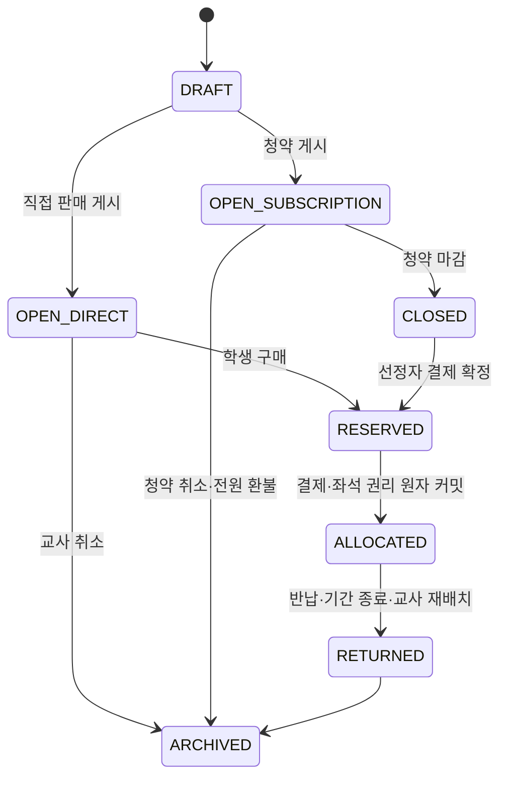

# 교육용 좌석 이용권(부동산) MVP 정책·거래 흐름

- 상태: 보강 결정안 (`S15P11B201-315`)
- 대상: 초등 6학년 교실 경제 활동
- 선행 조건: `REAL_ESTATE` 모듈이 `ACTIVE`, 교사가 좌석 배치도를 확정함

부동산은 실제 주택·토지 소유나 투자 상품이 아니다. 학급 안의 실제 **자리(좌석)를 선택해 이용할 수 있는 기간형 권리**를 통해 희소성, 예산, 선택의 기회비용을 배우는 활동이다. 데이터 모델의 `ownership`은 구현상 권리 배정 기록일 뿐 법적·사회적 소유권을 뜻하지 않는다. 실제 주소·건물·현금·수익 보장·대출 권유·전매는 포함하지 않는다.

## 1. 좌석 기반 모델과 학습권 경계

### 1.0 배치도와 경제 권리의 분리

자리 모듈은 경제 모듈보다 먼저 동작하는 독립적인 학급 운영 기능이다. 교사는 `관리 → 자리배치`에서 행·열을 정하고, 통로·교사 공간·사용 제외 좌석을 표시한 뒤 학생 카드를 드래그해 기본 자리를 배정한다. 학생 프로필과 학생 화면은 항상 이 기본 자리 또는 이용권으로 확정된 자리를 조회한다.

경제 기능은 이 배치도를 바꾸지 않고, 배치도 위의 특정 좌석에만 **기간형 우선 선택권**을 덧씌운다. 따라서 다음 두 상태를 분리해서 저장한다.

| 계층 | 책임 | 변경 주체 |
| --- | --- | --- |
| `seat_layout`·기본 배정 | 교실의 행·열·통로와 학생의 현재 수업 자리 | 교사 |
| `seat_use_right`·경제 배정 | 한정 좌석을 선택할 수 있는 기간·결제·환급 이력 | 학생 요청, 교사 감독, 원장 |

이 분리를 지키면 경제 모듈을 끄거나 학기 중 자리배치를 고쳐도 학생의 기본 수업 자리가 사라지지 않는다. 이용권이 없는 학생도 기본 자리로 수업에 참여하며, 이용권이 끝나면 교사가 기본 배치도 기준으로 재배정한다.

### 1.1 좌석과 이용권

- 교사는 먼저 `seat_layout`에 행·열·구역·사용 가능 여부를 등록한다. `seat_key`는 교실 안에서 고유하고, 좌석 배치도가 바뀌면 기존 키를 재사용하지 않는다.
- 경제 활동용 자산은 사용 가능한 실제 좌석 하나에만 연결되는 `SEAT_USE_RIGHT`다. 자산 하나의 공급 수량은 언제나 **1**이다.
- 학생은 같은 기간에 활성 좌석 이용권을 최대 1개만 가질 수 있다. 한 좌석에도 활성 이용권은 최대 1개다.
- 구매·청약으로 배정된 학생은 해당 기간에 그 좌석을 우선 선택할 수 있다. 수업 중 자리 변경, 안전·건강·학습 지원을 위한 재배치는 항상 교사가 우선한다.
- 모든 학생에게 기본 좌석과 수업 참여 기회가 보장되어야 한다. 교사는 학습 지원이 필요한 좌석, 짝 활동·시험·안전상 고정이 필요한 좌석을 경제 활동 대상에서 제외한다.

교사가 기본 자리를 드래그해 옮길 때 활성 이용권이 없는 학생은 즉시 이동할 수 있다. 활성 이용권 보유 학생을 옮기려면 `TEACHER_OVERRIDE` 또는 동등 좌석 교환 절차를 거쳐야 하며, 단순 드래그로 권리·원장 이력을 덮어쓸 수 없다.

### 1.2 교사 재배치와 환급

교사가 수업 운영상 이용권을 해제하거나 다른 자리로 옮겨야 하면 사유를 기록하고 `TEACHER_OVERRIDE`로 처리한다. 이때 학생에게 불이익이 없도록 원래 결제 금액 전액을 환급하고, 가능하면 동등한 미배정 좌석을 먼저 제안한다. 학생 간 비교·낙인으로 이어질 수 있으므로 공개 화면에는 좌석 구역과 배정 여부만 표시하고 결제 금액·환급 사유·학생 이름은 표시하지 않는다.

## 2. MVP 범위와 의존성

- 공급 방식은 `DIRECT`(선착순)와 `SUBSCRIPTION`(청약) 두 가지다. 둘 다 좌석 하나를 대상으로 한다.
- 청약은 독립 모듈이 아니라 부동산의 신규 공급 방식이다. `SUBSCRIPTION` 자산에 대해서만 청약 상품을 만들 수 있다.
- 여러 좌석을 공급하려면 좌석별 자산·청약 상품을 각각 만든다. 단일 상품의 정원을 여러 명으로 설정하거나 여러 자산을 한 상품에 묶지 않는다.
- 지갑·원장 인프라와 학급 `ACTIVE` 상태가 필요하다. 투자·대출·담보·임대수익·세금 우대는 후속 범위다.
- 모듈을 비활성화하려면 열린 직접 판매와 청약을 먼저 마감 또는 취소해야 한다. 열린 청약이 남아 있으면 비활성화 명령은 `OPEN_ACTIVITY_EXISTS`로 거절한다.

## 3. 가격·공급·권리 규칙

교사는 좌석 표시명·교육 목적·기준 가격(100~5,000)·공급 방식·이용 기간을 `DRAFT`로 등록한다. 교사 지정 가격과 사전에 공개된 이벤트 계수 외에는 가격을 바꾸지 않는다.

```text
게시 가격 = floor(기준 가격 × 현재 이벤트 계수 / 100)
이벤트 계수 = 80, 90, 100, 110, 120 중 하나
```

- 이벤트 계수 변경은 이후에 여는 직접 판매에만 적용한다. 이미 열린 청약의 가격과 신청자 예치금은 절대 바꾸지 않는다.
- `DIRECT` 자산은 서버가 가격 스냅샷을 만든 뒤 학생 지갑 차감과 권리 배정을 한 원자 작업으로 확정한다. 동시에 구매하면 한 명만 성공한다.
- `SUBSCRIPTION` 자산은 청약 공개 시 게시 가격을 `locked_price`로 고정한다. 선정 뒤 가격 인상·할인이나 추가 결제는 없다.
- 배정 권리는 이용 기간 종료, 학생 반납, 교사 재배치, 학급 종료 중 먼저 일어난 시점에 끝난다. 자유 매매·호가·가격 흥정은 MVP에서 제외한다.
- 정상 반납·학급 종료 환급은 **배정 시 고정된 결제 가격의 80%**다. 이후 이벤트 계수나 게시 가격을 기준으로 다시 계산하지 않는다.

## 4. 상태와 원자 거래 흐름



`RESERVED → ALLOCATED`는 다음을 하나의 DB 트랜잭션으로 확정한다.

1. 결제 금액을 부동산 판매 계정으로 이동한다.
2. 좌석 이용권 배정 레코드와 결제 가격 스냅샷을 만든다.
3. 자산 상태·버전·감사 이력을 갱신한다.
4. 커밋 후에만 실시간 이벤트를 발행한다.

잔액 부족, 중복 요청, 동시 구매, 원장 실패 중 하나라도 발생하면 지갑·좌석 권리·자산 상태가 모두 바뀌지 않는다. 요청 ID와 자산 상태 버전으로 재시도는 같은 영수증을 돌려준다.

## 5. 데이터·원장 계약

| 레코드 | 핵심 필드·불변식 |
| --- | --- |
| `seat_layouts`, `seat_units` | `classroom_id + seat_key` 유일, 경제 활동 가능 좌석만 자산 생성 가능 |
| `real_estate_assets` | `seat_unit_id` 유일, `supply_mode`, `locked_price`, 상태·버전 |
| `real_estate_allocations` | 활성 행은 학생당 1개·좌석당 1개, `paid_amount`와 `ends_at` 불변 |
| `real_estate_price_history` | 게시·계수 변경 당시 가격과 근거를 append-only 기록 |
| 판매 계정 | `REAL_ESTATE_SALES:{asset_id}`. 자산별 수입·환급을 원장으로 추적 |

| 시점 | `transaction_type` | 원장 효과 | actor |
| --- | --- | --- |
| 직접 구매 | `REAL_ESTATE_SEAT_PURCHASE` | 학생 지갑 `-가격`, 판매 계정 `+가격` | `STUDENT` |
| 청약 선정 결제 | `SUBSCRIPTION_ALLOCATION_SETTLEMENT` | 청약 예치 계정 `-고정 가격`, 판매 계정 `+고정 가격` | `SYSTEM` |
| 학생 반납·기간 종료 | `REAL_ESTATE_SEAT_RETURN` | 판매 계정 `-환급액`, 학생 지갑 `+환급액` | `STUDENT` 또는 `SYSTEM` |
| 교사 재배치 | `REAL_ESTATE_TEACHER_OVERRIDE_REFUND` | 판매 계정 `-전액`, 학생 지갑 `+전액` | `TEACHER` |

교사는 담당 학급의 배치도·등록·게시·마감·재배치·정산만 할 수 있다. 학생은 본인의 구매·반납·배정 결과만 볼 수 있고, 공개 화면은 집계와 좌석 상태만 사용한다.

## 6. 구현 API·검증 기준

- 교사: 행·열 기반 좌석 배치 등록, 빈자리/통로/제외 좌석 설정, 학생 카드 드래그 기본 배정, 자산 `DRAFT` 생성, 게시·마감·재배치·종료 정산, 가격 이력 조회
- 학생: 내 현재 자리와 이용권을 같은 화면에서 조회, 이용 가능 좌석 목록 조회, 직접 구매, 반납
- 모든 명령: `expected_state_version`, `screen_id`, `ui_action_id`, `client_occurred_at`, idempotency key를 받는다.
- 이벤트: `real_estate.asset.changed`(CLASSROOM), `real_estate.allocation.changed`(SELF/TEACHER). 공개 이벤트에는 학생 ID·금액·사유를 담지 않는다.
- 필수 테스트: 좌석/학생 이중 배정 거절, 기본 드래그 배정이 경제 권리를 덮어쓰지 않음, 동시 직접 구매 단일 승자, 잔액 부족 무변경, 원장 실패 시 권리 미생성, 교사 재배치 전액 환급, 종료 정산 멱등성, 좌석 배치 변경 뒤 기존 키 재사용 거절.

청약의 예치·선정·환불 규칙은 [SUBSCRIPTION_MVP_POLICY.md](SUBSCRIPTION_MVP_POLICY.md)를 따른다.
