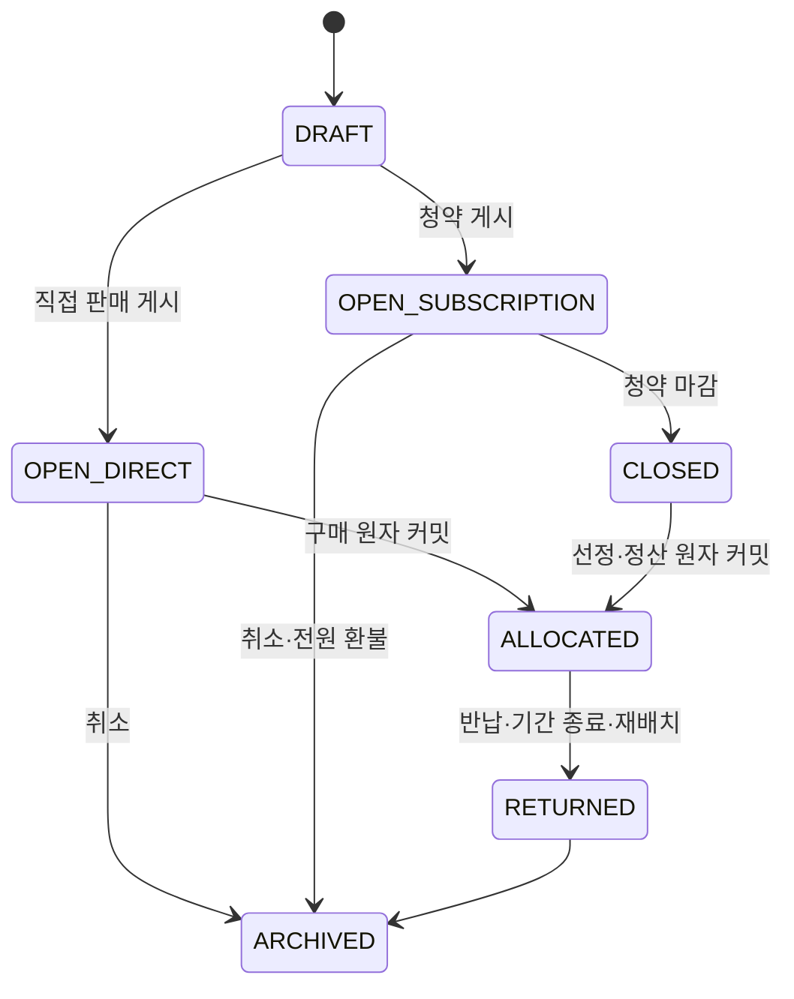

# 교육용 좌석 이용권(부동산) MVP 정책

- 상태: 보강 결정안 (`S15P11B201-315`)
- 대상: 초등 5~6학년 학급 경제 활동
- 선행 조건: `REAL_ESTATE` 모듈 `ACTIVE`, 교사가 좌석 배치도 확정

부동산은 실제 주택·토지 소유나 투자 상품이 아니다. 교실의 실제 **자리(좌석)를 일정 기간 우선 선택할 수 있는 이용권**으로 희소성, 저축, 선택의 기회비용을 배우는 활동이다. 데이터 모델의 소유 기록은 법적 소유권이 아니라 권리 배정 이력이다. 전매·임대수익·대출·실제 주소·건물·현금 보장은 포함하지 않는다.

## 1. 자리배치와 경제 권리의 분리

자리배치는 부동산보다 먼저 동작하는 학급 운영 기능이다. 교사는 행·열 기반의 배치도를 만들고, 통로·교사 공간·사용 제외 좌석을 표시한 뒤 학생 카드를 드래그해 기본 자리를 배정한다. 학생 프로필은 현재 기본 자리 또는 확정된 이용권 자리를 조회한다.

| 계층 | 책임 | 변경 주체 |
| --- | --- | --- |
| `seat_layout`, 기본 배정 | 행·열·통로와 수업용 현재 자리 | 교사 |
| `seat_use_right`, 경제 배정 | 기간·결제·환급을 가진 좌석 선택권 | 학생 요청, 교사 감독, 원장 |

경제 기능은 배치도 위에 권리만 추가한다. 모듈을 끄거나 배치도를 수정해도 학생의 기본 수업 자리는 사라지지 않는다. 활성 이용권이 없는 학생은 교사가 즉시 드래그 이동할 수 있지만, 이용권 보유 학생은 단순 드래그로 옮길 수 없다.

## 2. 좌석·학습권 불변식

- 경제 자산은 사용 가능한 실제 좌석 하나에만 연결되는 `SEAT_USE_RIGHT`이며 공급 수량은 항상 1이다.
- 활성 이용권은 학생당 최대 1개, 좌석당 최대 1개다.
- 학습 지원, 안전, 시험, 짝 활동에 필요한 좌석은 교사가 경제 활동 대상에서 제외한다. 모든 학생은 기본 좌석과 수업 참여 기회를 보장받는다.
- 교사가 수업상 재배치해야 하면 `TEACHER_OVERRIDE` 사유를 남긴다. 원 결제 금액을 전액 환급하고, 가능하면 동등한 빈 좌석을 먼저 제안한다.
- 공개 화면은 좌석 구역과 배정 여부만 표시한다. 학생 이름, 금액, 환급 사유, 잔액은 공개하지 않는다.

## 3. 공급·가격·수명

교사는 좌석 표시명·교육 목적·기준 가격(100~5,000)·공급 방식·이용 기간을 `DRAFT`로 만든다. 공급 방식은 `DIRECT`(선착순)와 `SUBSCRIPTION`(청약)뿐이다.

```text
게시 가격 = floor(기준 가격 × 이벤트 계수 / 100)
이벤트 계수 = 80, 90, 100, 110, 120 중 하나
```

- 여러 좌석을 공급하려면 좌석별 자산을 각각 만든다.
- 직접 판매는 서버가 가격을 고정한 뒤 지갑 차감·판매 계정 증가·권리 배정을 한 원자 작업으로 처리한다. 동시 구매는 한 명만 성공한다.
- 청약 공개 시에는 가격을 `locked_price`로 고정한다. 이후 이벤트 계수 변경은 열린 청약의 가격과 신청자 예치금에 영향을 주지 않는다.
- 권리는 기간 종료, 학생 반납, 교사 재배치, 학급 종료 중 먼저 일어난 시점에 끝난다. 정상 종료·반납 환급은 **배정 때 고정된 결제 가격의 80%**다.
- 모듈 비활성화는 열린 직접 판매·청약을 모두 마감 또는 취소한 뒤에만 가능하며, 남아 있으면 `OPEN_ACTIVITY_EXISTS`를 반환한다.

## 4. 상태·원장 계약



배정 원자 작업은 결제, `real_estate_allocations` 생성, 자산 상태·버전·감사 이력 갱신을 하나의 DB 트랜잭션으로 처리하고 커밋 뒤에만 실시간 이벤트를 낸다. 원장 실패·잔액 부족·중복 요청·동시 요청이면 지갑과 권리, 상태 모두 바뀌지 않는다.

| 시점 | `transaction_type` | 원장 효과 | actor |
| --- | --- | --- | --- |
| 직접 구매 | `REAL_ESTATE_SEAT_PURCHASE` | 학생 지갑 `-가격`, 판매 계정 `+가격` | `STUDENT` |
| 청약 선정 | `SUBSCRIPTION_ALLOCATION_SETTLEMENT` | 청약 예치 `-고정 가격`, 판매 계정 `+고정 가격` | `SYSTEM` |
| 반납·기간 종료 | `REAL_ESTATE_SEAT_RETURN` | 판매 계정 `-환급액`, 학생 지갑 `+환급액` | `STUDENT` 또는 `SYSTEM` |
| 교사 재배치 | `REAL_ESTATE_TEACHER_OVERRIDE_REFUND` | 판매 계정 `-전액`, 학생 지갑 `+전액` | `TEACHER` |

## 5. 구현 계약·검증

- DB: `seat_layouts`, `seat_units`, `real_estate_assets`, `real_estate_allocations`, append-only 가격 이력. `classroom_id + seat_key`, 활성 학생당 권리 1개, 활성 좌석당 권리 1개를 강제한다.
- 교사 API: 행·열 배치도와 기본 자리 드래그 배정, 자산 초안/게시/마감/재배치/정산, 가격 이력 조회.
- 학생 API: 현재 자리·내 이용권 조회, 가능 좌석 조회, 직접 구매·반납.
- 모든 쓰기 명령은 `expected_state_version`, 화면·행동 ID, 발생 시각, 멱등 키를 받는다.
- 필수 테스트: 학생·좌석 이중 배정 거절, 기본 드래그가 경제 권리를 덮어쓰지 않음, 동시 구매 단일 승자, 원장 실패 무변경, 교사 재배치 전액 환급, 종료 정산 멱등성.

청약은 [SUBSCRIPTION_MVP_POLICY.md](SUBSCRIPTION_MVP_POLICY.md)의 예치·선정·환불 규칙을 따른다.
