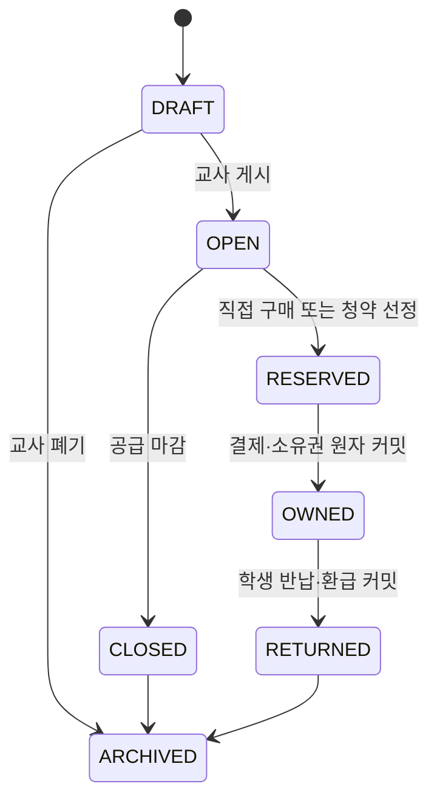

# 교육용 부동산 MVP 정책·거래 흐름

- 상태: 결정안 (`S15P11B201-315`)
- 대상: 초등 6학년 교실 경제 활동

부동산은 실제 주택 투자·거래가 아니라 학급 안의 한정된 **가상 토지 이용권**을 통해 자원 희소성, 예산, 소유권 이전을 배우는 모듈이다. 실제 주소·건물·현금·수익 보장·대출 권유는 포함하지 않는다.

## 1. MVP 범위와 의존성

- 자산은 교사가 만드는 `PARK`, `SHOP_SPACE`, `STUDY_ROOM` 세 종류의 가상 이용권이다.
- 자산마다 1개 단위만 존재하며, 학생은 동시에 최대 1개만 보유한다.
- 부동산 모듈은 지갑·원장 인프라와 `ACTIVE` 상태에 의존한다.
- **청약 모듈은 부동산 모듈의 신규 공급 방식**이다. 부동산이 비활성·미구현이면 청약 상품도 만들거나 신청할 수 없다.
- 투자·대출은 MVP에서 직접 연결하지 않는다. 투자 상품화, 담보대출, 임대수익, 세금 우대는 후속 범위다.

## 2. 가격·공급·소유 규칙

교사가 자산 이름·설명·기준 가격(100~5,000)·공급 방식·거래 기간을 `DRAFT`로 등록한다. 가격은 교사 설정과 사전에 공개된 이벤트 계수로만 정해진다.

```text
게시 가격 = floor(기준 가격 × 현재 이벤트 계수 / 100)
이벤트 계수 = 80, 90, 100, 110, 120 중 하나
```

- 교사만 이벤트 계수를 바꿀 수 있고, 변경은 다음 신규 거래부터 적용한다.
- 직접 판매는 선착순이며, 서버의 비교·차감으로 한 학생만 취득한다.
- 신규 공급이 청약 방식이면 `OPEN → CLOSED` 뒤 청약 모듈의 고정 순위 규칙으로 배정한다.
- 학생 간 자유 매매, 호가 경쟁, 가격 흥정은 MVP에서 제외한다. 보유 자산은 교사에게만 기준 가격으로 반납할 수 있다.

## 3. 상태와 거래 흐름



`RESERVED → OWNED`는 학생 지갑 차감, 부동산 판매 계정 증가, 소유권 레코드 생성, 상태 이력을 하나의 트랜잭션으로 확정한다. 잔액 부족·동시 구매·원장 실패면 자산과 지갑 모두 바뀌지 않는다. 종료 정산에서는 소유 학생에게 마지막 게시 가격의 80%를 환급하고 `RETURNED`로 마감한다.

## 4. 원장·권한·공개 경계

| 시점 | transaction_type | 원장 효과 | actor |
| --- | --- | --- | --- |
| 직접 구매/청약 배정 결제 | `REAL_ESTATE_PURCHASE` | 학생 지갑 `-가격`, 부동산 판매 계정 `+가격` | `STUDENT` |
| 학생 반납 | `REAL_ESTATE_RETURN` | 판매 계정 `-환급액`, 학생 지갑 `+환급액` | `STUDENT` |
| 교실 종료 정산 | `REAL_ESTATE_CLOSE_SETTLEMENT` | 판매 계정 `-정산액`, 학생 지갑 `+정산액` | `SYSTEM` |

학생은 본인 보유·구매 결과만, OWN은 담당 학급의 등록·게시·계수 변경·정산만, COT는 조회만 한다. 공개 화면에는 자산명·상태·보유 여부만 표시하며 소유 학생의 잔액과 거래 금액은 표시하지 않는다.

## 5. 구현 계약과 후속 작업

- DB: `real_estate_assets`, `real_estate_ownerships`, 가격 이력, `REAL_ESTATE_SALES:{asset_id}` 원장 계정
- API: 자산 등록/게시/마감, 자산 목록·상세, 직접 구매/반납, 종료 정산
- 청약 연결 API: `real_estate_asset_id`가 있는 청약 상품만 생성 가능; 선정 후 구매 명령이 실행된다.
- 이벤트: `real_estate.asset.changed`(CLASSROOM), `real_estate.ownership.changed`(SELF/TEACHER)
- 화면: 교사 자산 관리·가격 이력, 학생 자산 목록·내 보유, 청약 신규 공급 진입
- 테스트: 가격 계수 재현성, 동시 구매 단일 승자, 잔액 부족 무변경, 결제 실패 시 소유권 미생성, 청약 없이 자산 생성 불가가 아닌 “청약 방식일 때만 부동산 활성 필수”, 종료 정산 멱등성
