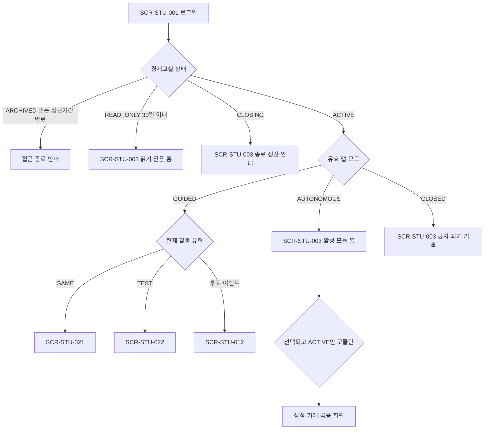
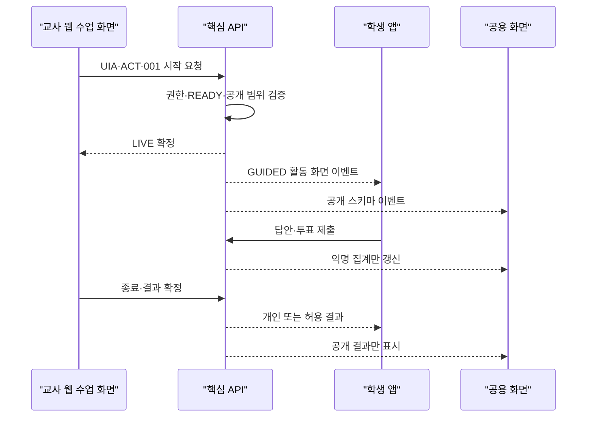
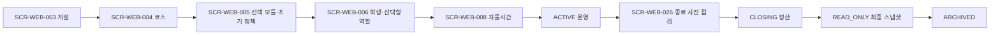

# 이코빌리지 화면 ID·행동 명세

- 버전: v0.5
- 기준일: 2026-07-30
- 상태: MVP 화면 경계·진입 조건·주요 행동 기준선
- 범위: 학생 앱, 교사 웹, 학교 관리 웹, 플랫폼 운영 콘솔, 교실 공용 화면

## 1. 화면 설계 원칙

1. 화면 노출은 편의 기능이고 최종 권한 판정은 핵심 API가 [역할·권한 매트릭스](PERMISSION_MATRIX.md)로 수행합니다.
2. 학생 앱은 React Native·Expo, 교사·관리자 웹과 공용 화면은 Next.js로 구현합니다.
3. 교사 웹은 같은 애플리케이션 안에서 수업 중 빠른 제어·승인·수령 경로와 개설·정책·콘텐츠·분석·내보내기 경로를 분리합니다.
4. 학생 화면은 경제교실 상태, 학생 앱 모드, 모듈 상태와 리소스 상태를 모두 통과해야 표시됩니다.
5. 선택하지 않았거나 `DISABLED`인 모듈은 학생 내비게이션·딥링크·검색 결과에서 숨깁니다.
6. 역할상 영구 금지된 행동은 숨기고, 역할상 가능하지만 현재 상태 때문에 불가능한 행동은 비활성화한 뒤 정확한 사유를 표시합니다.
7. COT가 OWN 전용 설정을 열면 값을 조회할 수 있지만 수정 버튼 대신 `소유 교사 전용` 배지를 표시합니다.
8. 금액·아이템·평가·정책을 바꾸는 버튼은 낙관적으로 완료 처리하지 않습니다. 서버 최종 결과가 올 때까지 로딩 상태를 유지합니다.
9. 중복 탭과 네트워크 재시도에는 같은 `request_id`를 사용하고 새 결과를 추정하지 않습니다.
10. 공용 화면은 공개 스키마만 구독하며 잔액·세금·금융·신용·평가 원본·실명을 받지 않습니다.

## 2. ID와 표기

### 2.1 화면 ID

| 접두사 | 화면 영역 |
| --- | --- |
| `SCR-STU` | 학생 앱 |
| `SCR-TCH` | 교사 웹 수업 진행 화면 |
| `SCR-WEB` | 교사 웹 관리 화면 |
| `SCR-ADM` | 학교 관리자 웹 |
| `SCR-OPS` | 플랫폼 운영 콘솔 |
| `SCR-PUB` | 교실 공용 화면 |

화면 ID는 `SCR-{영역}-{3자리 번호}`를 사용합니다. 화면 안의 탭·모달은 별도 화면 ID를 만들지 않고 부모 화면과 주요 행동 ID로 추적합니다.

### 2.2 행동 ID

사용자 또는 운영자가 상태·금액·아이템·정책·평가를 바꾸는 주요 행동은 `UIA-{영역}-{3자리 번호}`를 사용합니다. 단순 조회·탭 이동·필터·정렬에는 행동 ID를 만들지 않습니다.

### 2.3 상태 표기

| 표기 | 의미 |
| --- | --- |
| `ACTIVE` | 경제교실이 운영 중 |
| `CLOSING` | 경제교실 종료 정산 중 |
| `READ_ONLY` | 최종 스냅샷 이후 변경 금지 |
| `ARCHIVED` | 학생 접근 금지, 보존 범위 조회만 가능 |
| `CLOSED` | 학생 앱 조회 중심 모드 |
| `AUTONOMOUS` | 활성 모듈의 학생 자율 명령 허용 |
| `GUIDED` | 현재 지도 활동 화면과 제출만 허용 |
| `MOD ACTIVE` | 해당 모듈이 활성 상태 |

세부 전이는 [핵심 상태 머신](STATE_MACHINES.md)을 따릅니다.

## 3. 공통 진입·표시 규칙

### 3.1 학생 앱 유효 화면 계산

| 조건 | 첫 진입 화면 | 허용 범위 |
| --- | --- | --- |
| 인증 전 | `SCR-STU-001` | 로그인·비밀번호 재설정 |
| `ACTIVE + GUIDED` | 현재 활동의 `SCR-STU-012`, `SCR-STU-021` 또는 `SCR-STU-022` | 활동 조회·제출·허용된 결과만 |
| `ACTIVE + AUTONOMOUS` | `SCR-STU-003` | 활성 모듈의 자율 화면·명령 |
| `ACTIVE + CLOSED` | `SCR-STU-003` | 공지·허용된 과거 기록·읽기 전용 정보 |
| `CLOSING` | `SCR-STU-003` | 종료 안내와 허용된 조회만 |
| `READ_ONLY` 후 30일 이내 | `SCR-STU-003` | 본인 기록·최종 리포트 조회 |
| `READ_ONLY` 후 30일 초과 또는 `ARCHIVED` | 접근 종료 안내 | 경제교실 데이터 접근 금지 |

- `GUIDED`가 수동 설정과 반복 일정보다 우선합니다.
- 지도 활동 `LIVE` 커밋 후 해당 활동에 참가하는 학생만 활동 화면으로 전환합니다.
- 모듈 딥링크는 현재 권한을 다시 계산하며, 숨긴 화면의 URL·라우트 직접 접근도 서버에서 거부합니다.
- 오프라인에서는 마지막 조회 데이터를 `읽기 전용·최종 값 아님`으로 표시하고 변경 버튼을 모두 비활성화합니다.

### 3.2 버튼 표시 규칙

| 판정 | UI 처리 |
| --- | --- |
| 역할·소속상 영구 금지 | 버튼·메뉴 숨김 |
| OWN 전용 값을 COT가 조회 | 읽기 전용 + `소유 교사 전용` 배지 |
| 모듈 미선택·`DISABLED` | 학생 메뉴·딥링크 숨김, 교사 화면에는 활성화 안내 |
| 모듈 `STOPPING` | 신규 행동 비활성화, 정리 상태와 남은 항목 표시 |
| 상태·시간 때문에 일시 금지 | 버튼 비활성화 + 금지 사유 + 다시 가능한 조건 표시 |
| 서버 처리 중 | 중복 탭 차단 + 동일 `request_id` 유지 |
| `state_version` 충돌 | 자동 성공 처리 금지, 최신 상태 다시 불러오기 |
| 네트워크 단절 | 변경 버튼 비활성화, 재연결 후 서버 상태 재조회 |

### 3.3 교사 웹 수업 진행 화면과 관리 화면의 경계

| 업무 | 교사 웹 수업 화면 | 교사 웹 관리 화면 |
| --- | --- | --- |
| 수업 중 앱 열기·닫기 | 주 화면 | 보조 |
| 퀴즈·투표·이벤트 시작·종료 | 주 화면 | 사전 계획·결과 상세 |
| 개인거래·대출 승인 | 주 화면 | 대량 조회·상세 감사 |
| 실제 상품 수령 | 주 화면 | 주문·상품 설정 |
| 경제교실 개설·학생 명단·선택형 역할급여 | 조회·알림 | 주 화면 |
| 모듈·경제정책·상품·금융 정책 | 조회 | 주 화면 |
| AI 챗봇 | 빠른 질의 | 긴 분석·근거 |
| 리포트 | 요약 | PDF·CSV·감사 상세 |

두 화면 그룹은 같은 Next.js 애플리케이션, 인증 세션, API와 `PM-*` 규칙을 사용합니다. `SCR-TCH` 접두사는 수업 진행 경로를 추적하기 위해 유지하며 별도 모바일 교사 앱을 의미하지 않습니다.

## 4. 화면 카탈로그

### 4.1 학생 앱

| 화면 ID | 화면 | 핵심 내용 | 진입·표시 조건 | 관련 권한·상태 |
| --- | --- | --- | --- | --- |
| SCR-STU-001 | 학생 로그인 | 학급 코드·출석번호·닉네임·비밀번호 | 인증 전 | PM-AUTH-001 |
| SCR-STU-002 | 비밀번호 재설정 | 기존 본인 확인 절차, 비밀번호만 재설정 | 인증 전·복구 요청 | PM-AUTH-002 |
| SCR-STU-003 | 경제교실 홈·상태 안내 | 앱 모드, 공지, 활성 모듈, 종료 안내 | 인증 후 | SM-CLS-001·SM-APP-001·SM-MOD-001 / PM-RBAC-001·PM-DAT-001 |
| SCR-STU-004 | 지갑·거래내역 | 잔액, 거래 그룹, 전후 잔액, 정책 스냅샷 | 지갑이 있는 코스·본인 | SM-TXN-001 / PM-TXN-001 |
| SCR-STU-005 | 급여명세서 | 총급여·소득세·공제·실수령액 | 역할·급여 모듈 `ACTIVE`·본인. 미선택 시 메뉴 숨김 | SM-MOD-001·SM-TXN-001 / PM-TXN-001 |
| SCR-STU-006 | 상점 목록 | 상품·가격·부가세·재고 | `AUTONOMOUS + 상점 ACTIVE` | SM-SHP-001 / PM-SHP-001 |
| SCR-STU-007 | 상품 상세·구매 | 최종 결제액, 실제·디지털 구분, 환불 불가 안내 | `AUTONOMOUS + 상점 ACTIVE` | SM-SHP-001·SM-TXN-001 / PM-SHP-002 |
| SCR-STU-008 | 보유 아이템·캐릭터 | AVAILABLE·EQUIPPED·LOCKED_TRADE, 장착 캐릭터 | 아이템 보유·본인 | SM-ITM-001 / PM-ITM-001 |
| SCR-STU-009 | 개인거래 목록 | 내 제안·받은 제안·승인 대기·완료 기록 | 개인거래 모듈 선택 | SM-TRD-001 / PM-TRD-001·PM-TRD-002 |
| SCR-STU-010 | 개인거래 작성 | 상대 학생, 금액·아이템, 세금 예상, 요청번호 | `AUTONOMOUS + 개인거래 ACTIVE` | SM-TRD-001·SM-ITM-001 / PM-TRD-001 |
| SCR-STU-011 | 개인거래 상세·동의 | 거래 당사자·상태·세금·동의·거절·취소 | 거래 당사자 | SM-TRD-001 / PM-TRD-001·PM-TRD-002 |
| SCR-STU-012 | 공동기금·투표 | 기금 잔액·사용내역, 익명 선택지·투표 | 공동기금 조회 또는 투표 `LIVE` | SM-ACT-001·SM-TXN-001 / PM-ACT-001·PM-ACT-002 |
| SCR-STU-013 | 금융 홈 | 예금·적금·투자·대출의 활성 모듈 카드 | 금융 모듈 하나 이상 선택 | SM-MOD-001 / PM-FIN-001 |
| SCR-STU-014 | 정기예금 | 상품 조건, 가입 계좌, 만기·중도해지 예상액 | 예금 모듈 선택 | SM-DEP-001 / PM-FIN-002 |
| SCR-STU-015 | 정기적금 | 납입 일정, PAID·MISSED, 유예 재납입, 해지 | 적금 모듈 선택 | SM-SAV-001·SM-SAV-002 / PM-FIN-002 |
| SCR-STU-016 | 투자 시장 | 가상 자산 4종, 현재가, 과거 선 그래프, 시장 상태 | 투자 모듈 선택 | SM-IVT-001 / PM-FIN-003·PM-FIN-004 |
| SCR-STU-017 | 투자 주문 | 매수·매도, 정수 수량, 한도·예상 잔액 | `AUTONOMOUS + 시장 OPEN` | SM-IVT-002·SM-TXN-001 / PM-FIN-003 |
| SCR-STU-018 | 투자 포트폴리오 | 보유량·평균가격·평가손익·실현손익 | 투자 모듈 선택·본인 | SM-IVT-001·SM-IVT-002 / PM-FIN-003 |
| SCR-STU-019 | 대출 신청·상환 | 신청, 취소, 일정, 유예·중도상환, 종료 상태 | 대출 모듈 선택·본인 | SM-LON-001 / PM-FIN-005·PM-FIN-007 |
| SCR-STU-020 | 내 신용 | NORMAL·GOOD·CAUTION·RESTRICTED, 교육용 설명 | 대출 모듈 선택·본인 | SM-CRD-001 / PM-FIN-008 |
| SCR-STU-021 | GAME 퀴즈 | 문제·타이머·제출, 개인 진행 상태 | GAME `OPEN`·참여자 | SM-QZS-001·SM-ACT-001 / PM-QZ-002 |
| SCR-STU-022 | TEST 응시 | 개인별 문제·제출, 순위·보상 없는 안내 | TEST `OPEN`·응시자 | SM-QZS-001 / PM-QZ-002 |
| SCR-STU-023 | 퀴즈 결과·오류 신고 | 개인 결과, 공개 허용 결과, 문항 신고 | 결과 공개 또는 과거 본인 결과 | SM-QZS-001·SM-QAD-001 / PM-QZ-003·PM-QZ-004 |
| SCR-STU-024 | 개인·최종 리포트 | 잔액·금융·학습 결과와 최종 스냅샷 | 본인, 운영 중 또는 READ_ONLY 전환 후 30일 이내 | SM-CLS-001 / PM-DAT-002 |

### 4.2 교사 웹 수업 진행 화면

| 화면 ID | 화면 | 핵심 내용 | 진입·표시 조건 | 관련 권한·상태 |
| --- | --- | --- | --- | --- |
| SCR-TCH-001 | 교사 로그인 | 학교 계정 OIDC 로그인, 로딩·실패·미등록 안내 | 교사 인증 전 | PM-AUTH-003·PM-RBAC-001 |
| SCR-TCH-002 | 담당 학급 홈 | 담당 학급, 현재 상태, 오늘 일정, 승인 대기 | OWN·COT 담당 범위 | SM-CLS-001·SM-APP-001 / PM-RBAC-001 |
| SCR-TCH-003 | 학생 앱 빠른 제어 | 현재 유효 모드, 수동 열기·닫기, 종료 알림 | `ACTIVE`, 담당 학급 | SM-APP-001 / PM-CLS-008 |
| SCR-TCH-004 | 지도 활동 허브 | 퀴즈·투표·AI 이벤트 준비·시작·종료 | `ACTIVE`, 담당 학급 | SM-ACT-001 / PM-ACT-001 |
| SCR-TCH-005 | 실시간 퀴즈 진행 | 문제 전환, 타이머, 응답 집계, 종료·결과 확정 | 퀴즈 `READY` 이상 | SM-QZS-001 / PM-QZ-002 |
| SCR-TCH-006 | 투표·이벤트 진행 | 익명 집계, 이벤트 설명, 종료·확정 | 활동 `READY` 이상 | SM-ACT-001 / PM-ACT-001·PM-ACT-002 |
| SCR-TCH-007 | 공용 화면 연결 | 연결 코드·세션 상태·공개 필드 미리보기·해제 | 담당 활동 | SM-ACT-001 / PM-DSP-001 |
| SCR-TCH-008 | 승인함 | 개인거래·대출·복구 요청의 대기 건수 | 담당 학급 | PM-TRD-003·PM-FIN-006·PM-TXN-003 |
| SCR-TCH-009 | 승인 상세 | 최신 잔액·소유권·세율·신용·정책 재검증 결과 | 대기 리소스·담당 학급 | SM-TRD-001·SM-LON-001 / PM-TRD-003·PM-FIN-006 |
| SCR-TCH-010 | 실제 상품 수령 | PAID·READY_FOR_PICKUP 주문, 준비·수령 처리 | 실제 상품 주문·담당 학급 | SM-SHP-001 / PM-SHP-003 |
| SCR-TCH-011 | 급여·활동 보상 | 활성화된 지급 유형·대상·정책 미리보기, 지급 결과 | 학급 `ACTIVE`, 해당 지급 모듈 `ACTIVE`, 담당 학급 | SM-MOD-001·SM-TXN-001 / PM-TXN-002 |
| SCR-TCH-012 | 알림·요약 리포트 | 종료·승인·정산 알림, 학급 요약, 내보내기 진입 | 담당, 운영 중 또는 READ_ONLY 전환 후 1년 이내 | PM-DAT-002·PM-DAT-003 |

### 4.3 교사 관리 웹

| 화면 ID | 화면 | 핵심 내용 | OWN·COT 차이 | 관련 권한·상태 |
| --- | --- | --- | --- | --- |
| SCR-WEB-001 | 교사 로그인 | 학교 계정 OIDC 로그인, HttpOnly 갱신 쿠키 | 동일 | PM-AUTH-003·PM-RBAC-001 |
| SCR-WEB-002 | 학급 대시보드 | 상태·잔액 집계·모듈·활동·승인·위험 알림 | 동일 조회 | PM-DAT-001·PM-RBAC-001 |
| SCR-WEB-003 | 경제교실 개설 마법사 | 학년·규모·기간·인원·0개 이상의 선택 모듈·자율시간·필수 화폐 단위명, 공통값 점검, 생성 완료 후 서버 발급 학급 코드. 역할·급여를 포함해 필수 모듈 없음 | OWN 생성 | SM-CLS-001·SM-MOD-001·SM-AIR-001 / PM-CLS-001·PM-CLS-005·PM-CLS-007·PM-AI-003 |
| SCR-WEB-004 | 학급 기본·코스 설정 | 학급 코드·화폐 단위명 읽기 전용 표시, 학년·규모·실제 일정·난이도·추천 수정 영향 | OWN 수정, COT 읽기, 코드·단위명은 모두 읽기 전용 | PM-CLS-005 |
| SCR-WEB-005 | 모듈 관리 | 전역 필수 모듈 없음, 조건부 선행 모듈, 추가 시 초기 정책 추천·확인, 중지 영향·정리 진행률 | OWN 실행·추천 적용, COT 읽기 | SM-MOD-001·SM-AIR-001 / PM-MOD-001·PM-AI-003 |
| SCR-WEB-006 | 학생 명단·선택형 역할급여 | 학급 번호·닉네임, 역할·급여 모듈 활성 시 역할 배정·급여, 비밀번호 재설정 처리. 비활성 시 역할 필드 숨김 | OWN 수정, COT 조회·재설정 | SM-MOD-001 / PM-CLS-004·PM-CLS-005·PM-AUTH-002 |
| SCR-WEB-007 | 담당 교사·소유권 | COT 초대·해제·OWN 이전·감사 이력 | OWN 실행, COT 이전 수락 | PM-CLS-002·PM-CLS-003 |
| SCR-WEB-008 | 자율시간 일정 | 반복 일정, 수동 상태 이력, 종료 알림 | OWN 일정 수정, COT 조회 | SM-APP-001 / PM-CLS-007·PM-CLS-008 |
| SCR-WEB-009 | 경제정책 | 가격·재고·급여·세율·금리·물가·투자·대출 한도 | OWN 수정, COT 읽기 | SM-TXN-001 / PM-POL-001 |
| SCR-WEB-010 | 세금·공동기금 설정 | 기본 사용처, 이름·설명·예산 항목, 투표 연결 | OWN 수정, COT 읽기 | PM-POL-002 |
| SCR-WEB-011 | 상점·캐릭터 카탈로그 | 공식 상품, 부가세, 재고, 실제 상품, 승인 캐릭터, 상품 작성 중 현재 정책 기반 가격 추천 | OWN 수정·추천값 선택, COT 읽기 | SM-SHP-001·SM-AIR-001 / PM-SHP-001·PM-CNT-001·PM-AI-003 |
| SCR-WEB-012 | 거래 원장·복구 | 거래 그룹, 전후 잔액, 정책 스냅샷, 복구 연결 | 둘 다 조회·복구 요청 | SM-TXN-001 / PM-TXN-001·PM-TXN-003 |
| SCR-WEB-013 | 개인거래 관리 | 제안·동의·승인·취소·실패, 아이템 잠금 상태 | 둘 다 조회·승인 | SM-TRD-001·SM-ITM-001 / PM-TRD-003 |
| SCR-WEB-014 | 예금·적금 상품 | 금리·일정·유예·해지 정책, 활성 계좌 영향 | OWN 정책, COT 읽기 | SM-DEP-001·SM-SAV-001·SM-SAV-002 / PM-FIN-001 |
| SCR-WEB-015 | 투자 시나리오·시장 | 가상 자산·가격 단계·한도·시장 제어·정산, 단계별 AI 뉴스 사전 생성·검토·승인·공개 상태 | OWN 시나리오·뉴스 승인, 둘 다 시장 제어 | SM-IVT-001·SM-IVT-002·SM-AIR-001 / PM-FIN-001·PM-FIN-004·PM-AI-002 |
| SCR-WEB-016 | 대출·신용 정책 | 기간·금리·한도·상환·유예·신용 임계치 | OWN 정책, COT 읽기 | SM-LON-001·SM-CRD-001 / PM-FIN-001·PM-FIN-008 |
| SCR-WEB-017 | 퀴즈 문제은행 | ECONOMY·NONSENSE, GAME·TEST, 상태·버전·검색 | 둘 다 작성·검토 | SM-QST-001 / PM-QZ-001 |
| SCR-WEB-018 | 퀴즈 편집·AI 초안 | 직접 작성, 객관식·OX AI 초안, GAME 세션 보상 추천과 전체 발행액 30% 상한, TEST 보상 금지와 안전 경고 | 둘 다 작성·승인 | SM-QST-001·SM-AIR-001 / PM-QZ-001·PM-AI-002·PM-AI-003 |
| SCR-WEB-019 | 퀴즈 세션·결과 | 세션 스냅샷, 채점·무효화·재채점·결과 확정 | 둘 다 운영 | SM-QZS-001·SM-QAD-001 / PM-QZ-002·PM-QZ-003 |
| SCR-WEB-020 | 지도 활동 계획 | 퀴즈·투표·이벤트 일정, 대상·공개 범위 | 둘 다 계획 | SM-ACT-001 / PM-ACT-001 |
| SCR-WEB-021 | AI 경제 설정·모니터링·학급 AI 설정 | 시작 전 BLOCK·WARN 점검, 설정 추천, 수동·자동 분석, NORMAL·OBSERVE·WARN 알림, 중복 억제·확인, 제안·근거·영향·정책 비교, 학급 AI 끄기 | 둘 다 조회·알림 확인, OWN 적용·끄기 | SM-AIR-001 / PM-AI-003·PM-AI-004·PM-AI-005 |
| SCR-WEB-022 | 교사용 AI 챗봇 | 학급 집계 질의, 근거·기간·대응안·부작용 | 둘 다 사용 | SM-AIR-001 / PM-AI-001 |
| SCR-WEB-023 | AI 경제 이벤트 | 교사 요청·모니터링 추천 출처, 7종 템플릿, 근거, 중복 억제, 학년 검증, 초안·승인·거절 | 둘 다 요청·승인 | SM-AIR-001·SM-ACT-001 / PM-AI-002 |
| SCR-WEB-024 | 리포트·내보내기 | 개인·학급 리포트, PDF·CSV, 최종 스냅샷 | 둘 다 실행 | PM-DAT-002·PM-DAT-003 |
| SCR-WEB-025 | 감사 기록 | 실행자·PM 규칙·전후 상태·사유·요청번호 | 둘 다 담당 범위 | PM-DAT-005 |
| SCR-WEB-026 | 경제교실 종료 | CLOSING 사전 점검·정산 진행률·최종 스냅샷 | OWN 시작, COT 보조 | SM-CLS-001 / PM-CLS-006·PM-FIN-009 |
| SCR-WEB-027 | 학급 템플릿 복사 | 코스·모듈·승인 퀴즈만 복사, 제외 데이터 확인 | 둘 다 복사 | PM-DAT-004 |
| SCR-WEB-028 | 공용 화면 모니터 | 연결 세션·공개 데이터 미리보기·강제 해제 | 둘 다 운영 | SM-ACT-001 / PM-DSP-001 |

### 4.4 학교 관리자 웹

| 화면 ID | 화면 | 핵심 내용 | 금지 범위 | 관련 권한 |
| --- | --- | --- | --- | --- |
| SCR-ADM-001 | 학교 대시보드 | 교사·학급·기기 상태와 비식별 집계 | 수업 명령·학생 금융 상세 | PM-OPS-001·PM-DAT-001 |
| SCR-ADM-002 | 교사 계정 관리 | 교사 생성·상태·학교 소속 | 학급 운영 권한 자동 부여 | PM-OPS-001 |
| SCR-ADM-003 | 학교 기기 관리 | 학교 지급 태블릿 연결·분실·세션 상태 | 학생 금융 내용 | PM-OPS-001 |
| SCR-ADM-004 | 학급 소유권 복구 | 학교 메타데이터, COT 배정, 긴급 OWN 이전 | 일반 수업·경제정책 변경 | PM-CLS-003·PM-CLS-004 |
| SCR-ADM-005 | 학교 AI·감사 | 학교 AI 끄기, 사유 기반 감사 내보내기 | 모델 공급자·학급 정책 변경 | PM-AI-005·PM-DAT-003·PM-DAT-005 |

### 4.5 플랫폼 운영 콘솔

| 화면 ID | 화면 | 핵심 내용 | 금지 범위 | 관련 권한 |
| --- | --- | --- | --- | --- |
| SCR-OPS-001 | 배포·서비스 상태 | Jenkins·EAS·AWS 상태, 오류율·추적 ID·지표 | 학생 개인 금융 원문 | PM-OPS-002 |
| SCR-OPS-002 | AI 공급자·서비스 자격증명 | Bedrock·OpenAI 어댑터, 전역 한도, 자격증명 발급·폐기 | 학급 경제정책·학생 계좌 | PM-AI-006·PM-SVC-001 |
| SCR-OPS-003 | 전역 캐릭터 권리·콘텐츠 | 출처·지역·권리 상태·검토일·전역 게시 | 학급 상품 선택·학생 구매 | PM-CNT-001 |

### 4.6 교실 공용 화면

| 화면 ID | 화면 | 공개 가능 정보 | 반드시 제외할 정보 | 관련 권한·상태 |
| --- | --- | --- | --- | --- |
| SCR-PUB-001 | 연결 대기 | 연결 코드·활동 대기 상태 | 학생 목록·잔액 | PM-DSP-001 |
| SCR-PUB-002 | 퀴즈 진행 | 문제·선택지·타이머·익명 응답 집계 | 개인 답안·평가 원본·잔액 | SM-QZS-001 / PM-QZ-002·PM-DSP-001 |
| SCR-PUB-003 | 투표·이벤트 진행 | 선택지·이벤트 설명·익명 집계 | 개인 선택·금융정보 | SM-ACT-001 / PM-ACT-001·PM-DSP-001 |
| SCR-PUB-004 | 결과·순위 | 공개 결과, 교사 선택 시 1~3위 닉네임·장착 캐릭터 | 실명·잔액·세금·신용·TEST 순위 | SM-ACT-001·SM-QZS-001 / PM-ACT-002·PM-DSP-001 |

## 5. 주요 행동·버튼 레지스트리

### 5.1 인증·경제교실·운영

| 행동 ID | 화면·버튼 | 실행 역할 | 활성 조건·전이 | 권한 |
| --- | --- | --- | --- | --- |
| UIA-AUTH-001 | SCR-STU-001 로그인 | STU | 인증정보 검증, 성공 시 유효 진입 화면 계산 | PM-AUTH-001 |
| UIA-AUTH-002 | SCR-STU-002 재설정 요청 | STU | 기존 본인 확인 절차 통과 | PM-AUTH-002 |
| UIA-AUTH-003 | SCR-WEB-006 비밀번호 재설정 처리 | OWN·COT | 담당 학급 요청, 닉네임 변경 없음 | PM-AUTH-002 |
| UIA-AUTH-004 | SCR-TCH-001·SCR-WEB-001 학교 계정으로 로그인 | 인증 전 교사 | OIDC Authorization Code + PKCE 완료 후 ID 토큰 검증, 등록·활성 교사이면 세션 발급 | PM-AUTH-003·PM-RBAC-001 |
| UIA-STU-001 | SCR-STU-003 접속 상태 전송 | STU | 로그인된 학생의 `ONLINE·AWAY` 상태와 현재 화면을 교사에게 전달 | PM-AUTH-001 |
| UIA-CLS-001 | SCR-WEB-003 경제교실 개설 | OWN | 화폐 단위명 필수·형식·금칙어 검증, 서버 학급 코드 생성 후 `ACTIVE`. 모듈 목록은 비어 있을 수 있고 선택 모듈은 `DISABLED`로 등록한 뒤 각 활성화 단계에서 초기 정책을 확정 | PM-CLS-001·PM-CLS-005·PM-CLS-007 / SM-CLS-001·SM-MOD-001 |
| UIA-CLS-002 | SCR-WEB-004 기본·코스 저장 | OWN | `ACTIVE`, 진행 활동·정산과 충돌 없음 | PM-CLS-005 |
| UIA-CLS-003 | SCR-WEB-006 학생·선택형 역할급여 저장 | OWN | 학급 `ACTIVE`, 학급 범위·중복 번호 검증. 역할·급여 비활성 시 학생 역할은 `null` | PM-CLS-004·PM-CLS-005 |
| UIA-CLS-004 | SCR-WEB-007 COT 초대·해제 | OWN | 대상 교사 학교 소속, OWN 1명 유지 | PM-CLS-002 |
| UIA-CLS-005 | SCR-WEB-007 소유권 이전 요청·수락 | OWN·대상 COT | 대상이 현재 COT, 원자적 역할 교환 | PM-CLS-003 |
| UIA-CLS-006 | SCR-WEB-008 반복 일정 저장 | OWN | `ACTIVE`, 유효 시간대 | PM-CLS-007 / SM-APP-001 |
| UIA-CLS-007 | SCR-TCH-003 지금 열기·닫기 | OWN·COT | `ACTIVE`, GUIDED가 아니면 수동 모드 반영 | PM-CLS-008 / SM-APP-001 |
| UIA-CLS-008 | SCR-WEB-026 종료 시작 | OWN | `ACTIVE → CLOSING`, 영향 확인·재인증 | PM-CLS-006 / SM-CLS-001 |
| UIA-CLS-009 | SCR-WEB-002 학급 보관 | OWN | 개설 중이거나 운영 중인 학급을 목록에서 내려 보관 처리 | PM-CLS-001 / SM-CLS-001 |
| UIA-MOD-001 | SCR-WEB-005 모듈 추가 | OWN | 조건부 선행 모듈·학년 정책 통과, 추천 초기 정책 확인 후 정책 저장과 `DISABLED → ACTIVE` 원자 처리 | PM-MOD-001·PM-AI-003 / SM-MOD-001·SM-AIR-001 |
| UIA-MOD-002 | SCR-WEB-005 모듈 중지 | OWN | `ACTIVE → STOPPING`, LIVE 활동 없음 | PM-MOD-001 / SM-MOD-001 |
| UIA-MOD-003 | SCR-WEB-005 학생 이용 잠금·열기 | OWN | 모듈은 `ACTIVE` 유지, 학생 화면에서만 회색으로 잠기고 되돌릴 수 있음 | PM-MOD-001 / SM-MOD-001 |
| UIA-MOD-004 | SCR-WEB-005 투자 운영 방식 저장 | OWN | 투자 모듈 `ACTIVE`, 단기·장기 중 하나 이상 선택, 기존 시장·보유 내역은 삭제하지 않음 | PM-MOD-001 / SM-MOD-001 |
| UIA-POL-001 | SCR-WEB-009 경제정책 저장 | OWN | 최신 정책 버전, 이후 거래·신규 상품부터 적용 | PM-POL-001 |
| UIA-POL-002 | SCR-WEB-010 세금·기금 사용처 저장 | OWN | 기본 항목 유지 가능, 예산 규칙 검증 | PM-POL-002 |
| UIA-ACT-001 | SCR-TCH-004 지도 활동 시작 | OWN·COT | `READY → LIVE`, 대상·공개 범위 스냅샷 | PM-ACT-001 / SM-ACT-001 |
| UIA-ACT-002 | SCR-TCH-004 지도 활동 종료·취소 | OWN·COT | `LIVE → FINALIZING` 또는 `CANCELED` | PM-ACT-001 / SM-ACT-001 |
| UIA-ACT-003 | SCR-TCH-004 회차 자료로 수업 시작 | OWN·COT | 회차 자료를 순서대로 담아 `READY → LIVE`, 첫 장을 학생 화면에 고정 | PM-ACT-001 / SM-ACT-001·SM-APP-001 |
| UIA-ACT-004 | SCR-TCH-004 수업 자료 넘기기 | OWN·COT | 보여 줄 장을 이전·다음으로 옮김. 자료는 그대로 두고 커서만 이동 | PM-ACT-001 / SM-ACT-001 |
| UIA-DSP-001 | SCR-TCH-007 공용 화면 연결·해제 | OWN·COT | 담당 활동, 공개 스키마만 발급 | PM-DSP-001 |

### 5.2 경제·상점·개인거래

| 행동 ID | 화면·버튼 | 실행 역할 | 활성 조건·전이 | 권한 |
| --- | --- | --- | --- | --- |
| UIA-TXN-001 | SCR-TCH-011 급여·보상 지급 | OWN·COT | 학급·해당 지급 모듈 `ACTIVE`, 정책·대상·중복 요청 검증 후 원장 커밋 | PM-TXN-002 / SM-MOD-001·SM-TXN-001 |
| UIA-TXN-002 | SCR-WEB-012 복구 거래 요청 | OWN·COT | 완료 원거래·사유 필수, 새 원장 거래 생성 | PM-TXN-003 / SM-TXN-001 |
| UIA-SHP-001 | SCR-WEB-011 상품 저장·게시 | OWN | `ACTIVE`, 가격·부가세·재고·유형 검증 | PM-SHP-001 |
| UIA-SHP-002 | SCR-STU-007 상품 구매 | STU | `ACTIVE + AUTONOMOUS + MOD ACTIVE`, 잔액·재고 검증 | PM-SHP-002 / SM-SHP-001·SM-TXN-001 |
| UIA-SHP-003 | SCR-TCH-010 실제 상품 준비 | OWN·COT | `PAID → READY_FOR_PICKUP` | PM-SHP-003 / SM-SHP-001 |
| UIA-SHP-004 | SCR-TCH-010 실제 상품 수령 확인 | OWN·COT | `READY_FOR_PICKUP → RECEIVED` | PM-SHP-003 / SM-SHP-001 |
| UIA-SHP-005 | SCR-WEB-008 상품 가격 일괄 인상 | OWN | 인상률을 받아 모든 상품 가격을 한 번에 올림. 캐릭터 상품 포함 | PM-SHP-001 / SM-CLS-001 |
| UIA-ITM-001 | SCR-STU-008 캐릭터 장착·해제 | STU | 본인 `AVAILABLE ↔ EQUIPPED`, 잠금 아이템 제외 | PM-ITM-001 / SM-ITM-001 |
| UIA-ITM-002 | SCR-STU-007 캐릭터 착용 일괄 저장 | STU | 상점 드래프트를 확정, 프로필 `state_version` 일치 시 전체 슬롯 원자적 저장 | PM-ITM-001 / SM-ITM-001 |
| UIA-CNT-001 | SCR-OPS-003 원작 검토·전역 게시 | POP | 출처·배포 지역·권리 상태·검토일 완비 | PM-CNT-001 |
| UIA-CNT-002 | SCR-WEB-011 승인 캐릭터 선택 | OWN | POP 게시 원작만 학급 상품에 연결 | PM-CNT-001 |
| UIA-TRD-001 | SCR-STU-010 거래 제안 등록 | STU | `DRAFT → AWAITING_COUNTERPART`, 아이템 잠금 | PM-TRD-001 / SM-TRD-001·SM-ITM-001 |
| UIA-TRD-002 | SCR-STU-011 거래 제안 취소 | 제안 STU | 상대·교사 승인 대기 중, 완료 전만 허용 | PM-TRD-001 / SM-TRD-001 |
| UIA-TRD-003 | SCR-STU-011 상대 동의·거절 | 상대 STU | `AWAITING_COUNTERPART` | PM-TRD-002 / SM-TRD-001 |
| UIA-TRD-004 | SCR-TCH-009 거래 승인·거절 | OWN·COT | `AWAITING_TEACHER`, 최신 잔액·세율·소유권 재검증 | PM-TRD-003 / SM-TRD-001·SM-TXN-001 |

### 5.3 금융

| 행동 ID | 화면·버튼 | 실행 역할 | 활성 조건·전이 | 권한 |
| --- | --- | --- | --- | --- |
| UIA-FIN-001 | SCR-WEB-014 예금·적금 상품 저장 | OWN | `ACTIVE`, 신규 가입부터 새 정책 적용 | PM-FIN-001 |
| UIA-FIN-002 | SCR-STU-014 예금 가입 | STU | `AUTONOMOUS + 예금 ACTIVE`, 원금·정책 스냅샷 커밋 | PM-FIN-002 / SM-DEP-001·SM-TXN-001 |
| UIA-FIN-003 | SCR-STU-014 예금 중도해지 | STU | 계좌 `ACTIVE → EARLY_TERMINATED` | PM-FIN-002 / SM-DEP-001 |
| UIA-FIN-004 | SCR-STU-015 적금 가입 | STU | `AUTONOMOUS + 적금 ACTIVE`, 일정 생성 | PM-FIN-002 / SM-SAV-001·SM-SAV-002 |
| UIA-FIN-005 | SCR-STU-015 적금 유예 재납입 | STU | `MISSED`, `retryable_until` 이내 | PM-FIN-002 / SM-SAV-002·SM-TXN-001 |
| UIA-FIN-006 | SCR-STU-015 적금 중도해지 | STU | 계좌 `ACTIVE → EARLY_TERMINATED` | PM-FIN-002 / SM-SAV-001 |
| UIA-FIN-007 | SCR-WEB-015 투자 시나리오 저장 | OWN | 시장 `DRAFT`, 자산·단계·한도 검증 | PM-FIN-001 / SM-IVT-001 |
| UIA-FIN-008 | SCR-WEB-015 투자 시장 시작·재개·정지·종료 | OWN·COT | 허용 전이 `DRAFT/OPEN/PAUSED → OPEN/PAUSED/CLOSED` | PM-FIN-004 / SM-IVT-001 |
| UIA-FIN-009 | SCR-STU-017 투자 매수·매도 | STU | `AUTONOMOUS + 시장 OPEN`, 정수·한도·잔액 검증 | PM-FIN-003 / SM-IVT-002·SM-TXN-001 |
| UIA-FIN-010 | SCR-WEB-016 대출·신용 정책 저장 | OWN | `ACTIVE`, 신규 신청부터 적용 | PM-FIN-001 / SM-LON-001·SM-CRD-001 |
| UIA-FIN-011 | SCR-STU-019 대출 신청·취소 | STU | `AUTONOMOUS + 대출 ACTIVE`, RESTRICTED 아님 | PM-FIN-005 / SM-LON-001 |
| UIA-FIN-012 | SCR-TCH-009 대출 승인·거절 | OWN·COT | `APPLIED`, 최신 신용·잔액·동시 대출 재검증 | PM-FIN-006 / SM-LON-001 |
| UIA-FIN-013 | SCR-STU-019 대출 유예·중도상환 | STU | `ACTIVE` 또는 `OVERDUE`, 음수 잔액 금지 | PM-FIN-007 / SM-LON-001·SM-TXN-001 |
| UIA-FIN-014 | SCR-WEB-015 투자 다음 날 진행·정산 | OWN·COT | 해당 투자 방식 시장 `OPEN`, 최신 상태 버전 일치, 다음 가격 단계를 공개하고 마지막 단계면 자동 정산·`CLOSED` 전환 | PM-FIN-004 / SM-IVT-001·SM-IVT-002·SM-TXN-001 |

### 5.4 퀴즈·투표

| 행동 ID | 화면·버튼 | 실행 역할 | 활성 조건·전이 | 권한 |
| --- | --- | --- | --- | --- |
| UIA-QZ-001 | SCR-WEB-018 문제 직접 작성·수정 | OWN·COT | 새 문제 `DRAFT`, 게시 수정은 새 버전 | PM-QZ-001 / SM-QST-001 |
| UIA-QZ-002 | SCR-WEB-018 AI 문제 초안 요청 | OWN·COT | AI 켜짐, 초안은 `REVIEW_REQUIRED` | PM-QZ-001·PM-AI-002 / SM-AIR-001·SM-QST-001 |
| UIA-QZ-003 | SCR-WEB-018 문제 승인·게시·사용 중지 | OWN·COT | 허용된 문제 상태 전이만 | PM-QZ-001 / SM-QST-001 |
| UIA-QZ-004 | SCR-TCH-005 퀴즈 시작·제출 종료 | OWN·COT | `READY → OPEN → SCORING` | PM-QZ-002 / SM-QZS-001 |
| UIA-QZ-005 | SCR-STU-021 GAME 답안 제출 | STU | 참가자, GAME `OPEN`, 마감 전 | PM-QZ-002 / SM-QZS-001 |
| UIA-QZ-006 | SCR-STU-022 TEST 답안 제출 | STU | 응시자, TEST `OPEN`, 마감 전 | PM-QZ-002 / SM-QZS-001 |
| UIA-QZ-007 | SCR-TCH-005 퀴즈 결과 확정·공개 | OWN·COT | `REVIEWING → RESULT_PUBLISHED → CLOSED` | PM-QZ-002 / SM-QZS-001 |
| UIA-QZ-008 | SCR-STU-023 오류 문항 신고 | STU | 본인 응시 문항, 사유 입력 | PM-QZ-003 / SM-QAD-001 |
| UIA-QZ-009 | SCR-WEB-019 문항 무효화·재채점 | OWN·COT | `UNDER_REVIEW → INVALIDATED`, 결과 버전·복구 생성 | PM-QZ-002·PM-QZ-003 / SM-QAD-001·SM-QZS-001·SM-TXN-001 |
| UIA-QZ-010 | SCR-WEB-018 넌센스 문항 가져오기 | OWN·COT | 사람이 검토한 문제은행에서 학급에 없는 문항만 뽑아 `DRAFT`로 담음. AI를 부르지 않음 | PM-QZ-001 / SM-QST-001 |
| UIA-VOT-001 | SCR-TCH-006 투표 종료·결과 확정 | OWN·COT | 활동 `LIVE → FINALIZING → COMPLETED` | PM-ACT-002 / SM-ACT-001 |
| UIA-VOT-002 | SCR-STU-012 익명 투표 제출 | STU | 참여자, 활동 `LIVE`, 1회 제출 정책 | PM-ACT-001 / SM-ACT-001 |

### 5.5 AI·데이터·관리·운영

| 행동 ID | 화면·버튼 | 실행 역할 | 활성 조건·전이 | 권한 |
| --- | --- | --- | --- | --- |
| UIA-AI-001 | SCR-WEB-022 AI 챗봇 질의 | OWN·COT | AI 켜짐, 집계 범위, 30회·20초·1회 재시도 | PM-AI-001 / SM-AIR-001 |
| UIA-AI-002 | SCR-WEB-003·011·018·021 설정 점검·밸런싱 분석 요청 | OWN·COT | `SETUP_PRECHECK`는 정적 설정 검증, `ON_DEMAND·AUTO_MONITOR`는 학생 5명·관련 거래 10건 충분성 적용 | PM-AI-003 / SM-AIR-001 |
| UIA-AI-003 | SCR-WEB-021 제안 적용·거절·알림 확인 | OWN·COT | COT는 `ACKNOWLEDGE`만, OWN 적용은 `AWAITING_TEACHER → APPROVED → APPLYING`과 최신 정책 재검증 | PM-AI-004 / SM-AIR-001 |
| UIA-AI-004 | SCR-WEB-015·023 경제 이벤트·투자 뉴스 초안 요청·승인·거절 | OWN·COT | 교사 요청·모니터링 추천 출처 검증, `API-AI-004` 생성과 `API-AI-006` 승인 분리, 투자 뉴스는 시나리오·자산·가격 단계 연결 필수 | PM-AI-002 / SM-AIR-001·SM-IVT-001 |
| UIA-AI-005 | SCR-WEB-021 학급 AI 끄기 | OWN | 담당 학급, 진행 AI 적용과 충돌 없음 | PM-AI-005 |
| UIA-DAT-001 | SCR-WEB-024 PDF·CSV 내보내기 | OWN·COT | 담당, 운영 중 또는 READ_ONLY 전환 후 1년 이내, 실행자·범위 감사 | PM-DAT-003 |
| UIA-DAT-002 | SCR-WEB-027 학급 템플릿 복사 | OWN·COT | 학생 데이터 제외, 코스·모듈·승인 퀴즈만 | PM-DAT-004 |
| UIA-ADM-001 | SCR-ADM-002 교사 계정·학교 소속 저장 | SAD | 소속 학교 범위, 수업 권한 자동 부여 없음 | PM-OPS-001 |
| UIA-ADM-002 | SCR-ADM-003 학교 기기 연결·해제 | SAD | 소속 학교 기기, 세션 영향 확인 | PM-OPS-001 |
| UIA-ADM-003 | SCR-ADM-004 긴급 소유권 이전 | SAD | 사유 필수, COT 선배정, OWN 1명 원자 보장 | PM-CLS-003 |
| UIA-ADM-004 | SCR-ADM-005 학교 AI 끄기 | SAD | 학교 범위, 학급 정책 수정 없음 | PM-AI-005 |
| UIA-OPS-001 | SCR-OPS-002 AI 공급자·전역 한도 저장 | POP | 운영 승인·자격증명 분리·감사 기록 | PM-AI-006·PM-SVC-001 |
| UIA-OPS-002 | SCR-OPS-002 서비스 자격증명 발급·폐기 | POP | 목적·서비스 범위·만료 필수 | PM-SVC-001 |

## 6. 핵심 화면 흐름

### 6.1 학생 앱 라우팅

### 6.2 지도 활동과 공용 화면

### 6.3 경제교실 개설과 종료

## 7. 오류·동시성·접근성 표시

### 7.1 공통 오류 표시

| 상황 | 화면 처리 |
| --- | --- |
| 권한 없음 | 안전한 상위 화면으로 이동하고 허용 범위만 안내 |
| 상태 변경 충돌 | 최신 상태·가격·잔액을 다시 읽고 재확인 요구 |
| 중복 요청 | 기존 처리 결과를 표시하고 새 거래로 보이지 않게 함 |
| 잔액·재고·한도 부족 | 실패 원인과 변경된 최신 값 표시, 부분 성공 금지 |
| 화폐 단위명 형식·금칙어 위반 | 허용 형식과 글자 수를 안내하고 해당 필드에 오류 표시 |
| 자율시간 종료 | 신규 행동 차단, 종료 전 서버 접수 여부와 결과 표시 |
| AI 시간 초과·장애 | 자동 재시도 1회 후 수동 작성·기존 데이터 화면 제공 |
| 실시간 연결 끊김 | 재연결 중 표시, 제출 성공 추정 금지, 서버 접수 결과 확인 |

### 7.2 태블릿·수업 접근성

- 학생 핵심 선택 버튼은 태블릿 세로·가로 모두에서 충분한 터치 영역을 사용합니다.
- 퀴즈는 색상만으로 정오·선택 상태를 구분하지 않고 번호·문자·아이콘을 함께 사용합니다.
- 타이머는 남은 시간을 숫자와 진행 상태로 함께 제공하며 종료 직전 애니메이션만으로 알리지 않습니다.
- 초4·초5·초6 난이도 프로필에 따라 문장 길이·숫자 범위·계산 설명을 적용합니다.
- 공용 화면과 학생 화면은 같은 정보를 복제하지 않습니다. 학생은 본인 제출, 공용 화면은 공개 진행 상황을 보여줍니다.

## 8. 개인정보·공개 화면 체크리스트

- 학생 간에는 상대 거래에 필요한 닉네임·거래 대상 정보만 제공합니다.
- 개인거래 승인 화면은 담당 OWN·COT에게만 최신 잔액·소유권·세율 정보를 제공합니다.
- 신용·대출·평가 결과는 본인과 담당 OWN·COT 외에는 표시하지 않습니다.
- SAD는 학교 운영 집계와 사유가 있는 감사 범위만, POP는 서비스 메타데이터만 조회합니다.
- AI 화면은 학생에게 노출하지 않고 AI 요청에는 가명화·집계·최소 입력만 사용합니다.
- GAME 순위는 교사가 공개를 선택한 경우에만 닉네임·장착 캐릭터 1~3위를 표시합니다.
- TEST 결과·순위는 공용 화면에 표시하지 않습니다.
- 공용 화면 연결 해제 또는 활동 종료 즉시 구독 토큰을 폐기합니다.

## 9. API 설계에 넘길 화면 컨텍스트

화면의 모든 명령 요청에는 가능한 범위에서 다음 컨텍스트를 전달하고 서버가 신뢰 가능한 값으로 다시 판정합니다.

| 필드 | 용도 |
| --- | --- |
| `screen_id` | 요청이 발생한 화면 추적 |
| `ui_action_id` | 주요 버튼·행동 추적 |
| `request_id` | 변경 요청의 `Idempotency-Key`로 전달해 멱등성·중복 탭 통제 |
| `classroom_id` | 학급 범위 판정 |
| `resource_id` | 거래·상품·금융·퀴즈·활동 대상 |
| `expected_state_version` | 상태 충돌 감지 |
| `client_occurred_at` | 표시·진단용 클라이언트 시각 |

`screen_id`와 `ui_action_id`는 권한 증명이 아니며 변조돼도 권한이 상승하지 않아야 합니다.

공통 헤더·응답·오류·시간·금액 형식은 [API 공통 규칙](API_COMMON_RULES.md)을 따릅니다.

## 10. 후속 설계 순서

각 `UIA-*`의 HTTP 명령·응답·오류 연결은 [HTTP API 명세](HTTP_API_SPEC.md), `GUIDED`·퀴즈·투표·시장 실시간 연결은 [WebSocket 명세](WEBSOCKET_SPEC.md)에서 완료했습니다.

1. [물리 스키마](PHYSICAL_SCHEMA.md)를 기준으로 화면별 저장·projection 필드를 매핑합니다.
2. 화면·권한·상태 조합의 인수 테스트 ID를 RTM에 연결합니다.
3. 계약 기반 클라이언트·서버 인터페이스를 생성합니다.

논리 ERD와 물리 스키마는 화면·API 경계를 기준으로 완료했습니다.
