# 이코빌리지 핵심 상태 머신

- 버전: v0.1
- 기준일: 2026-07-29
- 상태: 요구사항 기준선 기반 설계
- 범위: 경제교실, 학생 앱, 모듈, 지도 활동, 거래, 상점, 금융, 퀴즈, AI

## 1. 공통 원칙

1. 서버의 현재 상태와 `state_version`을 최종 기준으로 사용합니다.
2. 상태 변경 요청에는 고유 요청번호를 사용하고 같은 요청의 재시도는 같은 결과를 반환합니다.
3. 요청 상태와 현재 상태가 맞지 않으면 변경하지 않고 상태 충돌로 응답합니다.
4. 금액·아이템·금융상품 상태는 거래 원장과 하나의 트랜잭션으로 변경합니다.
5. 트랜잭션이 확정된 뒤에만 WebSocket·알림 이벤트를 발행합니다.
6. 완료 거래와 종료 상태를 과거 상태로 되돌리지 않습니다. 오류는 연결된 복구 거래나 새 버전으로 정정합니다.
7. 모든 전이에 실행자, 이전·이후 상태, 사유, 정책 버전과 시각을 감사 기록으로 남깁니다.
8. 자동 전이는 서버 시각을 사용하고 실패 시 중복 반영 없이 재시도할 수 있어야 합니다.

상태 머신 ID는 `SM-{영역}-{번호}` 형식을 사용합니다.

## 2. 상태 머신 목록

| ID | 대상 | 핵심 상태 |
| --- | --- | --- |
| SM-CLS-001 | 경제교실 생명주기 | ACTIVE·CLOSING·READ_ONLY·ARCHIVED |
| SM-APP-001 | 학생 앱 이용 모드 | CLOSED·AUTONOMOUS·GUIDED |
| SM-MOD-001 | 모듈 운영 | DISABLED·ACTIVE·STOPPING |
| SM-ACT-001 | 교사 지도 활동 | READY·LIVE·FINALIZING·COMPLETED |
| SM-TXN-001 | 원장 거래 명령 | RECEIVED·VALIDATING·COMMITTED·REJECTED |
| SM-TRD-001 | 학생 개인거래 | DRAFT·AWAITING_COUNTERPART·AWAITING_TEACHER·SETTLING·COMPLETED |
| SM-ITM-001 | 거래 대상 아이템 | AVAILABLE·EQUIPPED·LOCKED_TRADE |
| SM-SHP-001 | 상점 주문 | REQUESTED·PAID·READY_FOR_PICKUP·RECEIVED |
| SM-DEP-001 | 정기예금 | ACTIVE·MATURED·EARLY_TERMINATED·CLOSE_SETTLED |
| SM-SAV-001 | 정기적금 계좌 | ACTIVE·MATURED·EARLY_TERMINATED·CLOSE_SETTLED |
| SM-SAV-002 | 적금 납입 | SCHEDULED·PAID·MISSED |
| SM-IVT-001 | 투자 시장 | DRAFT·OPEN·PAUSED·CLOSED |
| SM-IVT-002 | 투자 주문 | RECEIVED·VALIDATING·EXECUTED·REJECTED |
| SM-LON-001 | 교육용 대출 | APPLIED·APPROVED·ACTIVE·OVERDUE·REPAID |
| SM-CRD-001 | 기본 신용 | NORMAL·GOOD·CAUTION·RESTRICTED |
| SM-QST-001 | 퀴즈 문제 | DRAFT·REVIEW_REQUIRED·APPROVED·PUBLISHED·RETIRED |
| SM-QZS-001 | 퀴즈 실행 | READY·OPEN·SCORING·REVIEWING·RESULT_PUBLISHED·CLOSED |
| SM-QAD-001 | 출제 오류 판정 | VALID·UNDER_REVIEW·INVALIDATED |
| SM-AIR-001 | AI 실행 | REQUESTED·DATA_CHECK·GENERATING·VALIDATING·AWAITING_TEACHER·COMPLETED |

## 3. 경제교실과 앱 운영

### 3.1 SM-CLS-001 경제교실 생명주기

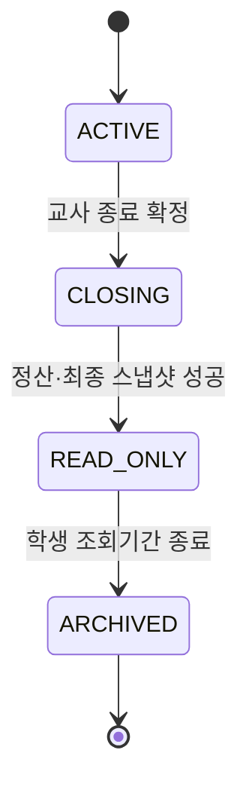

| 현재 상태 | 허용 | 금지·전이 조건 |
| --- | --- | --- |
| ACTIVE | 모듈 운영, 자율시간, 지도 활동, 정상 경제활동 | 종료 확정 전 CLOSING으로 이동하지 않음 |
| CLOSING | 미완료 거래 취소, 상품 처리, 금융 정산, 활동 종료, 최종 스냅샷 생성 | 신규 구매·거래·가입·대출·투자·지도 활동 시작 금지 |
| READ_ONLY | 학생 30일 조회, 교사·관리자 조회·내보내기 | 잔액·아이템·정책·학습 결과 변경 금지 |
| ARCHIVED | 교사·관리자의 보존기간 내 감사·내보내기 | 학생 접근과 모든 운영 명령 금지 |

- `ACTIVE → CLOSING`은 영향 목록을 확인한 교사의 최종 확인 후 시작하며 되돌리지 않습니다.
- `CLOSING → READ_ONLY`는 미완료 항목이 없고 최종 스냅샷이 성공한 경우에만 가능합니다.
- `READ_ONLY → ARCHIVED`는 학생 조회기간 30일 종료 후 자동 수행합니다.
- 보존기간이 끝나면 상태를 추가로 변경하는 대신 식별 연결정보 삭제 작업을 기록합니다.

### 3.2 SM-APP-001 학생 앱 이용 모드

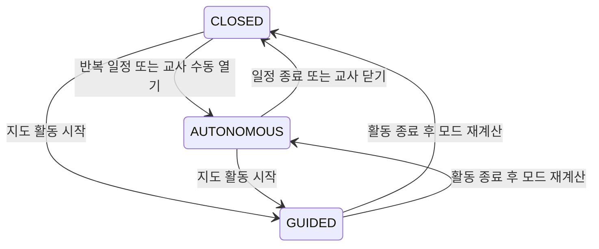

유효 모드는 저장된 마지막 모드가 아니라 다음 우선순위로 매번 계산합니다.

```text
진행 중 GUIDED 활동 > 교사 수동 설정 > 반복 일정 > CLOSED
```

| 모드 | 학생에게 허용되는 동작 |
| --- | --- |
| CLOSED | 로그인, 공지와 허용된 과거 기록 조회. 신규 금액·아이템·금융·거래 변경 금지 |
| AUTONOMOUS | 교사가 활성화한 모듈의 자율 명령 |
| GUIDED | 현재 활동 참여와 활동에 필요한 조회·제출. 상점·개인거래·금융 등 다른 경제 명령은 차단 |

- 종료 5분·1분 전에 알림을 발행합니다.
- 종료 전에 서버가 `RECEIVED`로 접수한 명령은 SM-TXN-001에 따라 완료하고, 클라이언트에만 남은 초안은 실행하지 않습니다.
- GUIDED 시작 시 참여 학생 앱은 활동 전용 화면으로 이동하고, 공용 화면에는 공개 가능한 정보만 표시합니다.
- LIVE 커밋 전에 서버가 접수한 경제 명령은 완료하되 이후 새 경제 명령은 거절합니다.
- GUIDED 종료 시 과거 모드로 단순 복귀하지 않고 수동 설정과 현재 일정을 다시 계산합니다.

### 3.3 SM-MOD-001 모듈 운영

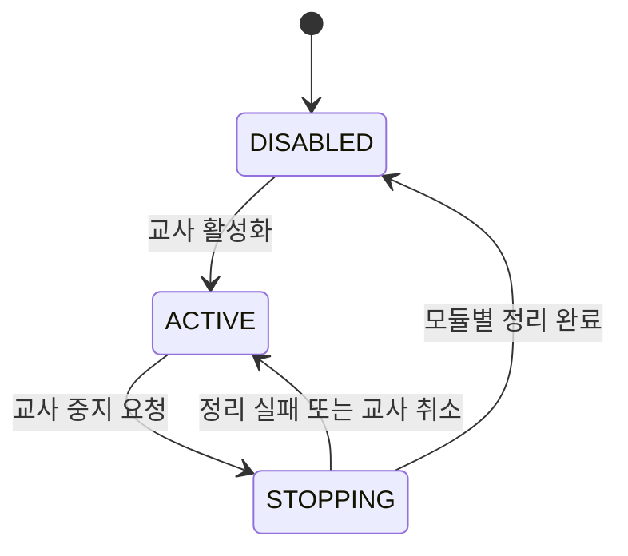

| 전이 | 필수 조건·효과 |
| --- | --- |
| DISABLED → ACTIVE | 선수 모듈 활성, 학년 정책 검증, 학생 메뉴·명령 공개 |
| ACTIVE → STOPPING | 진행 중 지도 활동이 없어야 함. 즉시 신규 사용 차단 |
| STOPPING → DISABLED | 모듈별 활성 데이터 정리 완료, 기존 기록 보존 |
| STOPPING → ACTIVE | 정리 트랜잭션이 반영되지 않았거나 교사가 확정 전에 중단 |

모듈별 중지 규칙:

| 모듈 | STOPPING 처리 |
| --- | --- |
| 개인거래 | 미완료 거래 취소, 잠긴 아이템 해제 |
| 실제 상품 상점 | 신규 구매 차단, 수령 대기 주문을 계속 처리하고 완료 후 중지 |
| 예금·적금 | 신규 가입 차단, 활성 계좌는 만기·중도해지까지 유지 |
| 투자 | 신규 주문 차단, 시장을 PAUSED로 전환한 뒤 교사 확인 가격으로 CLOSED 정산 |
| 대출 | 신규 신청 차단, 활성·연체 대출은 상환 또는 교실 종료 정산까지 유지 |
| 퀴즈·투표 | LIVE 활동 종료 전 중지 불가 |

## 4. 지도 활동과 공통 거래

### 4.1 SM-ACT-001 교사 지도 활동

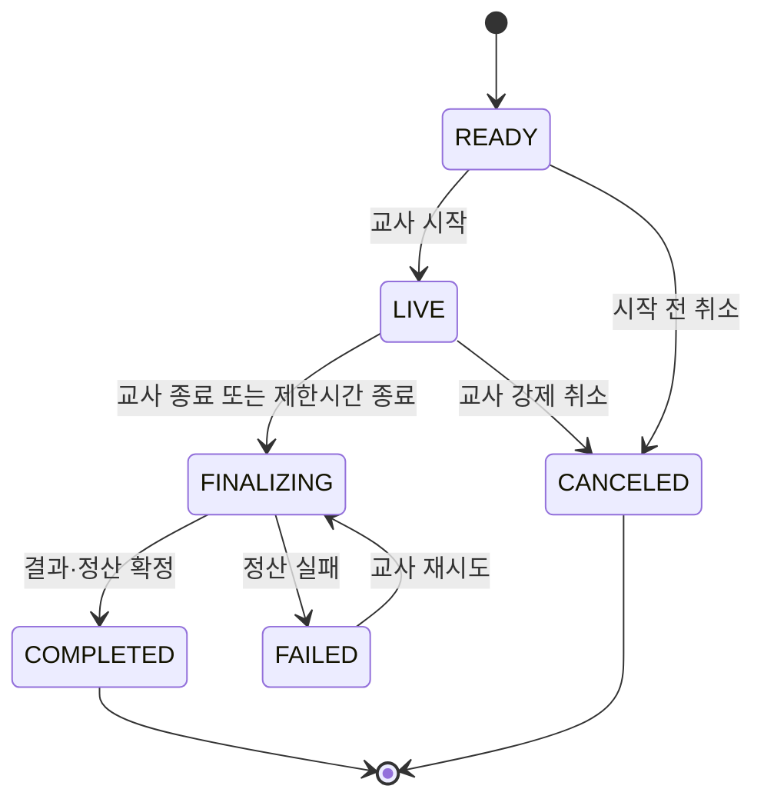

- `READY → LIVE`에서 대상 학생, 문제·선택지, 공개 범위와 정책 스냅샷을 고정합니다.
- LIVE 진입 커밋 후 학생 앱 전환과 공용 화면 이벤트를 발행합니다.
- `FINALIZING`에서는 신규 제출을 닫고 서버 접수 제출만 계산합니다.
- `COMPLETED`와 `CANCELED` 후 SM-APP-001 유효 모드를 재계산합니다.
- CANCELED 활동은 결과·보상을 만들지 않고 제출·취소 사유만 감사 기록으로 보존합니다.
- 활동 결과가 금액을 변경하면 SM-TXN-001이 성공한 뒤 결과를 확정합니다.

### 4.2 SM-TXN-001 원장 거래 명령

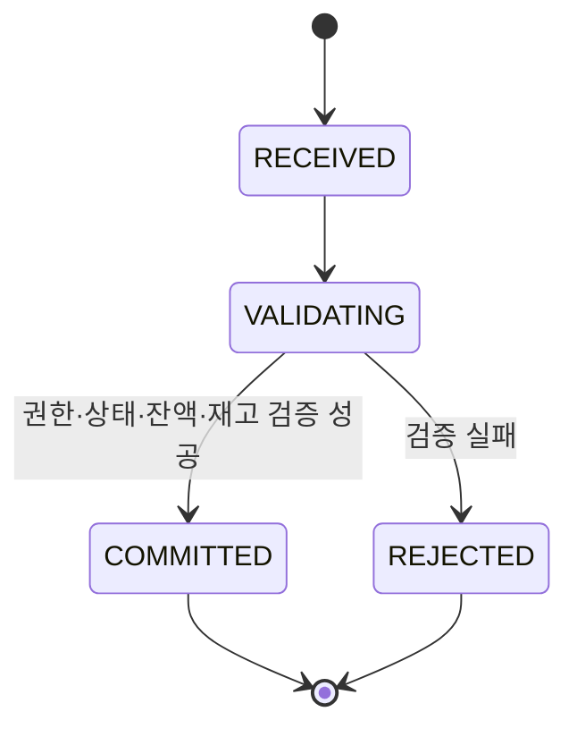

- 같은 요청번호가 다시 오면 새 거래를 만들지 않고 기존 `COMMITTED` 또는 `REJECTED` 결과를 반환합니다.
- `VALIDATING`에서 역할, 앱 모드, 모듈 상태, 정책 버전, 잔액, 재고와 현재 `state_version`을 확인합니다.
- `COMMITTED`에서 거래 그룹, 원장 항목, 전후 잔액, 정책 스냅샷과 관련 도메인 상태가 함께 확정됩니다.
- 일부 원장 항목만 성공하는 상태는 허용하지 않습니다.
- 완료 오류는 상태를 되돌리지 않고 원거래를 참조하는 새 복구 거래로 처리합니다.

## 5. 개인거래·아이템·상점

### 5.1 SM-TRD-001 학생 개인거래

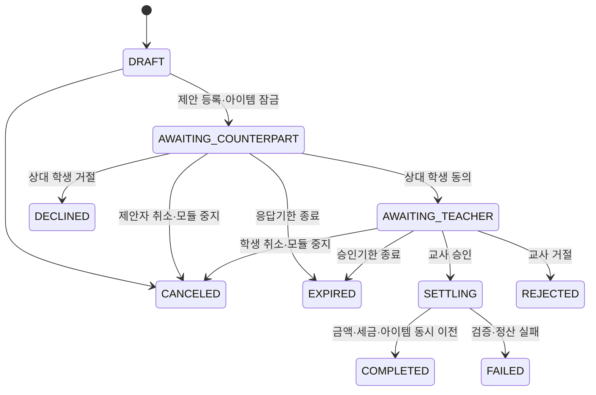

- 거래 내역은 `AWAITING_TEACHER`부터 교사 승인 목록에 표시합니다.
- 아이템은 `AWAITING_COUNTERPART` 진입 시 잠그고 완료 외 모든 종료 상태에서 원소유자의 AVAILABLE로 되돌립니다.
- 교사 승인 시 최신 잔액·소유권·세율·모듈 상태를 다시 검증합니다.
- `SETTLING → COMPLETED`는 금액, 개인거래세와 아이템 소유권을 한 트랜잭션으로 변경합니다.
- COMPLETED에는 학생 취소·환불 전이가 없습니다. 운영 오류는 복구 거래를 사용합니다.

### 5.2 SM-ITM-001 거래 대상 아이템

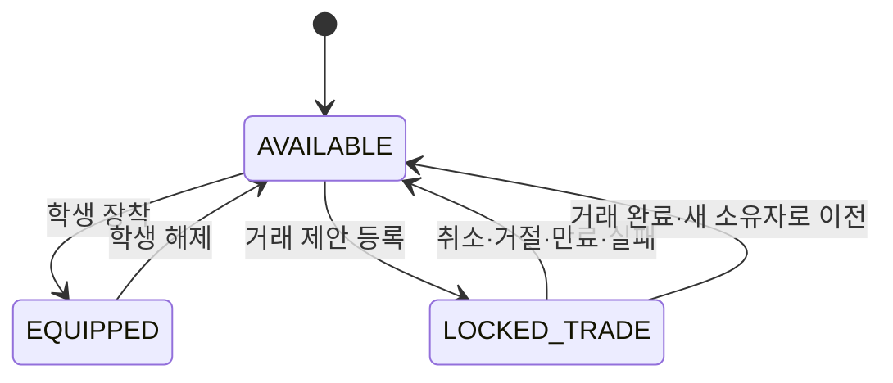

- EQUIPPED 아이템은 해제하기 전 거래에 등록할 수 없습니다.
- LOCKED_TRADE에서는 장착·다른 거래 등록·삭제를 금지합니다.
- 거래 완료 전이에서는 소유자 변경과 잠금 해제를 같은 트랜잭션으로 수행합니다.

### 5.3 SM-SHP-001 상점 주문

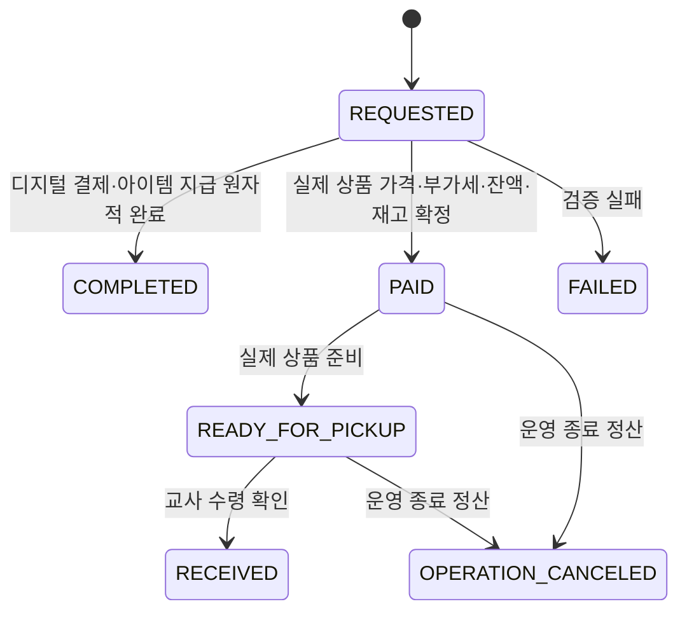

- 디지털 상품은 결제와 아이템 지급을 같은 트랜잭션으로 처리하고 바로 COMPLETED가 됩니다.
- 실제 상품은 PAID 후 수령 대기 상태를 유지하며 상점 모듈 중지 중에도 처리할 수 있습니다.
- 학생이 요청하는 환불·취소 전이는 없습니다.
- `OPERATION_CANCELED`는 교사의 운영 종료 사유와 복구 거래를 요구하며 일반 환불로 표시하지 않습니다.

## 6. 금융

### 6.1 SM-DEP-001 정기예금

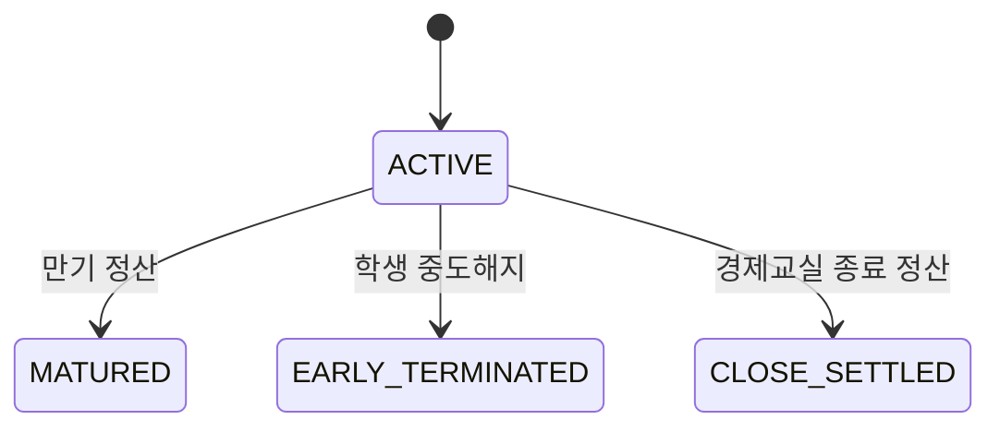

- ACTIVE 진입 시 원금 출금과 가입 정책 스냅샷 저장을 함께 처리합니다.
- 세 종료 상태는 원금·이자 지급 원장 거래가 성공한 뒤 확정합니다.
- CLOSE_SETTLED에는 중도해지 불이익을 적용하지 않습니다.

### 6.2 SM-SAV-001 정기적금 계좌

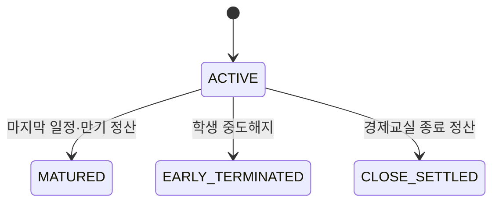

- 계좌 종료 후 SCHEDULED 납입은 실행하지 않습니다.
- 만기 이자는 실제 PAID 납입과 가입 당시 정책으로 계산합니다.
- CLOSE_SETTLED에는 중도해지 불이익을 적용하지 않습니다.

### 6.3 SM-SAV-002 적금 납입

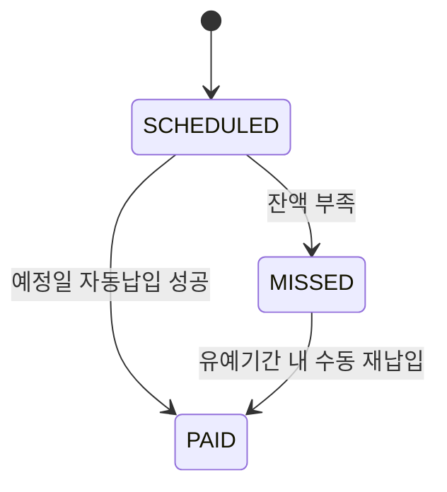

- 자동납입은 부분 출금과 음수 잔액을 허용하지 않습니다.
- MISSED 상태의 유예 종료 여부는 `retryable_until`로 판단하며, 종료 후 PAID 전이를 거절합니다.
- 적금 미납은 대출 신용 상태를 변경하지 않습니다.

### 6.4 SM-IVT-001 투자 시장

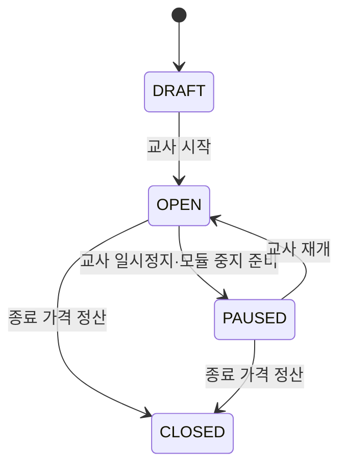

- DRAFT에서 가상 자산, 가격 시나리오, 단계와 한도를 고정합니다.
- OPEN에서만 신규 투자 주문을 접수합니다.
- PAUSED는 조회만 허용하고 보유자산을 자동 매도하지 않습니다.
- CLOSED에서 승인된 최종 가격으로 모든 포지션을 자동 매도하고 이후 재개하지 않습니다.

### 6.5 SM-IVT-002 투자 주문

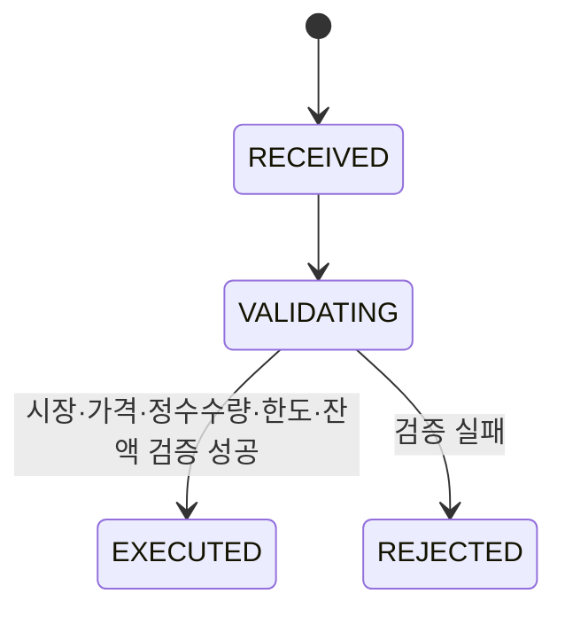

- 시장가 주문만 있으므로 대기·부분체결·취소 상태를 만들지 않습니다.
- EXECUTED에서 지갑, 포지션, 실현손익과 원장 항목을 함께 확정합니다.
- 같은 요청번호의 재시도는 같은 체결 결과를 반환합니다.

### 6.6 SM-LON-001 교육용 대출

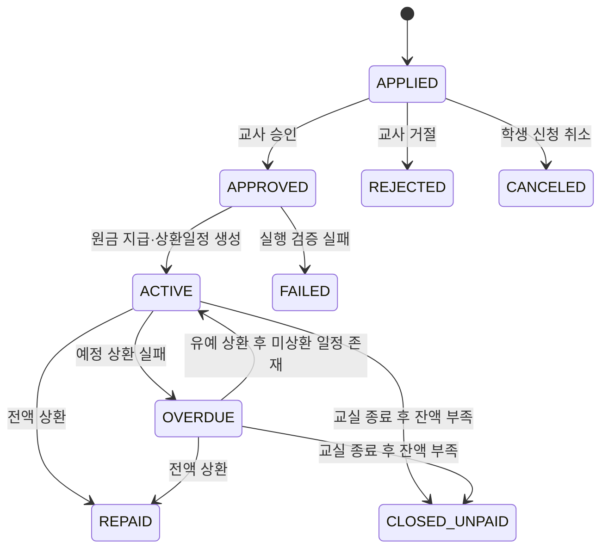

- APPROVED만으로 원금을 지급하지 않으며 ACTIVE 전이 트랜잭션에서 지급과 계좌 생성을 함께 처리합니다.
- 자동상환은 부분 출금·음수 잔액·연체료를 허용하지 않습니다.
- 교실 종료 시 가능한 금액을 먼저 상환하고 부족액은 CLOSED_UNPAID에 기록합니다.
- REPAID와 CLOSED_UNPAID는 종료 상태이며 새 학급으로 이월하지 않습니다.

### 6.7 SM-CRD-001 기본 신용

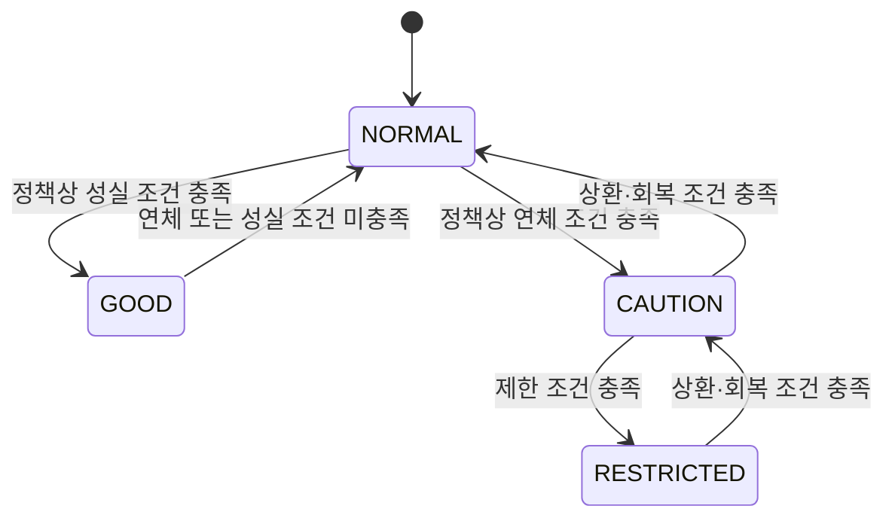

- 평가 임계치와 관찰기간은 버전 관리되는 교실 정책이며 코드에 고정하지 않습니다.
- 한 번의 평가에서는 최대 한 단계만 이동합니다.
- GOOD 금리는 최대 -1%p, CAUTION은 최대 +1%p 범위에서 신규 대출에만 반영합니다.
- RESTRICTED는 신규 대출 신청을 차단하며 현재 대출의 상환은 계속 허용합니다.
- 신용 상태는 본인과 권한 있는 교사만 조회합니다.

## 7. 퀴즈

### 7.1 SM-QST-001 퀴즈 문제

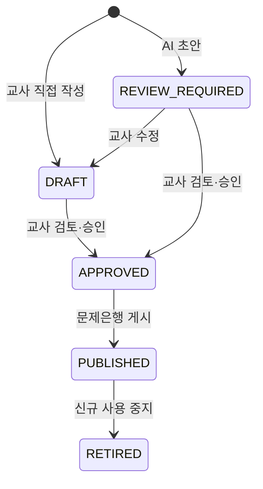

- 게시된 문제 수정은 PUBLISHED를 되돌리지 않고 새 DRAFT 버전을 만듭니다.
- 퀴즈 실행에는 문제 버전과 정답·해설 스냅샷을 저장합니다.
- AI가 만든 문제는 REVIEW_REQUIRED를 건너뛸 수 없습니다.

### 7.2 SM-QZS-001 퀴즈 실행

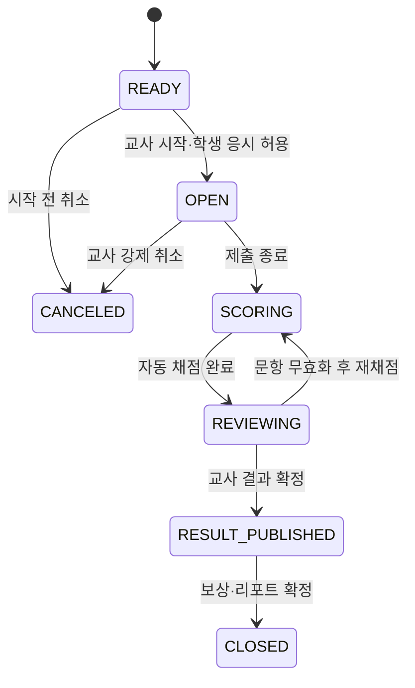

- GAME의 OPEN은 실시간 타이머·속도 점수를 사용하고 TEST는 개인별 응시창을 사용합니다.
- TEST는 순위·속도 보너스·화폐 보상을 생성하지 않습니다.
- 1회 코스는 GAME과 TEST 모두 화폐 보상을 생성하지 않습니다.
- 보상 거래가 필요한 경우 SM-TXN-001 COMMITTED 후 CLOSED로 전이합니다.
- RESULT_PUBLISHED 이후 오류는 결과 버전을 추가하고 복구 거래를 만들며 과거 상태로 되돌리지 않습니다.

### 7.3 SM-QAD-001 출제 오류 판정

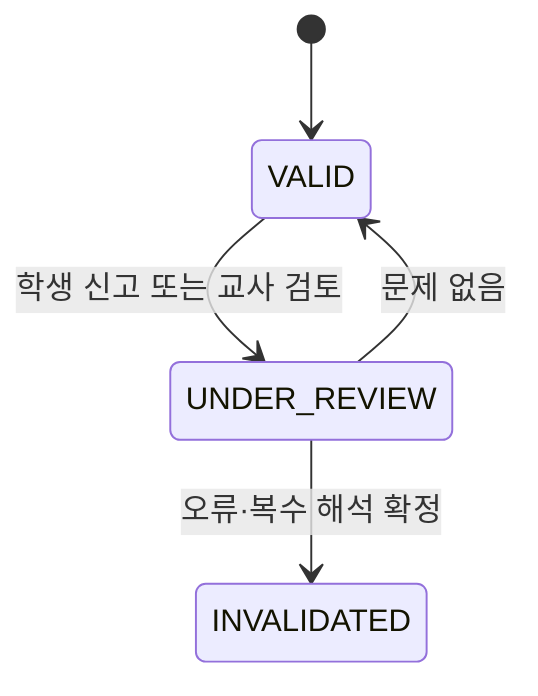

- INVALIDATED 문항은 점수, 정답률과 평가 분모에서 제외합니다.
- REVIEWING 단계라면 재채점 후 결과를 공개합니다.
- 결과·보상 확정 후라면 새 결과 버전과 학생별 복구 거래를 생성합니다.

## 8. AI

### 8.1 SM-AIR-001 AI 실행

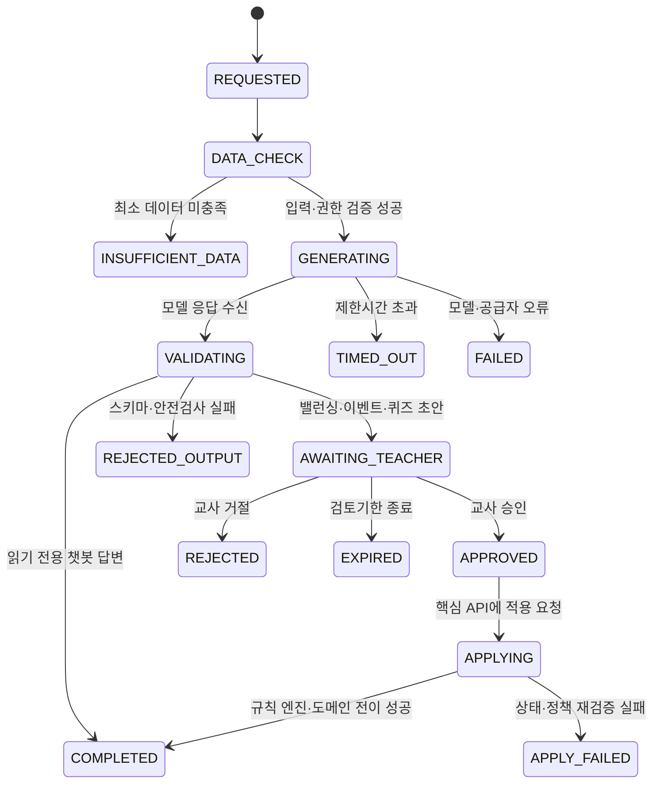

- DATA_CHECK에서 권한, AI 기능 켜짐, 최소 데이터와 입력 최소화를 검증합니다.
- 경제 밸런싱은 학생 5명 또는 관련 거래 10건 미만이면 INSUFFICIENT_DATA입니다.
- 챗봇은 구조화 검증 후 교사에게만 표시하므로 AWAITING_TEACHER 없이 COMPLETED가 됩니다.
- 밸런싱·이벤트·퀴즈 초안은 교사 승인 없이는 적용·게시하지 않습니다.
- APPROVED 이후에도 핵심 API가 최신 상태와 허용 범위를 다시 검증합니다.
- AI는 APPLYING 과정에서 데이터베이스나 학생 계좌를 직접 변경하지 않습니다.
- 모든 종료 상태에 AI 실행 ID, 모델·프롬프트 버전, 검증 결과와 교사 결정을 남깁니다.

## 9. 교차 전이 규칙

| 발생 상황 | 함께 적용되는 상태 머신 |
| --- | --- |
| 지도 활동 시작 | SM-ACT-001 LIVE 커밋 → SM-APP-001 GUIDED 계산 → 화면 이벤트 |
| 자율시간 종료 | SM-APP-001 CLOSED 계산, 이미 RECEIVED인 명령은 SM-TXN-001 계속 처리 |
| 개인거래 완료 | SM-TRD-001 SETTLING + SM-ITM-001 소유권 + SM-TXN-001 원장을 한 트랜잭션으로 확정 |
| 상점 구매 | SM-SHP-001 + 재고·아이템 + SM-TXN-001 원장을 한 트랜잭션으로 확정 |
| 금융 가입·상환·정산 | 금융 상태 + 지갑 + SM-TXN-001 원장을 한 트랜잭션으로 확정 |
| 퀴즈 보상 확정 | SM-QZS-001 REVIEWING → SM-TXN-001 COMMITTED → 결과 공개·CLOSED |
| AI 제안 적용 | SM-AIR-001 APPROVED → 핵심 API 최신 검증 → 해당 도메인 상태 전이 |
| 경제교실 종료 | SM-CLS-001 CLOSING이 모듈·거래·금융·활동 정산을 조정하고 성공 후 READ_ONLY |

## 10. API·데이터 설계에 넘길 공통 필드

모든 상태 보유 리소스의 최소 필드:

| 필드 | 의미 |
| --- | --- |
| `status` | 현재 상태 코드 |
| `state_version` | 낙관적 동시성 제어용 증가 값 |
| `status_changed_at` | 마지막 상태 변경 서버 시각 |
| `status_changed_by` | 학생·교사·시스템 실행자 |
| `status_reason_code` | 상태 변경 사유 코드 |
| `policy_snapshot_id` | 전이에 사용한 정책 버전 |
| `request_id` | 중복 요청 방지 식별자 |

상태 이력에는 이전 상태, 이후 상태, 명령, 실행자, 결과와 실패 사유를 추가로 저장합니다.

## 11. 후속 설계 순서

화면과 행동 경계는 [화면 ID·행동 명세](SCREEN_SPEC.md)를 따릅니다.

HTTP 명령 연결은 [HTTP API 명세](HTTP_API_SPEC.md)에서 완료했습니다.

1. WebSocket 이벤트 연결
2. 엔티티·상태 이력·원장 관계 데이터 설계
3. 상태 전이 인수 테스트와 오류 코드 연결

ERD는 권한과 화면·API 경계를 확인한 뒤 진행합니다.

상태별 명령 권한은 [역할·권한 매트릭스](PERMISSION_MATRIX.md)를 따릅니다.
