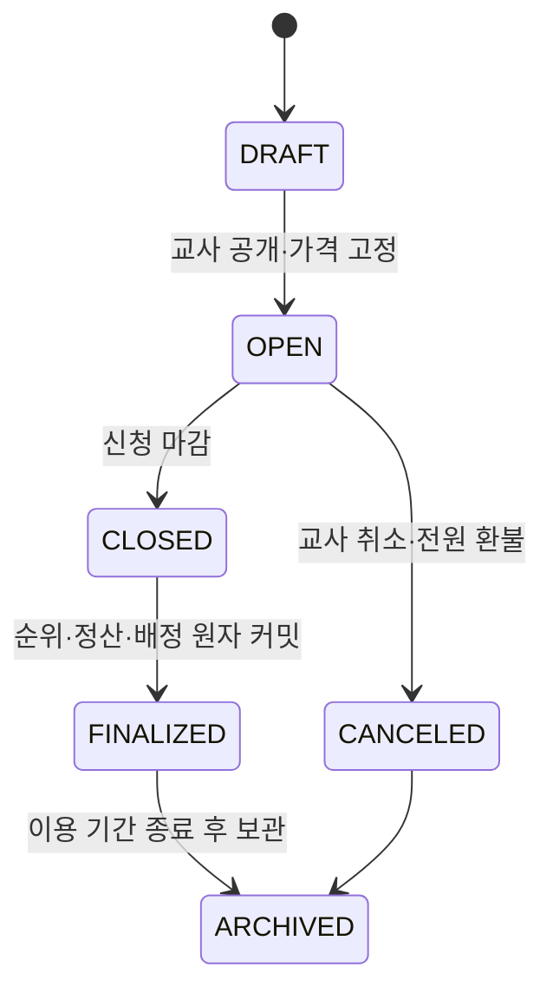

# 교육용 좌석 청약 MVP 정책·신청 흐름

- 상태: 부동산 연계 보강 결정안 (`S15P11B201-314`)
- 대상: 초등 5~6학년 교실 경제 활동
- 선행 조건: `REAL_ESTATE` 모듈 `ACTIVE`, 공급 방식 `SUBSCRIPTION`인 좌석 자산 1개

청약은 실제 주택 청약·분양·투자 상품이 아니다. 하나의 교실 좌석 이용권을 얻기 위해 목표 금액을 마련하고, 공개된 규칙으로 한 명을 배정하는 교육 활동이다. 화면에는 “실제 주택 청약이 아닌 교실 자리 선택 활동” 안내를 항상 표시한다.

## 1. 부동산과의 결합 불변식

- 청약 상품은 `real_estate_asset_id` 하나에만 연결된다. 연결 자산은 경제 활동 가능 좌석 하나를 나타낸다.
- 자산 하나에는 열린 청약 상품이 최대 1개, 상품의 배정 정원은 언제나 **1명**이다. 여러 좌석은 여러 상품으로 공급한다.
- 청약 공개 시 자산의 `locked_price`와 좌석 이용 기간을 상품에 복사해 고정한다. 이후 자산 가격·이벤트 계수를 바꿔도 신청자 조건은 변하지 않는다.
- 자산이 이미 배정·반납 대기·보관 상태이거나, 학생이 이미 활성 좌석 이용권을 가지면 신청·배정할 수 없다.
- 부동산 모듈을 끄기 전에는 열린 상품을 마감하거나 취소해 전액 환불해야 한다. 열린 상품이 있으면 모듈 비활성화가 거절된다.

## 2. 예치와 선정 규칙

청약 예치금은 소액 신청 수수료가 아니라 **고정된 좌석 가격 전액**이다. 신청 시 학생 지갑에서 `SUBSCRIPTION_ESCROW:{product_id}`로 전액 이동하므로, 선정 후 잔액 부족 때문에 순위 결과가 뒤집히지 않는다. 학생은 신청 전에 필요한 금액을 저축하는 것을 학습한다.

- 신청 가능 기간은 1~14일이며, 가격은 연결 좌석 자산의 청약 공개 가격(100~5,000)이다.
- 학생은 같은 상품에 한 번만 신청하고, 활성 좌석 이용권이 있으면 신청할 수 없다.
- 마감 전 취소하면 전액을 즉시 환불한다. 마감 후에는 임의 취소나 순위 변경이 불가능하다.
- 순위는 `저축 목표 달성 여부(0/1) + 활동 참여 횟수(0~3)` 내림차순, 동점이면 신청 시각 오름차순으로 정한다. 추첨·교사의 임의 개인 점수 변경은 MVP에서 제외한다.
- 점수는 마감 시각을 기준으로 서버가 한 번만 스냅샷한다. 재시도·실시간 화면 갱신은 같은 스냅샷과 정렬 결과를 사용한다. 신청 화면의 현재 점수는 안내용 예상 값임을 명시한다.
- 선정자는 예치금을 판매 계정으로 정산하면서 좌석 이용권을 받는다. 미선정자는 전액 환불된다.

## 3. 상태와 원자 처리

신청 상태는 `APPLIED`, `CANCELED`, `SELECTED`, `NOT_SELECTED`, `REFUNDED`, `FULFILLED`를 사용한다. 마감 명령은 아래를 하나의 원자 작업으로 처리한다.

1. 마감 시각 기준 우선순위 입력을 `subscription_priority_snapshots`에 append-only로 저장한다.
2. 정렬 첫 번째 신청자를 `SELECTED`, 나머지를 `NOT_SELECTED`로 확정한다.
3. 선정자 예치금은 판매 계정으로 정산하고 좌석 이용권을 생성한다. 미선정자 예치금은 각 지갑으로 환불한다.
4. 상품과 연결 자산의 상태·버전·감사 이력을 갱신한다.

하나라도 실패하면 신청 상태·예치금·좌석 권리 어느 것도 부분 전이하지 않는다. 같은 요청 ID로 마감을 재시도하면 기존 결과와 영수증을 반환한다.

교사가 열린 상품을 취소하면 모든 `APPLIED` 예치금을 전액 환불한다. 마감 완료 후에는 학습·안전상 재배치가 필요한 경우에만 부동산의 `TEACHER_OVERRIDE` 절차를 사용하며, 선정 결과 자체를 재정렬하지 않는다.

## 4. 원장·권한·공개 경계

| 시점 | `transaction_type` | 원장 효과 | actor |
| --- | --- | --- |
| 신청 | `SUBSCRIPTION_RESERVATION_DEPOSIT` | 학생 지갑 `-고정 가격`, 청약 예치 계정 `+고정 가격` | `STUDENT` |
| 마감 전 취소 | `SUBSCRIPTION_CANCELLATION_REFUND` | 예치 계정 `-고정 가격`, 학생 지갑 `+고정 가격` | `STUDENT` |
| 미선정 환불 | `SUBSCRIPTION_NON_SELECTION_REFUND` | 예치 계정 `-고정 가격`, 학생 지갑 `+고정 가격` | `SYSTEM` |
| 선정 정산 | `SUBSCRIPTION_ALLOCATION_SETTLEMENT` | 예치 계정 `-고정 가격`, 부동산 판매 계정 `+고정 가격` | `SYSTEM` |
| 열린 상품 취소 | `SUBSCRIPTION_PRODUCT_CANCEL_REFUND` | 예치 계정 `-고정 가격`, 학생 지갑 `+고정 가격` | `TEACHER` |

선정은 단순 business event가 아니라 예치금 정산과 좌석 이용권 배정을 포함한 원장 트랜잭션이다. 모든 환불은 원거래 수정이 아닌 새 원장 거래이며, 요청 ID로 멱등 처리한다.

학생은 본인 신청·예상 점수·결과만, 교사는 담당 학급의 상품 설정·집계·마감·취소만, 공용 화면은 상품명·좌석 구역·신청자 수·마감 결과 집계만 볼 수 있다. 개인 점수 원본, 잔액, 순위, 미선정 사유, 좌석 배정 학생은 공용 화면에 공개하지 않는다.

`MODULE_INACTIVE`, `ASSET_NOT_SUBSCRIPTION`, `ASSET_ALREADY_ALLOCATED`, `OPEN_PRODUCT_ALREADY_EXISTS`, `PRODUCT_NOT_OPEN`, `APPLICATION_WINDOW_CLOSED`, `ALREADY_APPLIED`, `ALREADY_HAS_SEAT_RIGHT`, `INSUFFICIENT_BALANCE`, `RESULT_ALREADY_FINALIZED`, `OPEN_ACTIVITY_EXISTS`를 명시 오류로 반환한다.

## 5. 구현 계약과 검증

- DB: `subscription_products`(필수 `real_estate_asset_id`, `locked_price`, 정원 1), `subscription_applications`, `subscription_priority_snapshots`, 상품별 예치 계정.
- API: 상품 초안/공개/조회/취소, 신청/취소, 마감·개인 결과 조회. 모든 쓰기 명령은 상태 버전과 UI 식별자, 멱등 키를 받는다.
- 이벤트: `subscription.application.status_changed`(SELF), `subscription.result.finalized`(SELF/TEACHER), `subscription.product.changed`(CLASSROOM 집계 전용).
- 필수 테스트: 중복 신청, 활성 좌석 보유 학생 거절, 전액 예치 잔액 부족 무변경, 마감 후 신청/취소 거절, 동점 시 신청 시각 정렬, 한 좌석에 복수 선정 불가, 마감 재시도 멱등성, 취소 시 전원 환불, 원장 실패 시 배정 미생성, 공개 이벤트 개인정보 누출 방지.

좌석의 학습권 보호·반납·교사 재배치 규칙은 [REAL_ESTATE_MVP_POLICY.md](REAL_ESTATE_MVP_POLICY.md)를 따른다.
