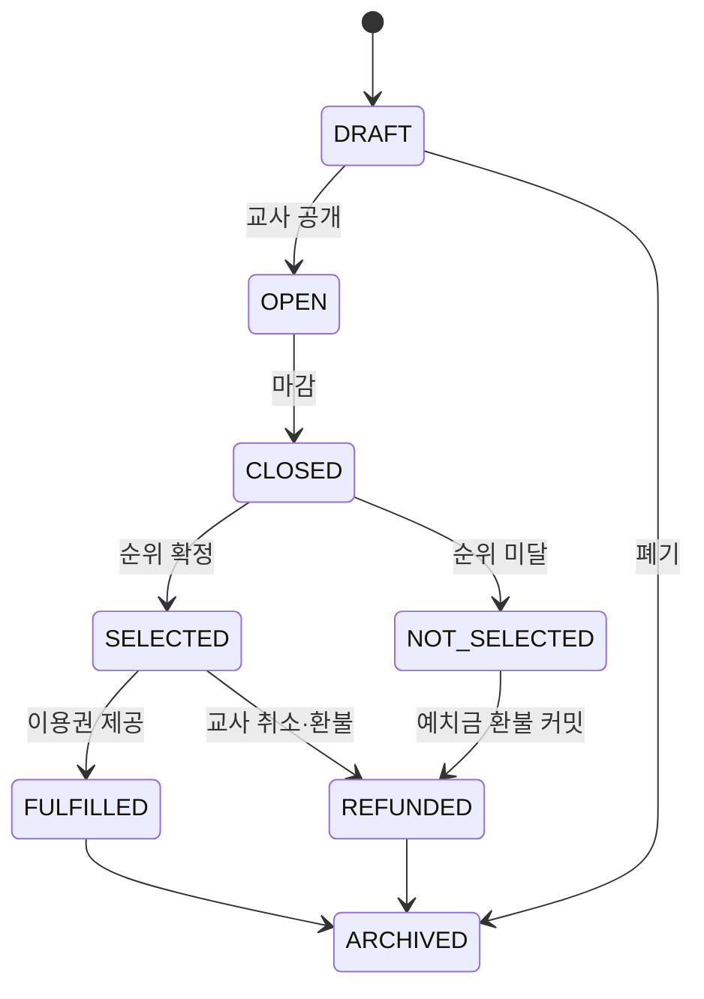

# 교육용 청약 MVP 정책·신청 흐름

- 상태: 결정안 (`S15P11B201-314`)
- 대상: 초등 5~6학년 교실 경제 활동

청약은 실제 주택 청약·분양·투자 상품이 아니라, 제한된 교실 자원을 위해 저축하고 우선순위를 정하는 교육 활동이다. 화면에는 항상 “실제 주택 청약이 아닌 교실 활동” 안내를 표시한다.

## 1. 범위와 선정 규칙

교사는 학급당 최대 2개의 **교실 자원 이용권** 상품(예: 팀 활동 우선 선택권, 가상 상점 한정 묶음)을 열 수 있다. 실제 부동산, 현금 환급, 프리미엄·전매, 대출 연계는 제외한다.

- 신청금은 10~300 정수 화폐이고 상품마다 고정한다. 신청 때 학생 지갑에서 청약 예치 계정으로 이동한다.
- 신청 기간은 1~14일, 정원은 1~학급 활성 학생 수다.
- 학생은 같은 상품에 한 번만 신청할 수 있고, 마감 전에는 취소·전액 환불할 수 있다.
- 선정은 **교사가 공개한 우선순위 점수 내림차순, 동점은 신청 시각 오름차순**으로 결정한다. 추첨은 MVP에서 제외한다.
- 우선순위 점수는 `저축 목표 달성 여부(0/1) + 활동 참여 횟수(0~3)`만 사용하며, 교사가 임의로 개인 점수를 변경할 수 없다. 선정 전 상품 화면에 계산식과 현재 내 점수를 표시한다.

## 2. 상태 흐름

상품은 `DRAFT → OPEN → CLOSED → ARCHIVED`이고, 신청은 `APPLIED`, `CANCELED`, `SELECTED`, `NOT_SELECTED`, `REFUNDED`, `FULFILLED` 상태를 가진다. 마감 처리에서 순위 계산, 선정/미선정 전이, 미선정 환불은 하나의 원자 작업으로 처리한다. 실패 시 어떤 신청도 결과 상태나 환불 상태로 부분 전이하지 않는다.

## 3. 교사·학생 흐름

교사는 상품명·교육 목적·정원·신청금·기간·우선순위 계산식을 저장하고 공개한다. 마감 후 서버가 고정한 입력으로 순위를 계산해 결과를 확정한다. 교사는 이미 확정한 순위를 재정렬할 수 없으며, 상품 자체를 취소할 때만 선정자까지 전액 환불할 수 있다.

학생은 상품의 목적, 신청금, 마감 시각, 정원, 내 점수와 계산식을 보고 신청한다. 잔액이 부족하면 신청은 생기지 않는다. 마감 전 취소하면 즉시 환불되고, 마감 후에는 결과와 본인 예치금 처리만 본다. 학급 공개 화면에는 선정 인원 수와 상품명만 표시하며 개인 점수·잔액·미선정 사유는 공개하지 않는다.

## 4. 원장·권한·예외

| 시점 | transaction_type | 원장 효과 | actor |
| --- | --- | --- | --- |
| 신청 | `SUBSCRIPTION_DEPOSIT` | 학생 지갑 `-신청금`, 청약 예치 계정 `+신청금` | `STUDENT` |
| 마감 전 취소 | `SUBSCRIPTION_CANCELLATION_REFUND` | 예치 계정 `-신청금`, 학생 지갑 `+신청금` | `STUDENT` |
| 미선정 환불 | `SUBSCRIPTION_NON_SELECTION_REFUND` | 예치 계정 `-신청금`, 학생 지갑 `+신청금` | `SYSTEM` |
| 상품 취소 환불 | `SUBSCRIPTION_PRODUCT_CANCEL_REFUND` | 예치 계정 `-신청금`, 학생 지갑 `+신청금` | `TEACHER` |

선정은 금액 이동이 아니며 이용권 제공은 `SUBSCRIPTION_ALLOCATION` business event로만 기록한다. 모든 환불은 원거래를 수정하지 않는 새 원장 거래이고, 요청 ID로 멱등 처리한다. 학생은 본인 신청만, OWN은 담당 학급 설정·취소만, COT는 읽기만 할 수 있다.

`MODULE_INACTIVE`, `PRODUCT_NOT_OPEN`, `APPLICATION_WINDOW_CLOSED`, `ALREADY_APPLIED`, `INSUFFICIENT_BALANCE`, `INVALID_PRIORITY_INPUT`, `RESULT_ALREADY_FINALIZED`를 명시 오류로 반환한다.

## 5. 구현 계약과 후속 분해

- DB: `subscription_products`, `subscription_applications`, `subscription_priority_snapshots`, 상품별 `SUBSCRIPTION_ESCROW:{product_id}` 원장 계정
- API: 상품 설정/공개/취소, 상품 조회, 신청/취소, 마감·결과 조회
- 이벤트: `subscription.application.status_changed`(SELF), `subscription.result.finalized`(SELF/TEACHER), 집계 전용 `subscription.product.changed`(CLASSROOM)
- 화면: 교사 설정·마감 확인·집계, 학생 상품 상세·신청·내 결과, 공용 결과 카드
- BE 작업: 상태 머신·점수 스냅샷·순위 확정/환불 원자 명령·동시성 테스트
- FE 작업: 신청 가능 조건·마감 카운트다운·개인 결과·재연결 조회

필수 검증은 정상 신청, 중복 신청, 잔액 부족, 마감 후 신청/취소, 동점 시 시각 정렬, 마감 재시도 멱등성, 취소 상품의 전원 환불, 공개 이벤트의 개인 정보 누출 방지를 포함한다.
