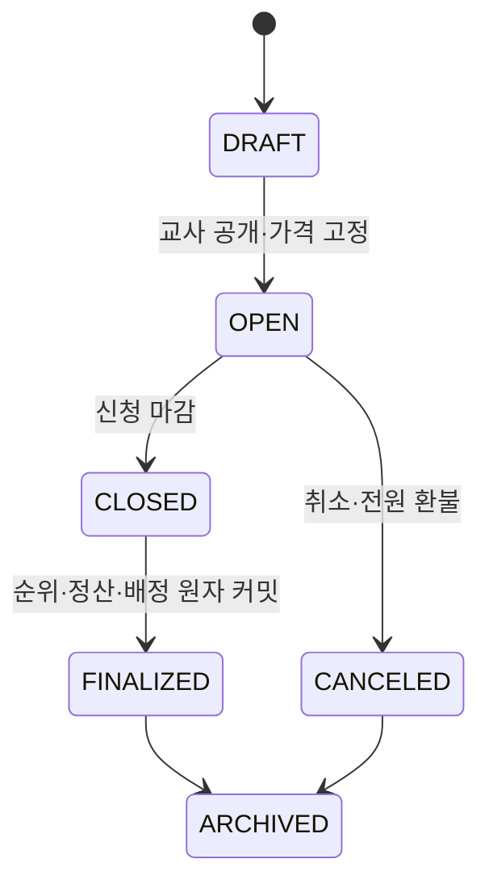

# 교육용 좌석 청약 MVP 정책

- 상태: 부동산 연계 보강 결정안 (`S15P11B201-314`)
- 선행 조건: `REAL_ESTATE` 모듈 `ACTIVE`, `SUBSCRIPTION` 방식 좌석 자산 1개

청약은 실제 주택 청약·분양이 아니라, 하나의 교실 좌석 이용권을 얻기 위해 필요한 금액을 마련하고 공개된 규칙으로 한 명을 배정하는 활동이다. 화면에는 “실제 주택 청약이 아닌 교실 자리 선택 활동”을 명시한다.

## 1. 부동산 연계 불변식

- 상품은 `real_estate_asset_id` 하나에만 연결되며, 그 자산은 실제 좌석 하나다.
- 자산 하나당 열린 청약 상품은 최대 1개, 상품의 배정 정원은 항상 **1명**이다. 여러 좌석은 여러 상품으로 공급한다.
- 공개 시 좌석 이용 기간과 `locked_price`를 상품에 복사해 고정한다.
- 이미 배정된 자산, 활성 이용권 보유 학생은 신청·배정할 수 없다.
- 모듈 비활성화 전에는 열린 상품을 마감 또는 취소해 전액 환불해야 한다.

## 2. 예치·순위·결과

청약 예치금은 신청 수수료가 아니라 **고정 좌석 가격 전액**이다. 신청 순간 학생 지갑에서 `SUBSCRIPTION_ESCROW:{product_id}`로 전액을 옮긴다. 따라서 선정 뒤 잔액 부족으로 순위 결과가 뒤집히지 않는다.

- 신청 기간은 1~14일, 가격은 좌석의 청약 공개 가격(100~5,000)이다.
- 상품당 학생은 한 번만 신청할 수 있고, 마감 전 취소는 전액 즉시 환불한다.
- 순위는 `저축 목표 달성 여부(0/1) + 활동 참여 횟수(0~3)` 내림차순, 동점이면 신청 시각 오름차순이다. 추첨과 교사의 임의 개인 점수 수정은 제외한다.
- 서버는 마감 시각의 입력을 한 번만 `subscription_priority_snapshots`에 저장한다. 재시도와 화면 갱신은 같은 스냅샷·결과를 사용한다.
- 선정자는 예치금이 판매 계정으로 정산되며 좌석 이용권을 받는다. 미선정자는 전액 환불된다.

## 3. 상태·원자 처리

마감은 점수 스냅샷, 선정·미선정 상태 확정, 선정자 정산·권리 생성, 미선정자 환불, 상품·자산 상태 갱신을 한 트랜잭션으로 처리한다. 하나라도 실패하면 어떤 신청도 부분 전이하지 않는다. 같은 요청 ID의 재시도는 기존 영수증과 결과를 반환한다.

교사가 열린 상품을 취소하면 모든 `APPLIED` 예치금을 전액 환불한다. 마감 뒤 학습·안전상 재배치가 필요하면 순위를 다시 정하지 않고 부동산의 `TEACHER_OVERRIDE` 절차를 사용한다.

## 4. 원장·권한·검증

| 시점 | `transaction_type` | 원장 효과 | actor |
| --- | --- | --- | --- |
| 신청 | `SUBSCRIPTION_RESERVATION_DEPOSIT` | 학생 지갑 `-고정 가격`, 예치 계정 `+고정 가격` | `STUDENT` |
| 마감 전 취소 | `SUBSCRIPTION_CANCELLATION_REFUND` | 예치 계정 `-고정 가격`, 학생 지갑 `+고정 가격` | `STUDENT` |
| 미선정 환불 | `SUBSCRIPTION_NON_SELECTION_REFUND` | 예치 계정 `-고정 가격`, 학생 지갑 `+고정 가격` | `SYSTEM` |
| 선정 정산 | `SUBSCRIPTION_ALLOCATION_SETTLEMENT` | 예치 계정 `-고정 가격`, 판매 계정 `+고정 가격` | `SYSTEM` |
| 열린 상품 취소 | `SUBSCRIPTION_PRODUCT_CANCEL_REFUND` | 예치 계정 `-고정 가격`, 학생 지갑 `+고정 가격` | `TEACHER` |

학생은 본인 신청·예상 점수·결과만, 교사는 상품 설정·집계·마감·취소만 본다. 공용 화면에는 상품명·좌석 구역·신청자 수·결과 집계만 공개하고 개인 점수·잔액·순위·배정 학생은 공개하지 않는다.

`MODULE_INACTIVE`, `ASSET_NOT_SUBSCRIPTION`, `ASSET_ALREADY_ALLOCATED`, `OPEN_PRODUCT_ALREADY_EXISTS`, `PRODUCT_NOT_OPEN`, `APPLICATION_WINDOW_CLOSED`, `ALREADY_APPLIED`, `ALREADY_HAS_SEAT_RIGHT`, `INSUFFICIENT_BALANCE`, `RESULT_ALREADY_FINALIZED`, `OPEN_ACTIVITY_EXISTS`를 명시 오류로 반환한다.

필수 테스트: 중복 신청, 활성 권리 보유 학생 거절, 잔액 부족 무변경, 마감 후 신청·취소 거절, 동점 시 신청 시각 정렬, 복수 선정 방지, 마감 재시도 멱등성, 취소 전원 환불, 원장 실패 시 권리 미생성, 공개 이벤트 개인정보 누출 방지.
