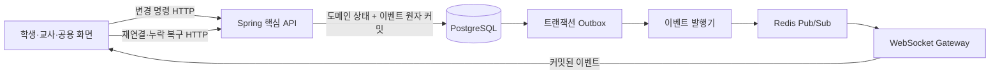

# 이코빌리지 WebSocket 명세

- 버전: v0.4
- 기준일: 2026-07-30
- 상태: AI 모니터링·투자 뉴스 사람 검토 계약 반영, AsyncAPI 3.1 동기화 예정
- 범위: 학생 앱, 교사 웹, 교실 공용 화면, 핵심 API 실시간 게이트웨이
- 기준: [API 공통 규칙](API_COMMON_RULES.md), [HTTP API 명세](HTTP_API_SPEC.md), [역할·권한 매트릭스](PERMISSION_MATRIX.md), [핵심 상태 머신](STATE_MACHINES.md)

## 1. 핵심 원칙

1. 상태·금액·아이템·답안·투표를 바꾸는 명령은 HTTP API로만 접수합니다.
2. WebSocket은 커밋된 상태 전달, 화면 전환, 타이머 동기화와 진행 집계에 사용합니다.
3. 핵심 API의 데이터베이스와 상태 머신이 최종 기준이며 Redis Pub/Sub는 전달 수단입니다.
4. 트랜잭션 커밋 전에 성공 이벤트를 발행하지 않습니다.
5. 전달은 최소 1회이며 중복될 수 있습니다. 클라이언트는 `event_id`로 중복을 제거합니다.
6. 순서는 채널별 `sequence`로만 보장하고 서로 다른 채널 사이의 전역 순서를 가정하지 않습니다.
7. 연결이 끊긴 동안의 변경 명령을 로컬에서 예약하거나 자동 실행하지 않습니다.
8. 공용 화면은 별도 공개 이벤트만 구독하며 내부 이벤트를 필드 마스킹해서 전달하지 않습니다.

## 2. 구성



- Spring 핵심 API는 도메인 변경과 outbox 이벤트를 같은 트랜잭션으로 저장합니다.
- 이벤트 발행기는 커밋된 outbox만 Redis Pub/Sub로 전달합니다.
- WebSocket Gateway는 구독 권한을 확인하고 역할별 또는 공개 이벤트로 전달합니다.
- Redis 전달 손실이나 Gateway 교체 시 이벤트 로그 또는 HTTP 스냅샷으로 복구합니다.
- Redis에 학생 계좌의 기준 상태나 유일한 거래 결과를 저장하지 않습니다.

## 3. 연결과 접속 티켓

### 3.1 접속 절차

1. 인증된 학생·교사·관리 웹은 `API-AUTH-007`로 1회용 실시간 접속 티켓을 발급받습니다.
2. 공용 화면은 `API-DSP-001`에서 발급된 공개 화면 티켓을 사용합니다.
3. 클라이언트는 `wss://{api_host}/ws/v1?ticket={one_time_ticket}`로 연결합니다.
4. Gateway가 티켓을 한 번 사용 처리하고 `connection.ready` 제어 메시지를 보냅니다.
5. 클라이언트가 허용된 채널을 구독합니다.

티켓 규칙:

- 기본 만료시간 60초
- 1회 사용
- 실행자, 역할, 학교·학급, 허용 채널 종류와 리소스 범위에 바인딩
- 장기 액세스·갱신 토큰을 URL에 사용하지 않음
- Gateway·프록시·관측 로그에서 `ticket` 쿼리를 마스킹
- 연결 최대 유지시간 8시간
- 사용자 세션 폐기, 공용 화면 해제 또는 활동 종료 시 연결을 즉시 폐기

### 3.2 연결 준비 메시지

```json
{
  "type": "connection.ready",
  "connection_id": "94b64514-2dce-4dc9-a7b4-545aec49119a",
  "server_time": "2026-07-29T07:00:00.120Z",
  "heartbeat_interval_seconds": 25,
  "connection_expires_at": "2026-07-29T15:00:00.120Z"
}
```

## 4. 클라이언트 제어 메시지

WebSocket으로 허용하는 클라이언트 메시지는 연결 관리뿐입니다.

| type | 용도 | 주요 필드 |
| --- | --- | --- |
| `subscription.subscribe` | 채널 구독 | `request_id, channel_id, resource_id?, last_sequence?` |
| `subscription.unsubscribe` | 채널 구독 해제 | `request_id, subscription_id` |
| `connection.ping` | 연결 확인 | `client_time` |
| `event.ack` | 마지막 적용 위치 진단 | `subscription_id, sequence` |
| `presence.update` | 학생 접속·화면 상태 전달 | `status=ONLINE\|AWAY, current_screen?` |

답안 제출, 투표, 거래, 투자 주문과 교사 제어 명령을 WebSocket 메시지로 받지 않습니다. 해당 작업은 [HTTP API 명세](HTTP_API_SPEC.md)를 사용합니다.

교사 연결에는 저장형 도메인 이벤트와 별도로 `presence.changed` 메시지를 전달합니다. 이 메시지는 학생 ID, `ONLINE/AWAY/OFFLINE/UNKNOWN`, 현재 화면과 마지막 확인 시각을 포함하며, 교사가 처음 학급을 열거나 연결을 복구할 때는 `GET /classrooms/{C}/roster-and-salaries`의 스냅샷을 기준으로 다시 맞춥니다.

구독 요청:

```json
{
  "type": "subscription.subscribe",
  "request_id": "2cb1211a-1809-4654-91d0-7f19b7ff1704",
  "channel_id": "WS-QZ-001",
  "resource_id": "31d1253c-d93e-4e9d-a5c8-8b1f42c5199a",
  "last_sequence": 42
}
```

구독 승인:

```json
{
  "type": "subscription.accepted",
  "request_id": "2cb1211a-1809-4654-91d0-7f19b7ff1704",
  "subscription_id": "ff8bc404-413c-43fc-a96f-a1f984933933",
  "channel_id": "WS-QZ-001",
  "resource_id": "31d1253c-d93e-4e9d-a5c8-8b1f42c5199a",
  "current_sequence": 45,
  "snapshot_url": "/api/v1/classrooms/8d492342/quiz-sessions/31d1253c"
}
```

## 5. 이벤트 공통 envelope

```json
{
  "type": "domain.event",
  "event_id": "ff6376ea-da5d-4389-956c-f283afae3ba1",
  "event_type": "quiz.question.opened",
  "schema_version": 1,
  "channel_id": "WS-QZ-001",
  "subscription_id": "ff8bc404-413c-43fc-a96f-a1f984933933",
  "sequence": 46,
  "occurred_at": "2026-07-29T07:01:20.000Z",
  "classroom_id": "8d492342-0d49-41d6-95a9-6d07b80cf199",
  "resource_id": "31d1253c-d93e-4e9d-a5c8-8b1f42c5199a",
  "state_version": 8,
  "originating_request_id": "ebbf2746-0793-43f2-8df5-e2bd4cc27211",
  "correlation_id": "240b0aac-565f-49b5-a796-d41b64ee103a",
  "audience": "PARTICIPANT",
  "payload": {
    "question_number": 3,
    "opens_at": "2026-07-29T07:01:20.000Z",
    "closes_at": "2026-07-29T07:01:40.000Z"
  }
}
```

| 필드 | 규칙 |
| --- | --- |
| `event_id` | 전체 시스템에서 유일한 UUID, 중복 제거 기준 |
| `event_type` | 버전과 독립적인 소문자 점 표기 이벤트 이름 |
| `schema_version` | payload 호환 버전, 기존 필드 의미 변경 시 증가 |
| `sequence` | 동일 논리 채널에서 증가하는 정수 |
| `state_version` | 이벤트를 만든 커밋 이후 리소스 버전 |
| `originating_request_id` | 원인이 된 HTTP `Idempotency-Key`, 자동 전이는 서버 요청 ID |
| `audience` | `SELF`, `PARTICIPANT`, `TEACHER`, `CLASSROOM`, `PUBLIC` |
| `payload` | 해당 audience 전용 DTO |

## 6. 채널 카탈로그

| 채널 ID | 논리 topic | 구독 주체 | 범위·권한 | 주요 용도 |
| --- | --- | --- | --- | --- |
| WS-CLS-001 | `classrooms/{C}/lifecycle` | STU·OWN·COT | 학급 소속·PM-RBAC-001 | 앱 모드, 학급 종료, 모듈·정책 버전 |
| WS-STU-001 | `classrooms/{C}/students/{S}/private` | 해당 STU | SELF·PM-DAT-001 | 잔액·주문·거래·금융·개인 퀴즈 결과 |
| WS-TCH-001 | `classrooms/{C}/teachers/control` | OWN·COT | 담당 학급 | 승인·수령·참가·정산·진행 알림 |
| WS-ECO-001 | `classrooms/{C}/economy` | STU·OWN·COT | 학급 소속, 선택 모듈 | 공개 가격·재고·경제 이벤트 |
| WS-ACT-001 | `classrooms/{C}/activities/{R}` | 참여 STU·OWN·COT | 참여자 또는 담당·PM-ACT-001 | GUIDED 전환·단계·타이머 |
| WS-QZ-001 | `classrooms/{C}/quiz-sessions/{R}` | 참여 STU·OWN·COT | 참가자 또는 담당·PM-QZ-002 | GAME·TEST 진행·집계·결과 |
| WS-VOT-001 | `classrooms/{C}/votes/{R}` | 참여 STU·OWN·COT | 참가자 또는 담당·PM-ACT-001 | 투표 시작·익명 집계·결과 |
| WS-IVT-001 | `classrooms/{C}/investment-market` | STU·OWN·COT | 투자 모듈 ACTIVE·PM-FIN-003/004 | 시장 상태·가격 단계 |
| WS-DSP-001 | `display-sessions/{display_session_id}/public` | DSP | 단일 활동·PM-DSP-001 | 공개 장면·문제·타이머·익명 집계·승인 결과 |
| WS-OPS-001 | `operations/{R}` | 요청자·허용 담당자 | 작업 소유·담당 범위 | AI·내보내기·재채점·종료 정산 진행률 |

구독 시 티켓의 정적 범위뿐 아니라 최신 학급 역할, 학생 참여 여부, 모듈·활동 상태를 다시 확인합니다. 역할 해제·학생 세션 교체·모듈 중지·활동 종료는 구독을 즉시 취소합니다.

## 7. 학급·개인·경제 이벤트

| 이벤트 ID | event_type | 채널·audience | 커밋 원인 | 핵심 payload | RTM |
| --- | --- | --- | --- | --- | --- |
| EVT-CLS-001 | `classroom.app_mode.changed` | WS-CLS-001·CLASSROOM | API-CLS-006·API-CLS-007·SM-APP-001 | `mode, source, starts_at, ends_at, active_activity_id?` | CLS-003·CLS-004·CLS-005·CLS-006 |
| EVT-CLS-002 | `classroom.closure.progress_changed` | WS-CLS-001·WS-TCH-001·CLASSROOM/TEACHER | API-CLS-008·SM-CLS-001 | `classroom_status, step, progress_percent, blocking_count` | CLS-007·CLS-008 |
| EVT-MOD-001 | `classroom.module.status_changed` | WS-CLS-001·CLASSROOM | API-MOD-001·API-MOD-002·SM-MOD-001 | `module_code, status, available_actions` | CLS-002·CRS-006·TRD-004 |
| EVT-POL-001 | `classroom.policy.version_changed` | WS-CLS-001·WS-TCH-001·CLASSROOM/TEACHER | API-POL-001·API-POL-002·API-AI-003 | `policy_area, policy_version, effective_from` | ECO-003·FIN-011·AI-003 |
| EVT-AUTH-001 | `session.revoked` | WS-STU-001·SELF | API-AUTH-001·API-AUTH-005·API-ADM-002 | `reason_code, effective_at` | AUTH-003 |
| EVT-NOTI-001 | `notification.created` | WS-STU-001 또는 WS-TCH-001·SELF/TEACHER | 커밋된 도메인 이벤트 | `notification_id, category, title, resource_id, action_url?` | DAT-003 |
| EVT-TXN-001 | `wallet.balance.changed` | WS-STU-001·SELF | API-TXN-001·API-TXN-002·금액 커밋 | `balance, delta, transaction_id, transaction_type` | ECO-001·ECO-002 |
| EVT-SHP-001 | `store.stock.changed` | WS-ECO-001·CLASSROOM | API-SHP-001·API-SHP-002 | `product_id, stock_status, available_quantity?, product_version` | ECO-005 |
| EVT-SHP-002 | `store.order.status_changed` | WS-STU-001·WS-TCH-001·SELF/TEACHER | API-SHP-002·API-SHP-003·API-SHP-004 | `order_id, status, pickup_message?` | ECO-005·ECO-006 |
| EVT-TRD-001 | `trade.status_changed` | WS-STU-001·WS-TCH-001·SELF/TEACHER | API-TRD-001·API-TRD-002·API-TRD-003·API-TRD-004 | `trade_id, status, required_actor, completed_at?` | TRD-001·TRD-002·TRD-003 |
| EVT-FIN-001 | `deposit.account.changed` | WS-STU-001·SELF | API-FIN-002·API-FIN-003·자동 만기 | `account_id, status, principal, payout_amount?, maturity_at` | FIN-001 |
| EVT-FIN-002 | `savings.account.changed` | WS-STU-001·SELF | API-FIN-004·API-FIN-005·API-FIN-006·자동 납입 | `account_id, status, installment_status?, retryable_until?` | FIN-002·FIN-003·FIN-004 |
| EVT-FIN-003 | `loan.application.status_changed` | WS-STU-001·WS-TCH-001·SELF/TEACHER | API-FIN-011·API-FIN-012 | `application_id, status, decision_reason?` | FIN-008·FIN-010 |
| EVT-FIN-004 | `loan.repayment.status_changed` | WS-STU-001·SELF | API-FIN-013·자동 상환 | `loan_id, status, next_due_at?, remaining_amount, credit_status` | FIN-009·FIN-010 |

학생 개인 채널에는 본인 데이터만 전달합니다. 교사 채널의 승인 알림에는 업무에 필요한 최신 검증 요약을 포함할 수 있지만 전체 학생 금융 이력을 푸시하지 않습니다.

## 8. GUIDED 활동 이벤트

| 이벤트 ID | event_type | 채널·audience | 커밋 원인 | 핵심 payload | RTM |
| --- | --- | --- | --- | --- | --- |
| EVT-ACT-001 | `activity.started` | WS-ACT-001·PARTICIPANT/TEACHER | API-ACT-001·SM-ACT-001 | `activity_id, activity_type, starts_at, phase, screen_id` | CLS-009 |
| EVT-ACT-002 | `activity.phase.changed` | WS-ACT-001·PARTICIPANT/TEACHER | 교사 HTTP 명령·서버 타이머 | `phase, phase_version, starts_at, ends_at, screen_id` | CLS-009 |
| EVT-ACT-003 | `activity.timer.synced` | WS-ACT-001·PARTICIPANT/TEACHER | 단계 시작·10초 동기화 | `server_time, ends_at, paused` | CLS-009·SYS-003 |
| EVT-ACT-004 | `activity.participation.updated` | WS-TCH-001·TEACHER | 제출·접속 상태 커밋 | `activity_id, joined_count, submitted_count, total_count` | CLS-009 |
| EVT-ACT-005 | `activity.finished` | WS-ACT-001·PARTICIPANT/TEACHER | API-ACT-002·SM-ACT-001 | `result_status, next_app_mode, summary_url?` | CLS-004·CLS-009 |
| EVT-ACT-006 | `activity.canceled` | WS-ACT-001·PARTICIPANT/TEACHER | API-ACT-002·SM-ACT-001 | `reason_code, next_app_mode` | CLS-004·CLS-009 |
| EVT-ACT-007 | `economic_event.published` | WS-ACT-001·WS-ECO-001·PARTICIPANT/CLASSROOM | API-AI-006 승인 커밋 | `event_id, template_type, title, description, effective_from` | AI-007 |
| EVT-ACT-008 | `activity.presentation.changed` | WS-ACT-001·PARTICIPANT/TEACHER | API-ACT-004 커서 이동 커밋 | `activity_id, page, total_pages, title` | CLS-009 |

타이머는 매초 이벤트를 보내지 않습니다. 서버의 `ends_at`을 기준으로 클라이언트가 표시하고 단계 전환 및 10초 간격 동기화 이벤트로 오차를 보정합니다.

## 9. 퀴즈 이벤트

| 이벤트 ID | event_type | 채널·audience | 커밋 원인 | 핵심 payload | RTM |
| --- | --- | --- | --- | --- | --- |
| EVT-QZ-001 | `quiz.session.started` | WS-QZ-001·PARTICIPANT/TEACHER | API-QZ-004 START | `mode, content_type, question_count, reward_policy_public` | QZ-001·QZ-003·QZ-004 |
| EVT-QZ-002 | `quiz.question.opened` | WS-QZ-001·PARTICIPANT/TEACHER | 교사 진행 명령·서버 단계 | `question_id, number, prompt, options, opens_at, closes_at` | QZ-003·QZ-004 |
| EVT-QZ-003 | `quiz.response.aggregate_changed` | WS-QZ-001·TEACHER | 답안 HTTP 커밋 후 최대 250ms 합산 | `submitted_count, total_count, option_counts?` | QZ-003 |
| EVT-QZ-004 | `quiz.submission.acknowledged` | WS-STU-001·SELF | API-QZ-005·API-QZ-006 | `quiz_session_id, question_id?, answer_sheet_version?, accepted_at` | QZ-003·QZ-004·DAT-006 |
| EVT-QZ-005 | `quiz.submissions.closed` | WS-QZ-001·PARTICIPANT/TEACHER | API-QZ-004 CLOSE_SUBMISSIONS | `closed_at, submitted_count, total_count` | QZ-003·QZ-004 |
| EVT-QZ-006 | `quiz.scoring.started` | WS-QZ-001·TEACHER | SM-QZS-001 | `result_version, invalidated_question_count` | QZ-003·QZ-004 |
| EVT-QZ-007 | `quiz.result.published` | WS-QZ-001·WS-STU-001·PARTICIPANT/SELF | API-QZ-007 | GAME 공개 요약 또는 TEST 본인 결과 DTO | QZ-003·QZ-004·QZ-005 |
| EVT-QZ-008 | `quiz.result.revised` | WS-QZ-001·WS-STU-001·TEACHER/SELF | API-QZ-009 완료 | `result_version, affected_question_ids, recovery_status` | QZ-009 |
| EVT-QZ-009 | `quiz.session.closed` | WS-QZ-001·PARTICIPANT/TEACHER | API-QZ-007 CLOSE | `closed_at, final_result_version, next_app_mode` | QZ-003·QZ-004 |

퀴즈 보안 규칙:

- 정답과 해설은 제출 마감 전 참가자·공용 이벤트에 포함하지 않습니다.
- GAME 응답 집계에는 개별 학생 ID와 개별 선택을 포함하지 않습니다.
- TEST 집계·점수·순위는 공용 채널에 전달하지 않습니다.
- TEST 세션은 `display.question.presented`, `display.aggregate.updated`, `display.result.presented` 이벤트를 생성하지 않습니다.
- GAME 1~3위는 교사가 공개를 선택한 경우에만 공용 전용 이벤트로 변환합니다.
- 속도 점수는 클라이언트 시각이 아니라 HTTP 답안의 서버 접수 시각으로 계산합니다.

## 10. 투표 이벤트

| 이벤트 ID | event_type | 채널·audience | 커밋 원인 | 핵심 payload | RTM |
| --- | --- | --- | --- | --- | --- |
| EVT-VOT-001 | `vote.started` | WS-VOT-001·PARTICIPANT/TEACHER | 활동 시작 커밋 | `vote_id, question, options, closes_at, multiple_choice=false` | ECO-008 |
| EVT-VOT-002 | `vote.ballot.aggregate_changed` | WS-VOT-001·TEACHER | API-VOT-002 후 최대 250ms 합산 | `submitted_count, total_count, option_counts?` | ECO-008 |
| EVT-VOT-003 | `vote.closed` | WS-VOT-001·PARTICIPANT/TEACHER | API-VOT-001 CLOSE | `closed_at, submitted_count, total_count` | ECO-008 |
| EVT-VOT-004 | `vote.result.published` | WS-VOT-001·PARTICIPANT/TEACHER | API-VOT-001 CONFIRM_RESULT | `option_counts, selected_option_id, fund_use_summary?` | ECO-008 |

학생의 개별 선택, 제출 순서와 기기 정보는 참가자·교사·공용 이벤트에 포함하지 않습니다. 중복 투표 방지는 서버 내부 참가자 키로 처리하고 집계 이벤트는 익명 값만 제공합니다.

## 11. 투자 이벤트

| 이벤트 ID | event_type | 채널·audience | 커밋 원인 | 핵심 payload | RTM |
| --- | --- | --- | --- | --- | --- |
| EVT-IVT-001 | `investment.market.status_changed` | WS-IVT-001·CLASSROOM | API-FIN-008·SM-IVT-001 | `status, price_version, next_step_at?` | FIN-005·FIN-007 |
| EVT-IVT-002 | `investment.price.changed` | WS-IVT-001·CLASSROOM | 규칙 기반 가격 단계 커밋 | `asset_id, price, change_rate_bps, price_version, approved_news_id?, approved_news_title?, occurred_at` | FIN-005·FIN-007·AI-011 |
| EVT-IVT-003 | `investment.order.executed` | WS-STU-001·SELF | API-FIN-009 | `order_id, side, asset_id, quantity, executed_price, transaction_id` | FIN-006 |
| EVT-IVT-004 | `investment.portfolio.changed` | WS-STU-001·SELF | API-FIN-009·시장 종료 정산 | `portfolio_version, total_cost, current_value, realized_profit` | FIN-006·FIN-007 |
| EVT-IVT-005 | `investment.market.settlement_progress` | WS-IVT-001·WS-TCH-001·CLASSROOM/TEACHER | 시장 CLOSE·교실 종료 | `status, processed_count, total_count, failed_count` | FIN-007·FIN-012 |

가격 이벤트는 자산별 최대 초당 1회로 제한합니다. 연결 가격 단계에 교사가 승인한 뉴스만
식별자와 제목을 포함하며 본문은 `API-READ-016`에서 조회합니다. 다음 단계 가격과 미승인
뉴스는 이벤트에 포함하지 않습니다. 학생별 보유량·매수 가격·손익은 시장 채널이 아니라
본인 개인 채널로만 전달합니다.

## 12. 공용 화면 이벤트

공용 화면 Gateway는 내부 이벤트를 그대로 전달하지 않고 공개 projection을 새 이벤트로 생성합니다.

| 이벤트 ID | event_type | 채널 | 화면 | 핵심 payload | 금지 필드 |
| --- | --- | --- | --- | --- | --- |
| EVT-DSP-001 | `display.scene.changed` | WS-DSP-001 | SCR-PUB-001·SCR-PUB-002·SCR-PUB-003·SCR-PUB-004 | `scene=WAITING\|QUIZ\|VOTE\|EVENT\|RESULT, title?` | 학생 ID·잔액·평가 |
| EVT-DSP-002 | `display.timer.synced` | WS-DSP-001 | SCR-PUB-002·SCR-PUB-003 | `server_time, ends_at, paused` | 개인 제출 시각 |
| EVT-DSP-003 | `display.question.presented` | WS-DSP-001 | SCR-PUB-002 | 문제·선택지·문항 번호 | 정답·해설·개인 답안 |
| EVT-DSP-004 | `display.aggregate.updated` | WS-DSP-001 | SCR-PUB-002·SCR-PUB-003 | 익명 제출 수·선택지별 집계 | 학생별 선택·미제출자 |
| EVT-DSP-005 | `display.result.presented` | WS-DSP-001 | SCR-PUB-004 | 공개 승인 결과, 선택 시 GAME 1~3위 닉네임·장착 캐릭터 | TEST 결과·잔액·보상 원장 |
| EVT-DSP-006 | `display.cleared` | WS-DSP-001 | SCR-PUB-001 | 대기 화면 전환 사유 | 종료된 활동 데이터 |

공용 화면 연결 해제, 활동 종료 또는 티켓 범위 변경 시 `display.cleared`를 보낸 뒤 구독을 폐기합니다. 폐기 후 재구독하려면 교사가 새 공개 화면 티켓을 발급해야 합니다.

## 13. 비동기 작업 이벤트

| 이벤트 ID | event_type | 채널·audience | 핵심 payload | RTM |
| --- | --- | --- | --- | --- |
| EVT-OPS-001 | `operation.progress_changed` | WS-OPS-001·SELF/TEACHER | `operation_id, status, progress_percent, current_step` | AI-006·DAT-003 |
| EVT-OPS-002 | `operation.succeeded` | WS-OPS-001·SELF/TEACHER | `operation_id, result_type?, severity?, result_url?, result_resource_id?, expires_at?` | AI-006·AI-010·DAT-003 |
| EVT-OPS-003 | `operation.failed` | WS-OPS-001·SELF/TEACHER | `operation_id, error_code, retryable, fallback_action` | AI-006·DAT-003 |

자동 모니터링 성공은 담당 교사에게 `result_type=AI_MONITORING`과 심각도만 알리고 지표·
제안 본문은 푸시하지 않습니다. WebSocket 작업 이벤트는 편의를 위한 알림이며 최종 결과는
`API-READ-027`과 `API-READ-030 GET /operations/{operation_id}`로 확인합니다.

## 14. 초기 동기화와 재연결

### 14.1 최초 구독

1. WebSocket 연결 후 채널을 구독합니다.
2. Gateway는 `subscription.accepted`와 `snapshot_url`, `current_sequence`를 반환합니다.
3. 클라이언트는 새 이벤트를 임시 버퍼링하면서 HTTP snapshot을 조회합니다.
4. snapshot 응답의 `meta.event_sequence` 이하 이벤트는 버리고 그보다 큰 이벤트를 순서대로 적용합니다.
5. sequence가 연속되지 않으면 다음 복구 절차를 실행합니다.

### 14.2 짧은 연결 끊김

- 클라이언트는 채널별 마지막 적용 `sequence`를 메모리에 보관합니다.
- 재접속 후 `last_sequence`를 보내고 Gateway는 이후 이벤트를 순서대로 재전송합니다.
- replay 이벤트는 원래 `event_id`, `sequence`, `occurred_at`을 유지합니다.
- replay 저장 구간은 최소 30분 또는 채널별 최근 10,000개 중 더 넓은 범위입니다.

### 14.3 replay 불가

Gateway가 다음 제어 메시지를 보내고 해당 구독의 도메인 이벤트 전달을 멈춥니다.

```json
{
  "type": "subscription.resync_required",
  "subscription_id": "ff8bc404-413c-43fc-a96f-a1f984933933",
  "reason": "REPLAY_WINDOW_EXCEEDED",
  "snapshot_url": "/api/v1/classrooms/8d492342/quiz-sessions/31d1253c",
  "current_sequence": 152
}
```

클라이언트는 HTTP snapshot을 다시 읽고 새 `last_sequence`로 구독합니다. 제출·결제·거래 성공을 추정하거나 새 `Idempotency-Key`로 자동 재실행하지 않습니다.

### 14.4 재접속 간격

- `0.5초 → 1초 → 2초 → 5초 → 10초 → 최대 15초`
- 각 시도에 ±20% jitter 적용
- `session.revoked`, 금지된 채널, 공용 티켓 폐기에는 자동 재접속하지 않음
- 앱이 백그라운드에서 돌아오면 기존 연결을 신뢰하지 않고 ping 또는 새 티켓으로 확인

## 15. heartbeat·흐름 제어

- 서버는 25초마다 protocol ping을 보내고 10초 안에 pong이 없으면 한 번 더 확인합니다.
- 두 번 연속 응답이 없으면 연결을 종료합니다.
- 일반 이벤트 payload는 16KB 이하, 단일 frame은 64KB 이하를 기본으로 합니다.
- 큰 리포트·문제은행·가격 이력은 이벤트에 넣지 않고 HTTP URL과 버전만 보냅니다.
- 퀴즈·투표 집계와 투자 가격 coalescing은 채널 sequence를 부여하기 전에 발행기에서 수행합니다.
- sequence가 부여된 이벤트는 클라이언트별 대기열에서 삭제·병합하지 않습니다.
- 클라이언트별 대기열이 100개 이벤트 또는 1MB를 넘으면 `4008 SLOW_CONSUMER`로 연결을 종료하고 HTTP 재동기화를 요구합니다.
- 퀴즈·투표 집계는 최대 250ms마다, 투자 가격은 자산별 최대 1초마다 새 sequence로 전달합니다.
- 타이머는 매초 보내지 않고 서버 종료시각과 10초 동기화를 사용합니다.

## 16. 오류·종료 코드

### 16.1 구독 거부

```json
{
  "type": "subscription.rejected",
  "request_id": "2cb1211a-1809-4654-91d0-7f19b7ff1704",
  "channel_id": "WS-QZ-001",
  "code": "NOT_PARTICIPANT",
  "retryable": false
}
```

| 코드 | 의미 |
| --- | --- |
| `TICKET_INVALID` | 티켓이 유효하지 않거나 이미 사용됨 |
| `TICKET_EXPIRED` | 접속 전 티켓 만료 |
| `CHANNEL_NOT_ALLOWED` | 티켓 scope에 채널 종류가 없음 |
| `CLASS_NOT_ASSIGNED` | 담당·소속 학급이 아님 |
| `NOT_PARTICIPANT` | 활동·퀴즈·투표 참가자가 아님 |
| `MODULE_NOT_ACTIVE` | 필요한 모듈이 ACTIVE가 아님 |
| `ACTIVITY_NOT_LIVE` | 실시간 구독 가능한 활동 상태가 아님 |
| `PUBLIC_DATA_ONLY` | 공용 세션이 내부 채널을 요청함 |
| `REPLAY_WINDOW_EXCEEDED` | 마지막 sequence를 재전송할 수 없음 |

### 16.2 WebSocket 종료 코드

| 종료 코드 | 의미 | 클라이언트 처리 |
| ---: | --- | --- |
| `4001` | 인증 세션 폐기 | 로그인 화면 이동, 자동 재연결 금지 |
| `4002` | 티켓 만료·중복 사용 | 유효 세션이면 새 티켓 발급 |
| `4003` | 허용되지 않은 연결 범위 | 안전한 상위 화면 이동 |
| `4004` | 연결 전체가 바인딩된 학급·활동 종료 | HTTP 상태 조회 후 화면 이동 |
| `4008` | 느린 소비자 | HTTP snapshot 후 재연결 |
| `4010` | 서버 점검·Gateway 교체 | backoff 후 재연결 |

## 17. 보안·개인정보

- 학생은 본인 개인 채널만 구독할 수 있고 다른 `student_id`로 구독을 요청하면 존재 여부를 숨기고 거부합니다.
- 교사 채널은 최신 담당 학급 역할을 매번 확인합니다.
- SAD와 POP에는 학생 개인 실시간 채널을 제공하지 않습니다.
- 공용 화면 이벤트에는 실명, 학생 ID, 잔액, 세금, 신용, 대출, 개인거래, TEST 결과를 넣지 않습니다.
- 교사가 GAME 순위 공개를 선택한 경우에만 닉네임·장착 캐릭터 1~3위를 전달합니다.
- 이벤트 payload 전체를 애플리케이션 로그에 남기지 않고 event ID, type, sequence, channel, 크기와 처리 결과만 기록합니다.
- 티켓, 토큰과 자격증명은 로그·오류·Redis topic에 포함하지 않습니다.
- Redis topic은 내부 식별자만 사용하고 닉네임·학급 코드 같은 표시값을 넣지 않습니다.

학생·교사처럼 한 연결에서 여러 채널을 구독한 경우 활동 종료는 해당 구독만 취소하고 연결은 유지합니다. 단일 공용 화면처럼 연결 전체가 종료된 활동에 바인딩된 경우에만 `4004`로 연결을 닫습니다.

## 18. 관측·감사

각 이벤트는 다음 연결을 유지합니다.

- `originating_request_id`: 원 HTTP 멱등성 키
- `correlation_id`: API·outbox·Redis·Gateway 추적
- `event_id`: 중복 제거와 발행 감사
- `state_version`: 도메인 상태 확인
- `sequence`: 채널 순서·누락 감지

관측 지표:

- 활성 연결·구독 수
- 티켓 발급·실패·재사용 시도
- 이벤트 생성부터 Gateway 전달까지 지연
- 채널별 sequence gap·replay·resync 발생 수
- Redis publish 실패와 outbox 미발행 수
- 클라이언트 대기열·slow consumer 종료 수
- 퀴즈·투표·가격 집계 coalescing 비율

## 19. 인수 기준

1. 동일 HTTP 요청 재시도는 이벤트를 중복 생성하지 않거나 같은 `event_id`로 식별됩니다.
2. 다른 Gateway에 연결된 학생·교사·공용 화면이 같은 커밋 결과를 받습니다.
3. Redis가 잠시 중단돼도 커밋된 거래는 유지되고 복구 후 replay 또는 HTTP snapshot으로 일치합니다.
4. GUIDED 시작 이벤트 이후 참여 학생만 활동 화면으로 이동합니다.
5. TEST 결과와 개인 금융정보가 공용 화면 채널에 나타나지 않습니다.
6. 연결 단절 중 제출 성공을 추정하지 않고 HTTP 결과로 확인합니다.
7. sequence gap이 있으면 이벤트 적용을 멈추고 replay 또는 resync를 수행합니다.
8. 학생 세션 교체와 공용 화면 해제는 기존 연결을 폐기합니다.
9. 타이머는 서버 `ends_at`을 기준으로 여러 기기에서 허용 오차 안에 표시됩니다.
10. 느린 클라이언트가 전체 학급 이벤트 발행을 지연시키지 않습니다.

## 20. 커버리지와 다음 작업

- 채널: 10개
- 도메인·공개 이벤트: 48개
- HTTP 변경 명령: WebSocket으로 중복 구현하지 않음
- 재연결: replay와 HTTP snapshot fallback 정의
- 공용 화면: 전용 공개 projection과 즉시 티켓 폐기 정의

다음 작업:

WebSocket ID의 요구사항 역방향 연결은 [RTM v1.4](RTM.md), 이벤트 저장 구조와 outbox·stream DDL은 [논리 데이터 모델](DATA_MODEL.md), [물리 스키마](PHYSICAL_SCHEMA.md), Flyway에서 관리합니다. AI 모니터링·투자 뉴스 payload의 다음 동기화 대상은 [AsyncAPI 3.1 계약](../contracts/asyncapi.yaml)입니다.

1. outbox publisher의 미발행 재시도·replay·Gateway 통합 테스트
2. AsyncAPI 기반 이벤트 타입·Gateway 인터페이스 생성
3. 인수 테스트 ID와 개발 백로그 연결
