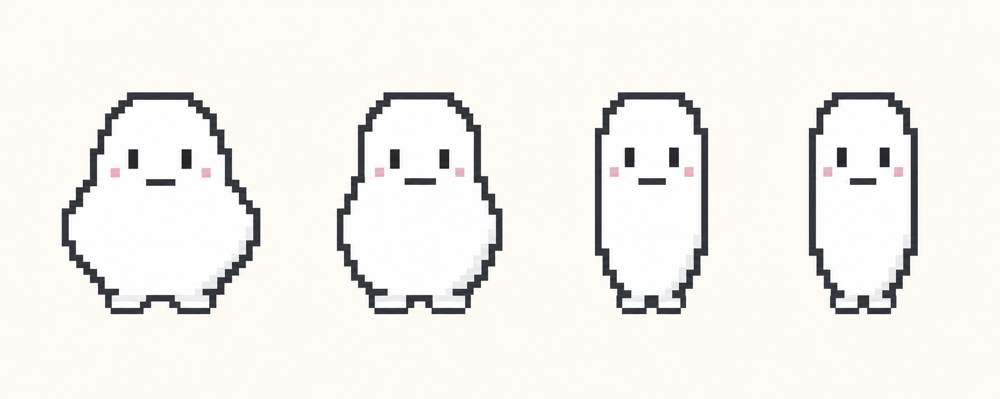
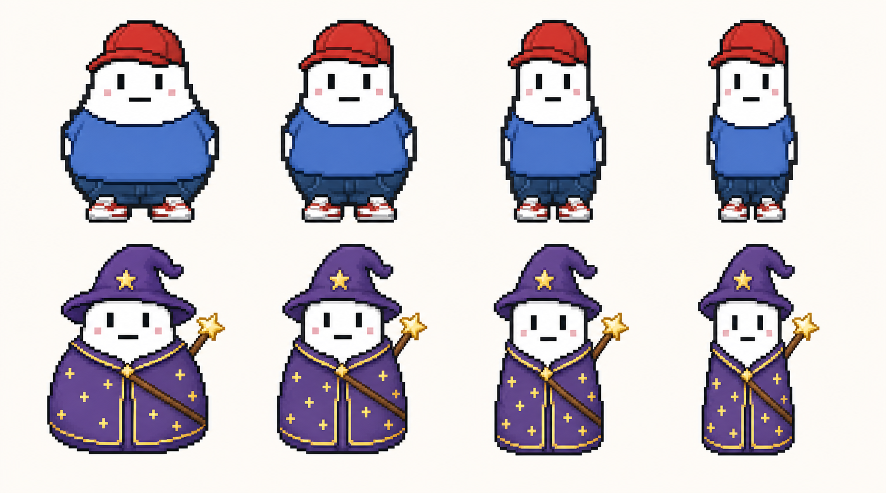

# 캐릭터·코스메틱 에셋 제작 규격 v1.1 (폐기)

> **이 문서는 더 이상 사용하지 않습니다.**
> 2026-08-05부터 [도트 캐릭터 이미지 작업 규격 v2.0](../design/CHARACTER_ASSET_SPEC.md)이 정본입니다.
>
> 이 문서의 다음 전제는 모두 폐기되었습니다.
>
> | 항목 | 이 문서(v1.1) | 현행(v2.0) |
> | --- | --- | --- |
> | 논리 캔버스 | 64×72 | 64×64 |
> | 상품 수 | 77종 | 64종 |
> | 체형 | 4단계 | 1종 고정 |
> | 렌더러 | PixiJS | 웹 Canvas 2D + Expo Skia |
> | 제작 방식 | `COMMON`/`BODY_VARIANT`/`POSITION_VARIANT` | 전체 캔버스 PNG 1종 |
> | 실루엣 외곽선 | 2px | 1px |
> | 반투명 | 면사포·날개·효과에 허용 | 전면 금지 (알파 0/255) |
>
> 아래 내용은 결정 이력 보존용입니다. 작업 기준으로 삼지 마십시오.

- 최초 확정일: 2026-07-30
- 최신 개정일: 2026-07-30
- 대상: React + PixiJS 캐릭터 상점 77개 상품
- 목적: 초기 캐릭터와 모든 상품을 같은 좌표계로 제작해 체형 변경 시에도 다시 배치하지 않고 합성한다.

## 0. 최신 정본 이미지

아래 두 이미지를 도트 제작과 착용 검수의 최우선 기준으로 사용한다.

### 기본 캐릭터 4체형 정본



- 파일: `docs/assets/character/base-character-4-body-refined-v2.png`
- 왼쪽부터 `CHUBBY → BASE → SLIM → VERY_SLIM`
- 몸통 폭은 단계적으로 줄지만 머리 꼭대기, 얼굴 중심, 눈, 입, 전체 키, 발바닥선은 고정한다.
- 기존 UI 캡처와 `base-character-4-body-concept.png`보다 이 이미지를 우선한다.

### 체형별 상품 착용 정본



- 파일: `docs/assets/character/body-aware-outfit-fitting-v1.png`
- 위 행은 기본 코디, 아래 행은 마법사 코디의 체형별 착용 비교다.
- 이 이미지는 상품 디자인 원본이 아니라 **체형별 맞춤 재단과 부착 위치를 검수하는 기준**이다.
- 생성된 비교 이미지를 게임에 그대로 넣지 않는다. 아래 규격에 따라 64×72 투명 PNG로 다시 제작·분리한다.

### 상품 디자인 참고 시트

아래 이미지는 상품의 색상·무늬·부위 구성을 확인하는 참고 자료다. 캐릭터 실루엣과 체형별 핏은 위 두 정본을 우선한다.

- [기본 상품](../assets/character/product-basic-reference.png)
- [계절 상품](../assets/character/product-seasonal-reference.png)
- [스포츠 상품](../assets/character/product-sports-reference.png)
- [직업 상품](../assets/character/product-career-reference.png)
- [판타지 상품](../assets/character/product-fantasy-reference.png)
- [행사 상품](../assets/character/product-event-reference.png)
- [대표 테마 코디](../assets/character/product-theme-outfits-reference.png)

## 1. 초기 캐릭터 확정안

### 기본 형태

- 이름: 이코(가칭)
- 정면 고정, 팔과 손이 없는 둥근 실루엣
- 체형 4단계: `CHUBBY`, `BASE`, `SLIM`, `VERY_SLIM`
- 전체 키, 머리 꼭대기, 눈, 입, 발바닥 위치는 4체형 모두 고정
- 체형 변화는 몸통 폭을 중심으로 표현하고 얼굴 폭은 몸 변화량의 약 25%만 반영한다.
- `CHUBBY`는 비만을 과장하지 않고 `BASE`보다 양옆이 3px씩 넓은 수준으로 제한한다.
- 발은 체형에 따라 가로 위치만 달라지며 높이·바닥선·픽셀 두께는 동일하게 유지한다.
- 외곽선의 계단 간격과 좌우 곡선은 최신 정본처럼 단순하고 대칭적으로 정리한다.
- 체형명은 학생 화면에 직접 노출하지 않는다. 필요한 경우 `포근 / 기본 / 가벼움 / 민첩`처럼 중립 표현을 사용한다.

### 캔버스와 출력

| 항목 | 확정값 |
| --- | --- |
| 제작 원본 | 투명 PNG, 64×72px |
| 상점 미리보기 | 4배 확대, 256×288px |
| 확대 방식 | 정수 배율 + nearest-neighbor |
| 기준점 | 모든 레이어 좌상단 `(0, 0)` |
| 중심선 | `x=32` |
| 바닥선 | `y=67` |
| 안티앨리어싱 | 사용하지 않음 |

256×288 이미지를 원본으로 그리지 않는다. 64×72 원본을 4배 확대해야 픽셀 크기가 상품마다 일정하다.

### 실루엣 가이드

| 체형 | 몸통 좌우 권장 범위 | 얼굴 변화 |
| --- | --- | --- |
| CHUBBY | x=10~54 | 볼·턱선만 좌우 +2px |
| BASE | x=13~51 | 기준 |
| SLIM | x=15~49 | 볼·턱선만 좌우 -1px |
| VERY_SLIM | x=16~48 | 볼·턱선만 좌우 -2px |

위 수치는 외곽선 기준의 제작 가이드다. 눈·입·머리 상단은 움직이지 않는다.

## 2. 고정 앵커

모든 상품 PNG는 64×72 전체 캔버스를 유지하고 아래 좌표에 맞춘다. 잘라내기(trim) export를 금지한다.

| 앵커 | 좌표 | 사용처 |
| --- | --- | --- |
| `HEAD_TOP` | (32, 5) | 모자, 투구, 면사포 |
| `EYE_LEFT` | (26, 20) | 안경·고글 왼쪽 기준 |
| `EYE_RIGHT` | (38, 20) | 안경·고글 오른쪽 기준 |
| `FACE_CENTER` | (32, 24) | 얼굴 장식 |
| `NECK` | (32, 31) | 목도리·나비넥타이·목걸이 |
| `TORSO_CENTER` | (32, 44) | 상의 |
| `WAIST` | (32, 51) | 하의 |
| `BACK_DIAGONAL` | (36, 38) | 등에 매는 검·마법봉·등 장식 |
| `SIDE_RIGHT` | (51, 45) | 글러브·서류 가방 |
| `WAIST_RIGHT` | (47, 51) | 꽃다발 |
| `FLOOR` | (32, 67) | 신발·구름 효과 |

코드 기준값은 `spikes/character-pixi/src/assetProfile.ts`의 `CHARACTER_ANCHORS`가 단일 원본이다.

## 3. 도트 스타일

- 외곽선: 짙은 회색 계열, 실루엣 2px / 내부 디테일 1px
- 검정 순색보다 기존 캐릭터와 어울리는 차콜을 사용한다.
- 한 상품의 주색 3~5개, 전체 공용 팔레트는 24색 이내를 권장한다.
- 광원은 좌상단으로 통일한다. 밝은 면은 위·왼쪽, 그림자는 아래·오른쪽에 둔다.
- 작은 상품도 색만 바꾸지 말고 챙, 단추, 배지, 무늬 중 최소 한 가지 식별 요소를 둔다.
- 반투명은 면사포·날개·효과에만 제한적으로 사용한다.

## 4. 레이어 순서

`BACKGROUND → EFFECT → BACK → BASE → BOTTOM → SHOES → TOP → NECK → FACE → HAND → HAT`

- 슬롯당 1개만 착용한다.
- 전신 상의는 `BOTTOM`을 가리지만 하의 소유·착용 상태는 유지한다.
- 손이 없는 캐릭터이므로 검과 마법봉은 손에 들지 않고 등에 대각선으로 고정한다.
- 글러브·서류 가방은 몸 옆에 매단 형태, 꽃다발은 허리 옆에 고정된 형태로 표현한다.

## 5. 제작 방식 3종

| 방식 | 파일 수 | 적용 기준 |
| --- | ---: | --- |
| `COMMON` | 상품당 1 | 고정 앵커만으로 모든 체형에 맞는 상품 |
| `BODY_VARIANT` | 상품당 4 | 몸이나 얼굴을 감싸 실루엣 자체가 달라지는 상품 |
| `POSITION_VARIANT` | 상품당 1 + 좌표 4세트 | 모양은 같고 체형별 부착 위치만 달라지는 상품 |

`POSITION_VARIANT`는 이미지를 늘이거나 줄이지 않는다. 체형별 정수 좌표 보정만 사용한다.

### 구매·착용 시 체형 선택 규칙

- 상품 소유권은 체형과 무관하다. 학생은 상품을 한 번만 구매한다.
- 착용 시 현재 사용자의 `bodyState`를 조회해 대응하는 프레임을 자동 선택한다.
- `BODY_VARIANT`: `{sprite_key}_{body}.png` 선택
- `COMMON`: 모든 체형에서 `{sprite_key}.png` 선택
- `POSITION_VARIANT`: `{sprite_key}.png`를 선택한 뒤 체형별 정수 좌표를 적용
- 체형이 바뀌면 구매·착용 정보는 유지하고 화면의 프레임과 위치만 즉시 다시 바인딩한다.
- 완성된 상품 이미지를 가로로 확대·축소해서 다른 체형에 사용하지 않는다.

```text
구매 상품 ID
  → 상품의 sprite_key·fitMode 조회
  → 사용자 bodyState 조회
  → BODY_VARIANT이면 체형 프레임 선택
  → POSITION_VARIANT이면 체형 위치 보정
  → 기존 슬롯 z-order에 합성
```

## 6. 77개 상품 권장 에셋 세팅

### 슬롯 기본 규칙

| 슬롯 | 수량 | 기본 방식 | 가이드 |
| --- | ---: | --- | --- |
| HAT | 21 | COMMON | HEAD_TOP |
| FACE | 4 | COMMON | FACE_CENTER |
| NECK | 4 | COMMON | NECK |
| TOP | 22 | BODY_VARIANT | TORSO_CENTER |
| BOTTOM | 5 | BODY_VARIANT | WAIST |
| SHOES | 6 | BODY_VARIANT | FLOOR |
| BACK | 3 | POSITION_VARIANT | BACK_DIAGONAL |
| HAND | 5 | POSITION_VARIANT | 상품별 아래 예외 |
| EFFECT | 2 | COMMON | FLOOR |
| BACKGROUND | 5 | COMMON | CANVAS |

### 기본 규칙을 바꾸는 상품

| 상품 키 | 권장 방식 | 이유·표현 |
| --- | --- | --- |
| `hat_space_helmet` | BODY_VARIANT | 얼굴과 머리를 감싸는 헬멧 |
| `hat_knight` | BODY_VARIANT | 얼굴 폭과 바이저가 맞아야 함 |
| `hat_dinosaur` | BODY_VARIANT | 머리·목을 감싸는 후드 |
| `hat_veil` | BODY_VARIANT | 티아라 고정, 면사포 폭만 체형 대응 |
| `neck_scarf` | BODY_VARIANT | 목과 몸통 상단을 감쌈 |
| `neck_knit_scarf` | BODY_VARIANT | 목과 몸통 상단을 감쌈 |
| `back_dinosaur_tail` | BODY_VARIANT | 몸통 접합부 실루엣이 체형별로 다름 |
| `effect_swim_tube` | BODY_VARIANT | 몸통 둘레를 감쌈 |
| `back_backpack` | POSITION_VARIANT | 원본 1종, 체형별 x 위치만 보정 |
| `back_fairy_wings` | POSITION_VARIANT | 원본 1종, 몸통 뒤 중심만 보정 |
| `hand_magic_wand` | POSITION_VARIANT | 등에 대각선으로 고정 |
| `hand_toy_sword` | POSITION_VARIANT | 등에 대각선으로 고정 |
| `hand_baseball_glove` | POSITION_VARIANT | 몸 오른쪽 옆에 부착 |
| `hand_briefcase` | POSITION_VARIANT | 몸 오른쪽 옆에 부착 |
| `hand_bouquet` | POSITION_VARIANT | 허리 오른쪽에 부착 |

### 전신 상의

다음 상의는 착용 중 하의 레이어만 숨긴다.

- `top_wizard_robe`
- `top_hanbok`
- `top_spacesuit`
- `top_fantasy_armor`
- `top_dinosaur`
- `top_wedding_dress`

## 7. 파일명과 아틀라스 키

```text
base_char_{body}.png
{sprite_key}.png
{sprite_key}_{body}.png
```

- 체형 접미사: `chubby`, `base`, `slim`, `veryslim`
- 예: `top_wizard_robe_chubby.png`, `hat_red_cap.png`
- `COMMON`·`POSITION_VARIANT`: `sprite_key` 그대로 1개
- `BODY_VARIANT`: `sprite_key_body` 4개
- export 시 trim, rotate, smooth, arbitrary scale을 모두 끈다.
- PixiJS 텍스처는 `scaleMode: nearest`를 사용한다.

현재 분류 기준 제작량은 상품 스프라이트 200개, 기본 캐릭터 4개로 총 204개다.

## 8. 제작 우선순위

전체 204개를 한 번에 제작하기 전에 최신 정본 이미지의 기본 코디와 마법사 코디를 골든 샘플로 확정한다.

1. 기본 캐릭터 4개
2. 기본 코디: `hat_red_cap.png` 1개 + 상의·하의·신발 체형별 12개
3. 마법사 코디: `hat_wizard.png` 1개
4. `top_wizard_robe_{body}.png` 4개
5. `hand_magic_wand.png` 1개

기본 캐릭터와 두 코디로 4체형 합성·전환·확대 화면을 검수한 뒤 나머지 상품에 동일 규격을 적용한다.

## 9. 검수 기준

- 4체형 전환 시 머리 꼭대기, 눈, 입, 발바닥이 1px도 움직이지 않는다.
- 공용 모자는 4체형에서 재제작 없이 같은 위치에 맞는다.
- 체형별 의상 외곽선과 기본 몸이 겹치거나 1px 이상 벌어지지 않는다.
- 같은 코디를 비교했을 때 색상·무늬·선 두께는 같고 몸통에 닿는 외곽선만 체형에 맞게 달라진다.
- 체형 전환 전후에도 구매 상품 ID와 착용 슬롯은 변하지 않는다.
- 검·마법봉은 손처럼 떠 보이지 않고 등과 최소 2px 접촉한다.
- 1배, 2배, 4배에서 픽셀이 번지지 않는다.
- 배경을 제외한 투명 영역에 불필요한 픽셀이 없다.
- 모든 77개 `sprite_key`가 에셋 프로필에 존재하고 파일명 규칙과 일치한다.
- 완성 에셋의 색상·무늬는 해당 상품 참고 시트와 일치하고, 실루엣과 착용 핏은 최신 두 정본과 일치한다.
