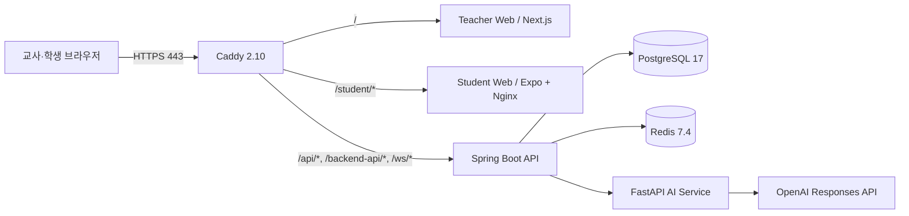

# 이코빌리지(EcoVillage) 포팅 매뉴얼

- 프로젝트: SSAFY 15기 공통 프로젝트 S15P11B201
- 기준 브랜치: `master`
- 기준 커밋: `e71bb20aab548e30fab1a246dac36adeb547f4e1`
- 운영 URL: <https://i15b201.p.ssafy.io>
- 학생 웹: <https://i15b201.p.ssafy.io/student/>
- 문서 기준일: 2026-08-10

이 문서는 GitLab 소스 클론 이후 로컬 개발 환경을 실행하거나 Ubuntu EC2에 운영 환경을 재구축하는 절차를 설명한다. 저장소에는 비밀번호, API 키, PEM 파일을 포함하지 않는다.

## 1. 제출 산출물

```text
exec/
├── README.md                         # 포팅 매뉴얼
├── env.prod.example                  # 비밀값이 제거된 운영 환경 변수 예시
└── db/
    ├── ecovillage_e71bb20_clean.sql  # 개인정보 없는 재현용 최신 DB 덤프
    └── bootstrap_demo_school.sql      # 최초 교사 가입용 데모 학교 생성 스크립트
```

`ecovillage_e71bb20_clean.sql`은 최신 Flyway 마이그레이션을 빈 PostgreSQL에 적용해 만든 덤프다. 운영 DB의 교사·학생·인증·세션·감사 데이터는 포함하지 않는다.

## 2. 서비스 개요

이코빌리지는 초등학교 4~6학년 학생이 학급 전용 화폐로 월급, 세금, 상점, 예·적금, 투자, 부동산, 공동기금 투표와 퀴즈를 경험하는 경제교육 플랫폼이다.

| 사용자 | 주요 기능 |
| --- | --- |
| 교사 | 교실 개설, 학생 명단·급여, 모듈 설정, 상품·금융·투자 운영, 승인·정산, AI 초안, 퀴즈, 공동기금 투표 |
| 학생 | 학급 코드 로그인, 지갑·급여 확인, 상점 구매, 예·적금, 투자, 부동산, 퀴즈, 공동기금 투표 |

### 2.1 운영 아키텍처



외부에 공개하는 포트는 SSH `22`, HTTP `80`, HTTPS·HTTP/3 `443/tcp`, `443/udp`뿐이다. PostgreSQL, Redis, Spring, FastAPI, Next.js, Nginx는 Docker 내부 네트워크에서만 통신한다.

## 3. 사용 버전

아래 표의 운영 버전은 2026-08-10 배포 컨테이너에서 직접 확인한 값이다.

| 구분 | 버전·이미지 |
| --- | --- |
| 개발 IDE | Visual Studio Code 1.131.0 |
| 운영 OS | Ubuntu 24.04.3 LTS |
| Docker Engine | 29.1.3 |
| Docker Compose | 2.40.3 |
| JVM | Java 21, Eclipse Temurin 21 Alpine |
| Backend | Spring Boot 4.1.0, Gradle 9.5.1 |
| AI Service | Python 3.12.13, FastAPI `>=0.115,<1`, OpenAI SDK `>=2.50,<3` |
| Teacher Web | Node.js 24.19.0, Next.js 15.5 계열, React 19 |
| Student Web | Expo 57.0.9, React Native 0.86.2, React 19.2.3 |
| Student Web Server | Nginx 1.29.8 |
| PostgreSQL | 17.10 |
| Redis | 7.4.10 |
| Reverse Proxy | Caddy 2.10.2 |

## 4. 저장소 구조

```text
ai-service/       FastAPI 기반 AI 공급자 라우팅·프롬프트·평가
backend/          Spring Boot 핵심 API, Flyway, 통합 테스트
contracts/        OpenAPI 3.1, AsyncAPI 3.1, 필드 매핑
deploy/           Caddy 설정, 운영 환경 변수 초기화 도구
docs/             요구사항, 화면, 데이터, AI, 운영 문서
exec/             본 포팅 매뉴얼과 재현용 DB 덤프
infra/            Jenkins, Terraform, 관측 설정
student-app/expo/ Expo Router 학생 앱과 웹 빌드
teacher-web/      Next.js 교사 콘솔
compose.yaml      로컬 개발 Compose
compose.prod.yaml 운영 Compose
Jenkinsfile       정적 검증·테스트·이미지 빌드 CI
```

Jenkinsfile에는 자동 운영 배포 단계가 없다. 운영 배포는 이 문서의 릴리스 디렉터리 방식으로 수행한다.

## 5. URL과 포트

| 대상 | 로컬 기본값 | 운영 주소·포트 |
| --- | --- | --- |
| Teacher Web | `http://localhost:3000` | `https://i15b201.p.ssafy.io/` |
| Student Web | Expo 개발 서버 | `https://i15b201.p.ssafy.io/student/` |
| Backend API | `http://localhost:8080` | 교사용 `/backend-api`, 학생용 `/api` |
| WebSocket | `ws://localhost:8080/ws/v1` | `wss://i15b201.p.ssafy.io/ws/v1` |
| Backend health | `http://localhost:8080/actuator/health` | `/api/actuator/health` |
| AI Service | `http://localhost:8000` | Docker 내부 `ai-service:8000` |
| PostgreSQL | `localhost:5432` | Docker 내부 `postgres:5432` |
| Redis | `localhost:6379` | Docker 내부 `redis:6379` |

## 6. 환경 변수

### 6.1 환경 파일 위치

| 환경 | 파일 | Git 추적 |
| --- | --- | --- |
| 로컬 | 저장소 루트 `.env` | 금지, `.gitignore` 처리 |
| 운영 | `/opt/ecovillage/shared/.env.prod` | 금지, 권한 `600 root:root` |
| 제출 예시 | `exec/env.prod.example` | 허용, 실제 비밀값 없음 |

### 6.2 운영 필수 변수

| 변수 | 설명 |
| --- | --- |
| `DOMAIN` | Caddy와 프런트 빌드에 사용할 도메인 |
| `POSTGRES_DB` | PostgreSQL DB명, 기본 `ecovillage` |
| `POSTGRES_USER` | PostgreSQL 사용자, 기본 `ecovillage` |
| `POSTGRES_PASSWORD` | 운영 DB 비밀번호 |
| `AUTH_JWT_SECRET` | 액세스 토큰 서명 비밀값 |
| `AUTH_TOKEN_PEPPER` | 인증 토큰·자격증명 보강 비밀값 |
| `ECOVILLAGE_AI_INTERNAL_SERVICE_TOKEN` | Backend→AI Service 내부 인증 토큰 |

비밀값은 다음 명령처럼 서버에서 생성한다.

```bash
openssl rand -hex 48
```

### 6.3 OpenAI 변수

| 변수 | 운영값 형식 |
| --- | --- |
| `ECOVILLAGE_AI_PROVIDER` | `OPENAI` |
| `ECOVILLAGE_AI_OPENAI_ENABLED` | `true` |
| `ECOVILLAGE_AI_OPENAI_MODEL_ID` | `gpt-5.4` |
| `OPENAI_API_KEY` | OpenAI Project API Key, 저장소 커밋 금지 |
| `OPENAI_BASE_URL` | `https://api.openai.com/v1` |

`sk-proj-` 형식의 OpenAI Project API Key를 SSAFY GMS 프록시 URL과 함께 사용하면 인증이 실패한다. OpenAI Project API Key는 공식 OpenAI Base URL과 함께 사용한다.

### 6.4 선택 변수

| 변수 | 사용 조건 |
| --- | --- |
| `TEACHER_OIDC_ENABLED` | 외부 학교 OIDC를 연결할 때 `true` |
| `TEACHER_OIDC_ISSUER` | OIDC issuer |
| `TEACHER_OIDC_JWK_SET_URI` | OIDC JWK Set URI |
| `TEACHER_OIDC_CLIENT_ID` | 백엔드 ID Token audience |
| `NEXT_PUBLIC_OIDC_*` | 교사 웹 OIDC Build Argument |

`NEXT_PUBLIC_*`, `EXPO_PUBLIC_*` 값은 프런트 이미지 빌드 시 포함된다. 값을 바꾸면 컨테이너 재시작만 하지 말고 해당 이미지를 다시 빌드해야 한다.

## 7. 외부 서비스

### 7.1 OpenAI

1. OpenAI Platform에서 배포 전용 Project를 만든다.
2. Project API Key를 발급한다.
3. Project별 예산·사용량 경보와 필요한 모델 권한을 설정한다.
4. 서버 `.env.prod`의 `OPENAI_API_KEY`에만 저장한다.
5. `OPENAI_BASE_URL=https://api.openai.com/v1`을 사용한다.
6. 키를 교체하면 AI Service를 강제 재생성한다.

```bash
cd /opt/ecovillage/current
sudo docker compose \
  -p ecovillage-prod \
  --env-file /opt/ecovillage/shared/.env.prod \
  -f compose.prod.yaml \
  up -d --force-recreate --no-deps --wait ai-service
```

### 7.2 선택 외부 서비스

- 교사 OIDC: 기본 비활성화. 활성화할 경우 issuer, JWK, client ID와 교사 웹 authorization/token URL을 설정한다.
- AWS Bedrock: 어댑터는 포함되어 있으나 현재 운영 공급자는 OpenAI다.
- S3, SQS, Sentry, OTLP: 환경 변수 계약은 있으나 현재 핵심 운영 경로에는 필수가 아니다.
- Caddy: 운영 도메인의 TLS 인증서를 자동 발급·갱신한다. DNS A 레코드와 80·443 포트가 먼저 열려 있어야 한다.

## 8. 로컬 개발 실행

### 8.1 준비물

- Java 21
- Node.js 24 권장 (`student-app` 지원 범위는 `>=20 <26`)
- Python 3.12
- Docker Desktop 또는 Docker Engine
- pnpm(Corepack), npm

### 8.2 DB·Redis 실행

```bash
cp .env.example .env
docker compose up -d --wait postgres redis
```

OpenAI를 사용하지 않는 로컬 테스트에서는 다음 값으로 비용 없는 FAKE 공급자를 사용할 수 있다.

```text
ECOVILLAGE_AI_PROVIDER=FAKE
ECOVILLAGE_AI_OPENAI_ENABLED=false
OPENAI_API_KEY=
```

### 8.3 Backend

Windows PowerShell:

```powershell
cd backend
.\gradlew.bat bootRun
```

Linux/macOS:

```bash
cd backend
chmod +x gradlew
./gradlew bootRun
```

### 8.4 AI Service

```bash
cd ai-service
python -m venv .venv
source .venv/bin/activate
python -m pip install -e ".[dev]"
uvicorn ecovillage_ai.main:app --reload --app-dir src
```

Windows에서는 `source` 대신 `.venv\Scripts\Activate.ps1`을 사용한다.

### 8.5 Teacher Web

```bash
cd teacher-web
corepack enable
pnpm install --frozen-lockfile
pnpm dev
```

### 8.6 Student Web

```bash
cd student-app/expo
npm ci
npm run web
```

다른 기기에서 Expo 개발 서버에 접속하면 `.env`의 API·WebSocket 호스트를 `localhost`가 아닌 개발 PC의 LAN IP로 변경한다.

### 8.7 전체 컨테이너 실행

```bash
docker compose --profile app up -d --build --wait
```

## 9. 운영 서버 최초 준비

### 9.1 SSH

```bash
ssh -i <SSH_PRIVATE_KEY_PATH> ubuntu@i15b201.p.ssafy.io
```

PEM 개인키는 저장소에 올리지 않는다. Linux/macOS에서는 `chmod 600 <SSH_PRIVATE_KEY_PATH>`를 적용한다.

### 9.2 UFW

SSH 연결을 하나 더 열어 둔 상태에서 방화벽을 설정한다.

```bash
sudo ufw allow 22/tcp
sudo ufw allow 80/tcp
sudo ufw allow 443/tcp
sudo ufw allow 443/udp
sudo ufw enable
sudo ufw status
```

`5432`, `6379`, `8000`, `8080`, `3000` 포트는 외부에 열지 않는다.

### 9.3 운영 디렉터리

```text
/opt/ecovillage/
├── current -> /opt/ecovillage/releases/<commit>
├── releases/<commit>/
└── shared/
    ├── .env.prod
    └── backups/
```

```bash
sudo install -d -o root -g root /opt/ecovillage/releases
sudo install -d -o root -g root /opt/ecovillage/shared
sudo install -d -o root -g root /opt/ecovillage/shared/backups
```

## 10. 운영 배포

아래 명령은 저장소 루트에서 실행한다. 변수 이름은 그대로 사용하되 값은 현재 커밋으로 계산한다.

```bash
RELEASE_SHA="$(git rev-parse --short=7 HEAD)"
RELEASE_DIR="/opt/ecovillage/releases/${RELEASE_SHA}"
ENV_FILE="/opt/ecovillage/shared/.env.prod"

sudo test ! -e "$RELEASE_DIR"
sudo mkdir "$RELEASE_DIR"
git archive HEAD | sudo tar -x -C "$RELEASE_DIR"
sudo chown -R root:root "$RELEASE_DIR"
```

최초 1회 환경 파일을 생성한다. 기존 파일이 있으면 스크립트가 덮어쓰지 않는다.

```bash
sudo sh "$RELEASE_DIR/deploy/bootstrap-env.sh" "$ENV_FILE"
sudo chmod 600 "$ENV_FILE"
sudoedit "$ENV_FILE"
```

`exec/env.prod.example`을 참고해 필수값과 OpenAI 설정을 채운다. 설정 검증 후 이미지를 빌드한다.

```bash
sudo docker compose \
  -p ecovillage-prod \
  --env-file "$ENV_FILE" \
  -f "$RELEASE_DIR/compose.prod.yaml" \
  config --quiet

sudo docker compose \
  -p ecovillage-prod \
  --env-file "$ENV_FILE" \
  -f "$RELEASE_DIR/compose.prod.yaml" \
  build
```

빌드 성공 후 컨테이너를 교체한다.

```bash
sudo docker compose \
  -p ecovillage-prod \
  --env-file "$ENV_FILE" \
  -f "$RELEASE_DIR/compose.prod.yaml" \
  up -d --remove-orphans --wait --wait-timeout 240

sudo ln -sfn "$RELEASE_DIR" /opt/ecovillage/current
```

`-p ecovillage-prod`를 빼면 별도 Compose 프로젝트와 볼륨이 만들어질 수 있으므로 반드시 유지한다.

### 10.1 배포 확인

```bash
sudo docker compose \
  -p ecovillage-prod \
  --env-file /opt/ecovillage/shared/.env.prod \
  -f /opt/ecovillage/current/compose.prod.yaml \
  ps

curl --fail --silent https://i15b201.p.ssafy.io/api/actuator/health
curl --fail --silent --output /dev/null https://i15b201.p.ssafy.io/
curl --fail --silent --output /dev/null https://i15b201.p.ssafy.io/student/
```

최근 오류 로그:

```bash
sudo docker compose \
  -p ecovillage-prod \
  --env-file /opt/ecovillage/shared/.env.prod \
  -f /opt/ecovillage/current/compose.prod.yaml \
  logs --since 10m --no-color
```

### 10.2 롤백

1. `/opt/ecovillage/current`가 가리키던 이전 릴리스 경로를 확인한다.
2. 환경 파일을 변경했다면 `/opt/ecovillage/shared/.env.prod.backup-*`에서 복구한다.
3. 이전 Compose 파일로 `up -d --wait`를 실행한다.
4. `current` 링크를 이전 릴리스로 되돌린다.

```bash
PREVIOUS_RELEASE="/opt/ecovillage/releases/<previous_commit>"
ENV_FILE="/opt/ecovillage/shared/.env.prod"

sudo docker compose \
  -p ecovillage-prod \
  --env-file "$ENV_FILE" \
  -f "$PREVIOUS_RELEASE/compose.prod.yaml" \
  up -d --remove-orphans --wait --wait-timeout 240

sudo ln -sfn "$PREVIOUS_RELEASE" /opt/ecovillage/current
```

## 11. DB 접속 정보와 설정 파일

| 항목 | 값·위치 |
| --- | --- |
| DBMS | PostgreSQL 17 |
| 운영 DB명 | `ecovillage` |
| 운영 사용자 | `ecovillage` |
| 운영 호스트 | Compose 내부 `postgres:5432` |
| 외부 공개 | 하지 않음 |
| 자격증명 | `/opt/ecovillage/shared/.env.prod`의 `POSTGRES_*` |
| 영속 볼륨 | `ecovillage-prod_postgres-data` |
| Spring 설정 | `backend/src/main/resources/application.yml` |
| Flyway | `backend/src/main/resources/db/migration/` |
| 운영 Compose | `compose.prod.yaml` |

운영 DB는 SSH 접속 후 컨테이너 안에서만 조회한다.

```bash
sudo docker exec -it ecovillage-prod-postgres-1 \
  sh -lc 'psql -U "$POSTGRES_USER" -d "$POSTGRES_DB"'
```

### 11.1 재현용 덤프

- 파일: `exec/db/ecovillage_e71bb20_clean.sql`
- 크기: 422,157 bytes
- SHA-256: `86942288118b677fe34cc70dd2a34b4ec6a14b7feb6589cfa167ac80c6b668eb`
- Flyway 최신 버전: `1.37`
- 테이블: 102개
- 사용자·학생 데이터: 0건

이 덤프는 `--clean` 옵션으로 생성했으므로 **운영 중인 DB에 적용하면 기존 테이블을 삭제한다. 반드시 새 빈 DB에만 사용한다.**

새 환경에서 PostgreSQL만 먼저 시작하고 복원한다.

```bash
RELEASE_DIR="/opt/ecovillage/current"
ENV_FILE="/opt/ecovillage/shared/.env.prod"

sudo docker compose \
  -p ecovillage-prod \
  --env-file "$ENV_FILE" \
  -f "$RELEASE_DIR/compose.prod.yaml" \
  up -d --wait postgres

sudo docker compose \
  -p ecovillage-prod \
  --env-file "$ENV_FILE" \
  -f "$RELEASE_DIR/compose.prod.yaml" \
  exec -T postgres \
  sh -lc 'psql -v ON_ERROR_STOP=1 -U "$POSTGRES_USER" -d "$POSTGRES_DB"' \
  < "$RELEASE_DIR/exec/db/ecovillage_e71bb20_clean.sql"
```

최초 교사 가입용 학교를 추가한다.

```bash
sudo docker compose \
  -p ecovillage-prod \
  --env-file "$ENV_FILE" \
  -f "$RELEASE_DIR/compose.prod.yaml" \
  exec -T postgres \
  sh -lc 'psql -v ON_ERROR_STOP=1 -U "$POSTGRES_USER" -d "$POSTGRES_DB"' \
  < "$RELEASE_DIR/exec/db/bootstrap_demo_school.sql"
```

그 후 전체 서비스를 시작한다.

```bash
sudo docker compose \
  -p ecovillage-prod \
  --env-file "$ENV_FILE" \
  -f "$RELEASE_DIR/compose.prod.yaml" \
  up -d --wait --wait-timeout 240
```

덤프 없이 빈 PostgreSQL에서 Backend를 시작해도 Flyway가 스키마를 자동 생성한다. 단, 이 경우 최초 학교 레코드는 별도로 추가해야 한다.

### 11.2 운영 백업

```bash
BACKUP_FILE="/opt/ecovillage/shared/backups/ecovillage_$(date -u +%Y%m%dT%H%M%SZ).dump"

sudo sh -c "docker exec ecovillage-prod-postgres-1 \
  pg_dump -U ecovillage -d ecovillage --format=custom --no-owner --no-privileges \
  > '$BACKUP_FILE'"
```

운영 백업에는 사용자·자격증명·세션 데이터가 포함될 수 있으므로 저장소에 커밋하지 않는다.

## 12. 주요 계정

| 계정 | 생성·관리 방식 |
| --- | --- |
| EC2 `ubuntu` | SSAFY 제공 PEM으로 SSH, 개인키는 별도 보관 |
| PostgreSQL `ecovillage` | `.env.prod`의 랜덤 비밀번호 사용, 외부 포트 비공개 |
| 최초 학교 | `bootstrap_demo_school.sql` 실행 시 코드 `ECO-DEMO` 생성 |
| 교사 | 교사 웹의 `회원가입`에서 학교 코드·이메일·비밀번호로 생성 |
| 학생 | 교사가 명단을 저장한 후 학생 웹에서 학급 코드·출석번호·닉네임·비밀번호로 최초 로그인 |

시연용 이메일·비밀번호를 저장소에 고정하지 않는다. 평가 시점에 직접 생성하거나 별도 보안 채널로 전달한다.

## 13. 시연 시나리오

권장 시연 환경은 교사 브라우저 1개와 학생 브라우저 1개다. 투자 기능까지 시연하려면 경제교실 학년을 5~6학년으로 설정한다.

### 13.1 최초 교사 가입과 경제교실 생성

1. 교사 웹 `/` → `회원가입` 선택.
2. 학교 코드 `ECO-DEMO`, 표시 이름, 사용할 이메일, 4자 이상의 비밀번호 입력.
3. `회원가입하고 로그인` 클릭.
4. 교실 목록 → `새 경제교실 만들기` 클릭.
5. 기본 정보에서 교실명, 학년, 반, 예상 학생 수, 화폐명 입력 → `다음`.
6. 운영 기간 선택. 통합 시연은 `1달 운영` 권장.
7. 월급·세금·상점·예금·투자·공동기금·퀴즈 모듈 선택.
8. 최종 확인 후 경제교실 생성. 화면에 표시되는 8자리 학급 코드를 기록.

### 13.2 학생 명단과 로그인

1. 교사 좌측 메뉴 `학생·급여` → `명단 수정`.
2. 출석번호 `1`, 학생 닉네임과 역할 입력 → `명단 저장하고 닫기`.
3. 학생 웹 `/student/` 접속.
4. 학급 코드, 출석번호 `1`, 교사가 저장한 닉네임, 4자 이상의 새 비밀번호 입력.
5. `계정 만들기 / 로그인` 클릭 → `마을 광장` 진입 확인.

### 13.3 월급·지갑·상점

1. 교사 `학생·급여`에서 역할과 급여 정책을 저장하고 `급여 지급`.
2. 학생 하단 `지갑` → 잔액과 거래 내역 확인.
3. 교사 `상점 상품` → 상품 등록 → 학생 공개.
4. 학생 `마을 광장` → `이코 상점` → `교실 상점` → 상품 구매.
5. 교사 `운영 현황` 또는 `승인·정산`에서 구매 기록 확인.

### 13.4 AI 투자

1. 교사 `AI 설정`에서 OpenAI 공급자와 투자 모듈 활성 상태 확인.
2. `운영 관리` → `투자` 탭 → 단기 또는 장기 투자 사용 설정.
3. `투자 시장 시작` → AI 투자 이야기 생성 → 내용 검토 후 승인·공개.
4. 학생 `마을 광장` → `투자 광장` → 종목 선택 → 수량 입력 → 매수.
5. 교사 화면에서 다음 가격 단계 또는 결과를 진행.
6. 학생 `투자 내역`에서 체결 가격과 손익 확인.

### 13.5 경제 퀴즈

1. 교사 `수업 준비·퀴즈` → 퀴즈 문제은행.
2. 직접 문항을 만들거나 AI 초안을 생성하고 검토·공개.
3. `학생 퀴즈 열기` 또는 `퀴즈 띄우기` 클릭.
4. 학생 `마을 광장` → `경제생활 퀴즈` → `퀴즈 시작하기`.
5. 답 선택 → `다음 문제` → 마지막 문제에서 `퀴즈 마치기`.
6. 교사가 결과·정답을 공개하면 학생 화면에서 정답 수, 순위와 보상 확인.

### 13.6 공동기금 투표

1. 교사 `공동기금·투표` → 제목·설명·사용처·금액 입력 → 투표 생성.
2. `투표 시작` 클릭.
3. 학생 `마을 광장` → `마을 회의` → 사용처 선택 → 투표.
4. 교사 `투표 마감` → 결과 확인.
5. `결과 공개·공동기금 사용 확정` 클릭 → 잔액 변경 확인.

### 13.7 선택 시연: 부동산

1. 교사 `부동산·청약` → 좌석판 생성 → 매매·전세·월세 조건과 공개 여부 설정.
2. 학생 `마을 광장` → `부동산` → 좌석 선택 → 계약 신청.
3. 교사 `승인·정산`에서 계약 승인.
4. 학생 화면에서 `내 자리`와 계약 상태 확인.

## 14. 운영 특이사항

- 모든 금액·소유권 변경은 Backend 트랜잭션과 원장 기록을 거친다.
- 완료 거래를 직접 수정·삭제하지 않고 반대 거래로 복구한다.
- PostgreSQL 시간대는 UTC이며 교실 기본 시간대는 `Asia/Seoul`이다.
- 학생 웹과 교사 웹의 공개 API 경로가 다르지만 Caddy가 동일 Backend로 전달한다.
- 학생·교사 웹의 공개 URL은 이미지 빌드 시 주입되므로 도메인 변경 시 다시 빌드한다.
- AI Service `/healthz`는 프로세스 상태만 확인한다. 실제 API 키 오류는 모델 호출 시 나타날 수 있다.
- AI 키 변경 시 `.env.prod`를 먼저 백업하고 AI 컨테이너를 강제 재생성한다.
- 새 릴리스에서도 기존 DB·Redis·Caddy 볼륨을 유지하려면 Compose 프로젝트명을 `ecovillage-prod`로 고정한다.

## 15. 문제 해결

| 증상 | 확인·조치 |
| --- | --- |
| OpenAI `401` | 키가 활성 Project Key인지, Base URL이 `https://api.openai.com/v1`인지 확인 |
| AI 컨테이너는 healthy지만 생성 실패 | AI 로그와 실제 모델 권한·예산·Rate Limit 확인 |
| `502 Bad Gateway` | Backend·Teacher·Student 컨테이너 health와 Caddy 로그 확인 |
| Flyway 실패 | DB가 빈 DB인지, 덤프의 Flyway 최신 버전이 코드와 일치하는지 확인 |
| 프런트가 이전 API 주소 사용 | `NEXT_PUBLIC_*`, `EXPO_PUBLIC_*` 변경 후 이미지 재빌드 |
| HTTPS 인증서 실패 | DNS A 레코드, 80·443 포트, Caddy 로그 확인 |
| 학생 로그인 실패 | 학급 상태, 학급 코드 8자리, 출석번호·닉네임의 명단 일치 여부 확인 |
| 투자 메뉴 비활성 | 5~6학년 여부, 투자 모듈 활성화, 투자 방식 사용 설정 확인 |

## 16. 보안 체크리스트

- [ ] `.env`, `.env.prod`, PEM, API 키, DB 덤프 원본을 커밋하지 않았는가?
- [ ] 운영 `.env.prod` 권한이 `600 root:root`인가?
- [ ] OpenAI 키가 배포 전용 Project Key이며 예산 경보가 설정됐는가?
- [ ] PostgreSQL·Redis·Backend·AI·프런트 내부 포트가 외부에 공개되지 않았는가?
- [ ] 운영 DB 백업은 저장소 밖의 접근 통제된 경로에 보관하는가?
- [ ] 배포 후 교사·학생 웹과 Backend health가 모두 HTTP 200인가?
- [ ] 최근 Backend·AI·Caddy 로그에 `ERROR`, `Exception`, `Traceback`이 없는가?

## 17. 제출 전 확인

```bash
git status --short
git ls-files exec
sha256sum exec/db/ecovillage_e71bb20_clean.sql
```

`git ls-files`에 `.env`, PEM, 운영 DB 원본 덤프가 나타나면 제출하지 말고 즉시 제거한다.
